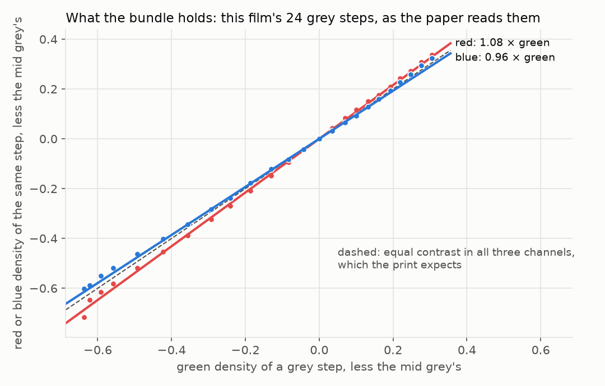
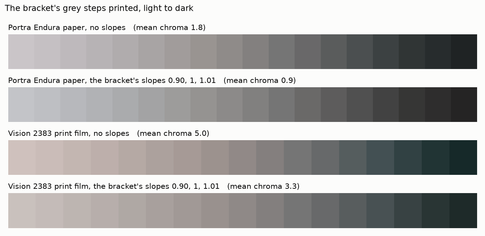
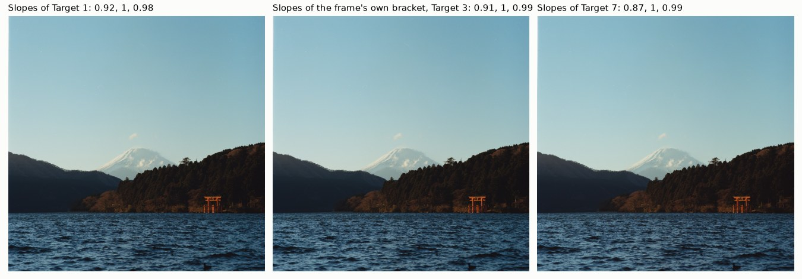
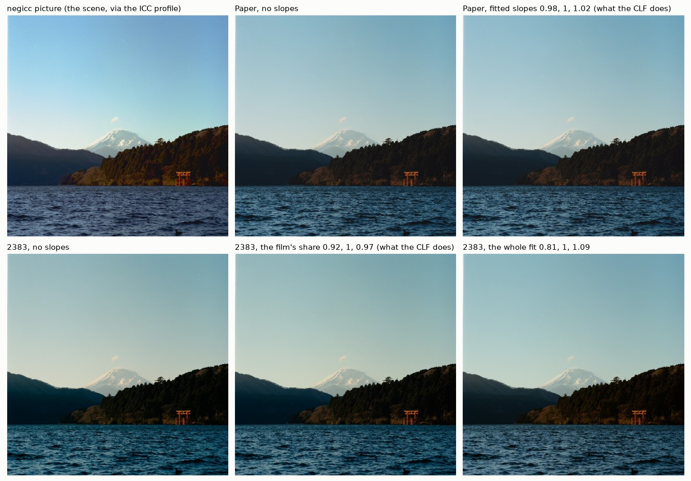
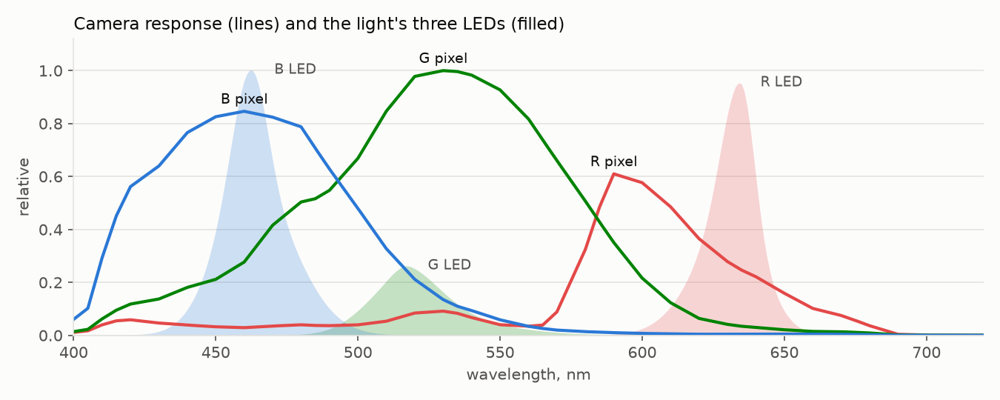

# Design

`neg_process` was built in three steps, and this document follows them.

1. **[The narrow-band LED conversion](#the-narrow-band-led-conversion).** The original design. Under a red, green
   and blue LED light the film's curves are measured on a chart, at several exposure brackets. Converting a frame
   is then a search: which bracket's profile, at what exposure and gains. The tone stage, added later for both
   lights, sets the contrast.
2. **[White light: the curve fit](#white-light-the-curve-fit).** Added on the first: scans under a white light,
   and with them two more stages, which fit for each frame a correction of the green and blue gains and curves of
   the profile.
3. **[Print emulation](#print-emulation).** Added last, for narrow-band scans: the negative as a density file, and a
   CLF beside it that prints the file on a paper or a print film.

The first two make a picture (`-P srgb`) in four stages, numbered in the order they run:

| # | Stage | Output | Applied to |
|---|---|---|---|
| 1 | Auto search | Which exposure bracket's profile converts the frame, and the exposure and the green and blue gains to use with it. | Only on small preview renders, which it scores. It has no pixel path of its own: its result is a set of parameters for the conversion. |
| 2 | Curve fit | A correction of the green and blue gains and of the slopes of the green and blue tone curves. It makes surfaces the neutral head picked out come out grey, and sets the overall magenta-green balance. | The green and blue input tables of the profile. |
| 3 | Profile tables | Nothing new. It writes stage 2's correction into the profile, so the conversion applies it. | The input tables. |
| 4 | Tone stage | One lightness curve that sets the contrast and the black and white levels. | Linear sRGB inside the conversion, before the output is encoded. |

Every pixel goes through the conversion once. No stage converts finished pixels to another colour space and back.

A narrow-band scan (`--light_source tri`) runs stages 1 and 4. A white-light scan (`--light_source d65`) runs all
four; `--fit_curves off` leaves out stages 2 and 3, and `--tone_stage off` leaves out stage 4.

# The narrow-band LED conversion

Stages 1 and 4. The profile's curves are the measured ones and are not fitted.

## Scoring model

**The intent field.** The search renders a small preview, and the intent network predicts, for each cell i of a
grid over it, what a finished scan would show there: a mean mu_i = (mu_L, mu_a, mu_b) and an uncertainty sigma_i per
channel (small sigma means the network is confident). A render with Lab values (L_i, a_i, b_i) is scored per
channel:

```
z_L,i = (L_i - mu_L,i) / sigma_L,i        (likewise z_a, z_b)
loss_L = mean_i z_L,i^2                  (likewise loss_a, loss_b)
residual = (loss_L + loss_a + loss_b) / 3 + clip penalty + exposure penalty
```

Under a Gaussian model per cell this is the negative log-likelihood, so cells the network is unsure of count for
little. The clip penalty grows once more than 2.5 % of the preview clips white. The exposure penalty grows as the
exposure moves away from the centre of the bracket's calibrated range. Within one step, exposure is chosen on loss_L
plus the penalties, the green gain on loss_a and the blue gain on loss_b. The residual ranks steps and brackets.

```
render at (E, g, b) -> network predicts mu, sigma -> search (E, g, b) against them -> repeat
stop when |dE| + |dg| + |db| <= 0.02, or once the residual has passed its minimum (the best step is kept)
```

## Table conventions

Each table lists the **parameters** of a stage: the values that determine the rendering or the weight given to an
estimate. **Effect** is the number of frames, out of a 140-frame test set, that change visibly (mean ΔE above 1) when
the parameter is switched off, or halved or doubled where the table says so. It measures a parameter's influence,
not whether the result is better. Bounds that only act when something goes wrong are listed in one line under each
table. Iteration counts, step sizes and table sizes are left to the code.

## Stage 1: Auto search

For each candidate bracket, Auto renders the bracket's profile at a metered exposure, asks the intent network what
the finished picture should look like, and then searches exposure and gains for the closest match. White-light scans
use the same stage.

| Parameter | Value | Purpose |
|---|---|---|
| Admissible brackets | Tonal range at least 0.75 of the widest bracket's | In a set of five or more brackets, a bracket that calibrates a much shorter range than the best ones cannot hold a whole scene, so it is not considered. At least three are always kept. |
| Bracket ranking | Scene fills 0.85 of the bracket's range; 0.5 per stop of overflow | Ranks the brackets by how well the scene's contrast fits each one's calibrated range: ideally filling 85 % of it. A scene wider than a bracket costs 0.5 per stop it overflows by. |
| Tournament | Best 2 | The two best brackets from a first, single-render screening each get the full search. The one that ends with the lower residual wins. |
| Bootstrap field | Mean over every metered bracket | Every bracket that meters is rendered at its metered exposure and the network's predictions are averaged. The screening uses this field, and its L\* is the frame's lightness wish. |
| Lightness wish | One per frame | Every full search scores and searches L\* against the bootstrap field's L\*; a\* and b\* are asked again on each step's render. See "One lightness wish per frame" below. |
| Overflow allowed | 1.5 stops of highlight, 1.2 of shadow | The margin by which a scene may exceed a bracket's calibrated range, at either end, before the bracket is ruled out. |
| Search window | The usable range, for every bracket | Every bracket is searched over its calibrated range widened by the overflow allowance above, whether or not it can hold the whole scene. No bracket wins or loses because its window let it reach a lightness another's did not. |
| Exposure trust region | ±0.5 stop | The full search may move exposure at most half a stop from the screening's value. It refines the screened exposure instead of relocating it. |
| Search start | Gains 1.22 (green), 1.15 (blue) | Where each search over exposure and gains begins. The very first render, used only to get the network's first prediction, uses 1.10 and 1.15. |
| Search penalties | White clipping above 2.5 %; exposure away from the bracket's centre (none for a bracket whose usable range is inverted) | Added to the intent residual, so the search avoids renders that clip or that leave the bracket's calibrated range. A bracket that cannot hold the scene within its tolerances has no centre to prefer; see "The picture the search scores". |
| Scene range | 0.5 % to 99.5 % | The scene's range is measured between these points, so a few specular highlights or dust specks do not count. |
| Clip fallback | Over 0.03 % white clip | Tries the next denser bracket. It is taken only if it halves the clipping, shifts the median lightness by no more than −4.5 to +0.5 L\*, and its residual is no more than 10 % worse. |
| Highlight pullback | Median L\* ≥ 58 with ≥ 2.2 % above sRGB 242, or ≥ 48 with ≥ 7.5 % | A bright frame whose highlights crowd the top was rendered too bright. Auto darkens it by up to 0.15 stop, or, when the scene does not fit the bracket, re-runs the search with penalties on exposure outside the calibrated range (over the same usable range as the first search). Dark or backlit frames are left alone, so the subject is not sunk. |
| Highlight roll-off | The scene's 99.5 % point mapped to sRGB 242 | Highlights above that point are compressed smoothly toward white instead of clipping. sRGB output only. |

That makes fourteen parameters. None of them has been switched off on the 140-frame test set yet, so the table has no
Effect column. The search also does not always converge to the same answer: where it ends depends on where it
starts.

### One lightness wish per frame

The lightness the network asks for follows the picture it is shown: shown a lighter render it accepts a lighter one,
shown a darker render a darker one. Three things let that turn into jumps of 10 to 14 L\* between brackets.

- **Each finalist answered to itself.** The full search asked the network again on each step's render, L\* included,
  and measured each finalist's residual against its own predictions. Each finalist's exposure walked its own way, and
  residuals measured against different predictions could not say which lightness was right. On one frame both
  finalists started near L\* 47; one ended at 35 and won by a residual of 8.43 against 8.79.
- **One bracket set the target.** The first prediction came from the render of the bracket that metered deepest, and
  on 112 of 200 frames the two deepest were within 0.02 stop: a 1 % tighter crop could swap them and move the result.
- **The windows differed.** A bracket that could hold the scene was searched over its calibrated range only, one that
  could not over a window around its centre, so one bracket could reach a lightness another could not.

Now the first prediction is the mean over every metered bracket's render, which has no switch between brackets; every
full search of the frame, the highlight pullback's included, holds L\* to that mean and asks again only for a\* and
b\*, whose prediction has a usable fixed point; and every bracket is searched over the same kind of range, its usable
range.

Measured on 55 TriLED and 145 white-LED frames with the shipped adapter, no parameter tuned (master → now):

| | TriLED | White LED |
|---|---|---|
| Finalists' L\* gap, mean / frames over 5 | 2.50 / 8 → 0.73 / 0 | 3.49 / 36 → 1.17 / 7 |
| A 1 % or 2 % tighter crop moves the result over 3 L\* | 5 → 0 of 110 | 35 → 15 of 290 |
| Swapping the adapter checkpoint moves the result over 5 L\* | 0 → 0 | 13 → 3 |
| Output lightness | −0.33 L\* | +1.25 L\* |
| Auto's time (one frame at a time, wp0 CPU) | 5.1 → 7.3 s | 4.2 → 6.5 s |

The time grows with the extra inferences, one per metered bracket. On white LED some frames still move: there the
brackets render the scene quite differently and the network does not separate them clearly.

### The picture the search scores

To judge a render, something has to turn the picture into one colour per patch of the network's grid (32 by 21 for a
3:2 frame). Three definitions were in use:

| Who | What it computes for a patch |
|---|---|
| The adapter's training (the profile-building tools' target extraction) | The picture resampled in linear light by area average to the network's input size, CIELAB per pixel, mean over the patch's 16 by 16 pixels |
| The residual, before | A bilinear resize of the preview straight to the grid: two by two pixels at the patch centre, of a preview 2,400 to 2,900 pixels wide |
| The (E, g, b) optimiser (`intent_loss`) | The negative's camera RGB averaged over the patch, then rendered |

- **The point samples were mostly film grain.** Per cell they sat 5.7 L\* (TriLED) and 4.8 L\* (white LED) from the trained cells, against a sigma of 3.8 and 4.5. That made the squared L\* residual about three times what the picture earns, and a crop one per cent tighter moved every sample onto other grains.
- **Rendering an average is not the average of the render.** A negative's bright grains render dark and its dark grains bright, by a curve. So the optimiser's cells read darker than the picture's, 2.1 L\* (TriLED) and 1.7 L\* (white LED) on average and differently per frame (sd 1.2 to 1.3), and about 1 b\* bluer.

Now:

- **The residual reads the trained cells** (`trained_cells_lab`), the same definition as the training targets. It ranks the finalists and decides when a loop has converged. Its formula is unchanged.
- **The optimiser keeps its cells but is corrected per bracket.** After each preview of a bracket (the bootstrap renders, every fixed-point step, the pullback's re-search renders), the difference between the trained cells of that preview and the optimiser's cells at the same parameters is kept. The bracket's next optimisation aims at the field minus that difference.
  - **Why the fixed point is the picture's:** if the loop stops at parameters p, the last correction was measured at p. Matching the optimiser's cells at p to the field minus (picture − optimiser) at p is matching the picture at p to the field.
  - **The field passed on is uncorrected:** the field kept for the sidecar and the later stages is the network's own.
- **A bracket whose usable range is inverted gets no centre pull** (`pull_centre`). When the scene overflows a bracket by more than the two tolerances together (1.5 + 1.2 stops), no E keeps both ends within tolerance.
  - **The window is the set of compromises.** At its light end the shadows sit exactly at their tolerance and the highlights carry all the overflow; at its dark end the reverse.
  - **The field decides where to stand,** with the white-clip penalty kept and the window's two ends as bounds. The pull toward the bracket's centre had answered "split the overflow equally in log E". On a night scene of 8.1 EV (`8dda4a7e7e`) that meant a picture with a median of L\* 2.

On 55 TriLED and 145 white-LED frames, shipped adapter, against the search before:
- **Lightness self-prediction on the trained cells:** TriLED 4.54 → 3.75 L\*; colour self-prediction lower on both lights.
- **Crop test** (frames moving over 3 L\* under a 1 % or 2 % tighter crop): white LED 10 → 5, TriLED none.
- **Finalists more than 5 L\* apart:** 7 → 2.
- **The pictures:** TriLED 1.3 L\* darker and 1.2 b\* yellower; white LED 0.9 L\* darker.
- **Against the owner's exports:** lightness gets closer (4.8 → 3.5 L\* lighter than the exports) and b\* about 1 further.

## Stage 4: Tone stage

The tone head predicts the shadow level, highlight level and tonal range that a lab scan of the frame would have.
One lightness curve moves the image toward those values while holding the mid-tone where it is. The head needs one
network inference, on the preview of the final render: the only inference after the search. The curve is applied to
each pixel's linear sRGB value inside the conversion. The pixel's brightness follows the curve, and its colour is
carried along unchanged.

The stage runs after every bracket search with `-P srgb`, on white light and narrow-band alike. Where no curve fit
runs (narrow-band, or `--fit_curves off`), it is planned on the search's own result and leaves that result's colour as it is.
In a blind comparison on 20 narrow-band frames, the stage was preferred on 17 and the conversion without it on 2.

| Parameter | Value | Purpose | Effect |
|---|---|---|---|
| Shadow move | 1.0 | Moves the shadows all the way to the predicted shadow level. | 60 at half |
| Highlight move | 0.5 | Moves the highlights half way to the predicted highlight level. | 16 to 30 |
| Range move | 0.5 | Moves the tonal range half way to the predicted range. | 38 to 61 |
| Clip allowance | 0.5 % of pixels | If the curve would clip more than this share of pixels to white, the highlight and range moves are scaled back until it does not. | 14 |
| Curve limits | Black ±15, white 80 to 110, gamma 0.7 to 1.45, contrast 0.7 to 1.5 | The range of each of the curve's four parameters. On most frames at least one of them sits on its limit. | — |

# White light: the curve fit

Stages 2 and 3, between the search and the tone stage. They exist for white light only. A white-light conversion leaves
a cast that differs from frame to frame, more than a narrow-band one does: the search has chosen a bracket, an
exposure and gains, and the fit then corrects the green and blue gains and the slopes of the green and blue curves,
so that what the frame shows as neutral comes out grey.

The errors of the two sets of profiles on the chart they were built from show the difference (CIEDE2000, mean over a stock's seven
brackets; each bundle's README has the brackets):

| Stock | Fitted patches: narrow band | white light | Held-out patches: narrow band | white light |
|---|---|---|---|---|
| Portra 400 | 0.61 | 0.78 | 2.64 | 2.17 |
| Portra 160 | 0.72 | 0.89 | 2.41 | 2.04 |
| Ektar 100 | 0.72 | 0.90 | 3.29 | 2.42 |

On the patches a profile was fitted to, white light is the less exact by about a quarter. On patches held out of
the fit it is the more exact, by 15 to 26 %. So the chart does not show the larger error of a white-light
conversion. That error is seen on converted frames, and this document has no figure for it.

## Cast estimation

**The neutral prediction.** A second head gives each cell p_i in [0, 1], the probability that it shows a neutral
surface. The anchors are the cells that Auto's render puts between L\* 2 and L\* 92, and each is weighted by p squared:

```
m = sum_i p_i^2                 w_i = p_i^2 / m    (plus 10^-3 spread evenly, so m = 0 is defined)
a_bar = sum_i w_i a_i           b_bar = sum_i w_i b_i
k_a = 50 cov_w(L, a) / (var_w(L) + 25)          (likewise k_b)
```

Squaring sets no threshold, but it makes a cell with p = 0.9 count 81 times as much as one with p = 0.1. m is the
frame's total neutral evidence. A neutral surface has a\* = b\* = 0 at every lightness, so two things are corrected:
the gains move the weighted means a_bar and b_bar, and the curve slopes remove the trend k (how far a\* or b\* drifts
per 50 L\*).

**Trust.** The pull toward neutral grows with the evidence:

```
w = m / (m + 12)
target a_bar = (1 - w) a_bar_Auto          target b_bar = (1 - w) b_bar_Auto
target k_a = (1 - w s) k_a_Auto,  s = var_w(L) / (var_w(L) + 36)         (likewise k_b)
```

With no evidence (m near 0) the targets are Auto's own values, so the anchors leave Auto's colour alone. s shrinks
the slope correction when the anchors cover only a narrow range of lightness, so a trend measured there is not
extrapolated over the whole curve.

**Pooling the two estimates of the overall a\*.** The intent field gives a second estimate of the overall
magenta-green balance, besides the anchors:

```
alpha_i = (1 / sigma_a,i^2) / sum_j (1 / sigma_a,j^2)        over every fit cell
s = sum_i alpha_i (a_i - mu_a,i)
intent term = (s - (k_a - target k_a) dL - SE) / sqrt(SE^2 + 1)
anchor term = (a_bar - target a_bar) / sigma_anc,     sigma_anc^2 = (144 + m) / (m + 12)
```

s is the precision-weighted mean gap between the render's a\* and what the intent field predicts. SE is the standard
error of s, computed from sums over 4 x 4 blocks of cells because neighbouring cells are not independent, and
detrended in L\*. dL is the gap between the intent field's and the anchors' mean lightness, per 50 L\*. It keeps a
change of slope from being read as a shift of a\*. Subtracting SE leans the intent term's target toward magenta by
one standard error.

Each term is divided by its own uncertainty, and both, like the b\* term, by 1.5, so the solve is a
precision-weighted compromise. With much neutral evidence the two estimates count about equally and a disagreement
between them is split. With little, the intent field decides. The 1 under the square root, and the value 1 that
sigma_anc approaches as m grows, are each estimate's systematic error in a\*: however much evidence there is, neither
is trusted closer than that.

| Component | Basis |
|---|---|
| The z-score loss and the inverse-variance weights | Maximum likelihood under a Gaussian model for each cell. |
| mu, sigma and p | Learned networks, checked on held-out data and in blind comparisons. |
| The p² weighting | A choice: it is not derived from anything. |
| The evidence half-mass 12, the systematic error of 1 a\* and the one-standard-error lean | Stated values. None of them is derived or fitted. |

## Stage 2: Curve fit

One least-squares solve over four numbers: the green and blue gains, and the slopes of the green and blue input
curves. It works on the anchor and intent terms described in "Cast estimation". Exposure is re-solved at
every step, so the median lightness stays where Auto put it.

| Parameter | Value | Purpose | Effect |
|---|---|---|---|
| Evidence half-mass | 12 | The anchors pull toward neutral with strength m / (m + 12): half strength when the neutral evidence m is 12. A correction resting on very little neutral surface is mostly ignored. | — |
| Head systematic error | 1 a\* | Neither estimate of the overall a\* (the neutral anchors or the intent field) is trusted more precisely than this. So when there is plenty of evidence and they disagree, the difference is split. A stated value, not derived. | — |
| Magenta lean | 1 standard error | The intent term's target leans toward magenta by its own uncertainty, because slightly magenta looks better than slightly green. A stated value, not derived. | — |
| Anchor range | L\* 2 to 92 | Only cells between these lightnesses are anchors. Clipped blacks and whites carry no colour, so they say nothing about a cast. | — |
| Slope span | 6 L\* | A tone slope measured over a narrow range of lightness is shrunk toward Auto's instead of being extrapolated. | 34 |
| Slope hold | On | Beyond the densest cell in the frame the curve stops bending, so the slope fitted in the measured range is not carried into tones the frame does not contain. | 38 |

Bounds: the curve slope is held within 0.35; the curve may deviate at most 2.2 stops from the profile's own; the
green gain may move 0.75 stop and the blue gain 1.25 stops from Auto's; the median lightness must stay plausible (L\*
18 to 85); at least 8 cells must be in range; on an uncropped frame, cells on the film rebate or the holder are left
out.

### The never-greener guard

The fit may not end greener than Auto's render: slightly magenta is preferred to slightly green. The fit first runs
freely. Only if its result is greener than Auto's does it run again with the excess green penalised.

| Parameter | Value | Purpose | Effect |
|---|---|---|---|
| The guard | On | As above. Without it, mid-tones end up greener on 38 of the 140 frames. | 41 |
| Tolerance | 0.5 a\* | A result up to this much greener than Auto's still counts as not greener. | 7 |
| Shadow exemption | Full below L\* 10, fading out by L\* 20 | The guard does not apply in the deep shadows, so a magenta cast there can still be corrected toward green. | 10 |

## Stage 3: Profile tables

Nothing is decided here. The correction of stage 2 is written into the profile's green and blue input tables, so
the one conversion of the pixels applies it.

## Parameter count

| Stage | Parameters |
|---|---|
| 1 Auto search | 11 |
| 2 Curve fit | 6 |
| Guard | 3 |
| 3 Profile tables | 0 |
| 4 Tone stage | 5 |
| **White light, stages 2 to 4** | **14** |

Not counted as parameters: the solver's constants. They set how the terms are scaled and solved rather than what the
solve aims at: the guard's penalty weight 4 and its counting minimums, the 4 x 4 blocks of the standard error, the
slope weight and the 25 in the slope moment, the residual scale 1/1.5, the slope ridge 1.5 and the lever factor.
They live in `input_curves.h`, and "Cast estimation" shows where most of them enter.

## Known limitations

- **Evidence half-mass (12).** A stated value, not a derived one. To do: re-check it on the scans that arrive
  through the web portal.
- **Slope span (6 L\*)** and **the guard's penalty strength.** Each has a clear purpose, but neither value is
  derived.
- **Tone moves (1.0, 0.5, 0.5).** Chosen by blind comparison, not derived.
- **The intent term's two constants** (head systematic error 1 a\*, magenta lean 1 standard error) are stated, not
  derived. Folding the overall balance into the fit costs a little where the true colour is known: on the emulated
  scans the grey a\* error is 8.03, against 7.62 with the separate trim stage it replaced. The guard is a penalty,
  not an exact bound: results end up to 0.18 a\* past it on 39 of the 140 frames (with the trim stage, up to 0.75 on
  18).
- **The intent term's cells.** Its weights run over every fit cell, including those Auto renders above L\* 92. On
  one upload those cells carry up to 42 % of its precision. That is the form that was checked in blind comparison;
  restricting it to the anchor range has not been tried.
- **The guard.** It costs accuracy where the true colour is known, because Auto's render can itself be magenta. It
  stays because guarded renders were preferred on real frames.
- **Tone-dependent error.** The fit removes most of a uniform cast but little of a cast that differs between shadows
  and highlights. What remains comes from the profile and the shape of the curve. Deep shadows have few neutral
  anchors, so a dark neutral object can end a few a\* off.
- **The clip check** measures the whole export, film borders included, while the tone curve is planned on the inner
  crop.
- **Stage 1 thresholds that need confirming:** the admissible-bracket cut (0.75), the overflow tolerances (1.5 and
  1.2 stops), the clip fallback's trigger and acceptance limits (0.03 %, half the clipping, −4.5 to +0.5 L\*, 10 %)
  and the highlight pullback's tiers (L\* 58 with 2.2 %, L\* 48 with 7.5 %).

# Print emulation

`neg_process` writes a scan as density (`-P statusm`, `-P rp180`, `-P apd`) and, with `--print`, a CLF
beside the file that prints it on a paper or a print film. This part specifies both and lists every parameter
involved. The density file is the film as measured. The CLF holds everything that turns it into a picture, and
`neg_process` only looks its numbers up and multiplies them: nothing is fitted when a file is written. A
white-light scan goes the same way with one more step, described under "White-light scans".

On a TriLED bundle `--print` also gives the print as a picture (`-P srgb`): Auto searches the print itself, with its
mid grey as a continuous printing exposure, and the conversion renders the print there, relative to the paper's white.
"Direct sRGB output: the print ICC", after the density output's stages, specifies it.

## Pipeline

| # | Stage | Function | Inputs |
|---|---|---|---|
| 1 | Density | Camera RGB to the density of the film above its base, in one standard measure. Writes the density file. | The profile set: the crosstalk correction and the density matrix. |
| 2 | Search | Stage 1 of the picture conversion, unchanged: the exposure bracket, the exposure and the green and blue gains. Nothing is applied to the file. | The frame. |
| 3 | Frame matrix | Places the frame on the print: its mid grey on the print's mid grey, its balance, and the slopes of its grey scale. One matrix, the first node of the CLF. | The search, the bracket's entry in the profile set, the print material's matrix. |
| 4 | Print | The print material's response: its curve per layer, then its dyes under a viewing light, as sRGB. The other nodes of the CLF. | The print material's file. |

A profile set holds nothing of a print material, and a print material's file (a spektrafilm print profile) holds nothing
measured on a film. `-P` picks one measure for a run. The code is `np_print.cc`.

## Derivations

**Density.** `v` is the camera RGB after the flat field, `C` the crosstalk correction and `B` the scale that puts
the film base on one level:

```
T        = B C v / base level                 transmittance against bare film, per LED channel
D_light  = -log10(max(T, 0.0001))
D        = M D_light                          the measure's density
code     = offset + scale k D                 10 bits: 95 + 500 k D     16 bits: 1520 + 8000 k D
```

**The density matrix, in two parts.** `M = F L` (for Status M when calibrated on the chart, `M = F L diag(α)` with
`α` the `light_density_factors` on the LED channels). `L` takes the density the LED sees to the film's three dye amounts
and depends on the light's spectrum and the film's dyes. `F` takes the dye amounts to the measure and depends on the
film's dyes and the measure's response curves, not on the light. The two are kept apart in `bundle.json`, so a
scanner with another light replaces `L` alone. Each is a least-squares 3×3 with no offset, on 3000 sample colours of
a model of the film: dye amounts along its neutral scale between log exposure −1.5 and 1.0, with a log-normal colour
variation.

**The print matrix.** `P` takes a measure's density as written in the file to the density the print material's own
layers read: its spectral sensitivity under a printer lamp. It is computed when a file is written, from the print
material's profile and the bundle's film model, as `P = Q L M⁻¹` — `P = Q F⁻¹` when the measure has no
`light_density_factors`, and with Status M's chart calibration undone when it has them so `P M = Q L` for every
measure ("The print matrix").

**The film's grey balance curve.** A narrow-band profile set keeps the film's grey scale as one curve per LED channel
(`density_matrices.grey_balance_curves`): `G_c(d)` is the APD of the film's grey that has light density `d` in channel
`c`. It comes from the chart's grey steps of all seven brackets (168 points): the red and the blue light density as a
cubic in the green, least squares, carried on by its tangent past the end steps, then through the APD matrix. 501
points per channel, light density −0.5 to 4.5 in steps of 0.01; a coarser table would do (251 points move a print by
0.001 ΔE00 at most).

**Mid grey.** Each bracket of a profile set is one shot of the chart, and the profile set keeps the chart's 18 %
grey patch (gs10) of each bracket as the density the LED sees. On a narrow-band bundle the mid grey is the curve's grey
with that patch's green APD, `A_mid`: `n_c = G_c⁻¹(A_mid)` (a white-light bundle, which has no curve, takes the patch
itself). The bracket's profile renders that density as mid grey at an exposure of 1. The search's exposure `E`
multiplies the LED channels, so for this frame the film that renders as mid grey is denser by `log10 E` in each:

```
grey = M (n + log10 E)
```

The patch and the curve's grey differ by up to 0.03 light density (Portra 400, Target 1 red); taking the curve's keeps
the CLF and the print ICC on one mid grey.

**Balance.** The gains `g` and `b` multiply the green and blue LED channels, which in density is an offset:

```
balance = M [0, -log10 g, -log10 b]
```

**Slopes.** Along the film's grey scale the red and the blue density do not change as the green does. On a
narrow-band bundle the slopes are the curve's contrast at the bracket's mid grey: with `n(g)` the light densities of
the curve's grey at green APD `g`,

```
k_c = sum_j M_cj dn_j/dg   at g = A_mid       dn_j/dg = 1 / G_j'(n_j), a central difference of one table step
S   = (k_green / k_red, 1, k_green / k_blue)
```

A white-light bundle keeps each bracket's own: over its 24 grey steps, with `r_i` a step's density less the mid
grey's, in Academy Printing Density,

```
k_red = sum_i r_i,red r_i,green / sum_i r_i,green^2          (likewise k_blue)
S     = (1 / k_red, 1, 1 / k_blue)
```

Multiplied by `S`, the film's grey scale has equal contrast in the three channels. A frame takes those of its bracket.
On Portra 400 the two differ by up to 0.045 in red (Target 6: 0.852 from the curve, 0.897 from the bracket's steps):
the curve is fitted to all seven brackets, each bracket's steps to themselves. The print ICC uses the curve, so the
CLF does too.



**The frame matrix.** On the file's code `x` (the code over the largest code):

```
D             = (x largest code - offset) / (scale k)
print density = 0.70 + S P (D + balance - grey)
```

The film that the picture conversion renders as the chart's mid grey is denser than the chart's by `log10 E`,
`log10 E g` and `log10 E b` in the LED channels. In this formula it comes out at 0.70 in all three channels, so the
print and the picture agree on which film is mid grey and neutral.

**The print.** For each layer `c` and wavelength `w`:

```
logE_c = aim_c - (print density_c - 0.70)       aim: the exposure that prints an 18 % grey
a_c    = curve_c(logE_c)                        dye amount, held at the ends of the curve
t(w)   = 10^-(sum_c a_c dye_c(w) + base(w))     the print's transmittance or reflectance
XYZ    = sum_w t(w) light(w) observer(w) / sum_w light(w) y(w)
rgb    = X XYZ                                  linear sRGB, then the sRGB curve
```

## Stage 1: the density file

| Parameter | Value | Purpose |
|---|---|---|
| Measures | Status M, RP 180, APD | `rp180` is SMPTE RP 180 printing density, the Cineon convention; `apd` is Academy Printing Density, SMPTE ST 2065-2. |
| Container | `.dpx`: 10 bits, `95 + 500 k D`. `.tif`: 16 bits, `1520 + 8000 k D` | The output's extension picks it. `rp180` in a DPX is a Cineon file; `apd` is ADX10 or ADX16. A DPX clips at 1.86 above the base. |
| ADX factors `k` | 1.00, 0.92, 0.95 for `apd`; 1 otherwise | SMPTE ST 2065-3, so an ADX reader gets APD back. With them a DPX clips at 1.86, 2.02 and 1.95. |
| Zero | The film base | From `--film_base`, a capture of unexposed film, else from the scan's rebate, else estimated from the thinnest film in the frame, with a warning. |
| Density floor | 4.0 | A transmittance below 0.0001 is held there, and counted. |
| Flat field | As for a picture | It corrects the scan and the base capture before the density is taken. |
| Not applied | Exposure, gains, curves, tone stage, look | The file is the film as measured. The search's result is recorded (`suggested_balance`). |

The file carries the matrix, the light's spectrum (and its three LED spectra when they were measured one LED at a
time), the film base and the encoding as JSON, in a TIFF's
`ImageDescription` or a DPX's user data, and so does the sidecar.

Accuracy of the 3×3 for each measure on the film model (`fit_rms_density`, `fit_max_density` in the bundle), over
the three stocks and the densities a scan reaches, about 2.2 above the base:

| Measure | RMS error (density) | Worst case (density) |
|---|---|---|
| Status M | up to 0.004 | up to 0.04, in green |
| RP 180 | up to 0.004 in red and green, 0.010 in blue | up to 0.10, in blue |
| APD | up to 0.010 in red, 0.002 in green and blue | up to 0.08, in red |

These are errors against the model, not against the film.

- **Film data that does not exist.** The datasheets give no base density below about 400 nm or above about 700 nm,
  and the nearest measured value is held there. RP 180 blue and APD red have part of their response outside that
  range (`response_outside_film_data`). Take those two rows as approximate.
- **Status M is calibrated on the chart**, the printing densities are not. One factor on the green and one on the
  blue LED density hold the chart's grey scale to the film model's Status M: 1.02 and 1.06 for Portra 400, 0.96 and
  0.97 for Portra 160. Ektar 100's, 0.83 and 1.08, lie more than 0.10 from 1 and are recorded, not applied.
- **Each LED band is taken as one channel.** The camera's departure from that is quantified under "The crosstalk correction, measured and computed".

## Stage 3: the frame matrix

| Parameter | Value | Purpose |
|---|---|---|
| Mid grey patch | `gs10` | The chart's step nearest 18 % reflectance. |
| Mid grey lands on | 0.70 | Code 445 of a Cineon file, where Cineon holds the LAD patch. The constant cancels inside the CLF. |
| Slopes measured in | APD | The standard measure in which equal steps are meant to print neutral. The same slopes serve a file in any measure. |
| Slopes taken from | The film's grey balance curve at the frame's bracket's mid grey (narrow-band); the bracket's own steps (white light) | One pair per bracket, since the film's channels shift with exposure. The print ICC uses the same curve. |
| Slopes applied | After `P` | They scale two rows of the print matrix. |

The slopes are the film's alone: no print material enters them, so a print material keeps its own grey scale. On
paper the bracket's grey steps then print near neutral. On Vision 2383, which in the model prints a neutral scale
from green in the shadows to yellow in the highlights, that look stays.



The brackets are seven exposures of one chart. Portra 400's slopes agree within 0.04. Portra 160's red runs from
1.08 to 0.89 and Ektar 100's from 0.83 to 1.18, with its blue from 0.83 to 1.35: on those two the film's channels
change their relation with exposure. The squares are what the same formula gives the film's datasheet model.


Two frames of one roll on different brackets are printed with different slopes. One Portra 400 frame, whose bracket
is Target 3, with the slopes of the two brackets furthest from it: against its own they move the picture by 0.8 and
1.4 of 255 levels on average. For Ektar 100 the brackets differ ten times as much.



The same frame without slopes and with its own, on each print material, beside the picture conversion:



## Stage 4: the print

| Parameter | Value | Purpose |
|---|---|---|
| Print materials | spektrafilm's print profiles: six papers and two print films built in, or a file | `--print <print>` writes the CLF of one, `<output>.<print>.clf`; repeated, or `all`, of several. `--print` alone lists them. Without it no CLF is written and stages 3 and 4 do not run. |
| Printer lamp | 3200 K blackbody, no heat filter | With the material's sensitivity it defines the density the material reads. |
| Viewing light | D50 for paper, D55 for print film | The print's colour is computed under it and adapted to D65 (CAT02) for sRGB. |
| Curve table | 4096 points | The curve of each layer, as a 1D table. |
| Colour table | 45 points a side | Dye amounts to linear sRGB, as a 3D table. |

A CLF fits the one file it is named after: its first matrix holds that file's code scale, measure and channel
factors. To print lighter or darker, add a constant to the three offsets of the first matrix; 0.30 is a stop. The
balance, the exposure and the slopes are applied there and nowhere else. The CLF's two tables derive from
spektrafilm's print profiles and carry their licence notice (CC BY-SA 4.0); the matrices are computed.

## Direct sRGB output: the print ICC

With `--print <print>` on a TriLED bundle and a picture output (`-P srgb`, or any other), the output is the print:
the film printed on that material, through a profile shaped as the chart profiles are (ICC v2, RGB to PCS XYZ D50,
A2B0 lut16: three 4096-entry input curves, a 45 × 45 × 45 table, identity output curves). Auto searches the print
itself ("The print's search"), and the conversion renders it at the search's result, relative to the paper's white
("The print's white"). A density output is written as in stages 1 to 4. Without `--print` the chart profiles render
the scene, as before.

| # | Stage | Function | Inputs |
|---|---|---|---|
| 1 | Bundle | One print ICC per print material, built when the profile set is saved by the profile-building tools: its table, and input curves for the middle bracket. | The film's grey balance curve, the bundle's matrices and film model, the material's spektrafilm profile. |
| 2 | Print profile at A | The bundle's print ICC with the input curves for a mid grey `A` written in (about 5 ms); at a bracket's own `A_mid` it is that bracket's print profile. | The curve, `A`, the nearest bracket's tilt, the material's curve. |
| 3 | Search | The print's search: `A`, then g and b, on the print profile at `A`. | The frame. |
| 4 | Conversion | The picture conversion with the print profile at the search's `A`, relative to the paper's white. No tone stage and no highlight shoulder: the paper's curve gives the tone and rolls the highlights off to its white. | The search. |

**The chain.** For the profile's input `v` (the scan after the crosstalk correction, the film base at `n0 =
normalization_target / 65535`, after the soft knee at 0.95), in each channel `c`:

```
dL_c     = -log10(unknee(v_c) / n0)                  light density
alpha_c  = (G_c(dL_c) - A) (1 + b_c)                 APD above the print's mid grey A; equal in all channels on a grey
pd       = 0.70 + Q L (w alpha),  w = M⁻¹ (1, 1, 1)  printing density (Q L = P M, "The print matrix")
logE_c   = aim_c - (pd_c - 0.70)                     then the print as in "Derivations": dye amounts, XYZ
XYZ_PCS  = XYZ (paper, under D50)  |  Bradford(D55 -> D50) XYZ (print film)
XYZ_out  = XYZ_PCS × D50 / XYZ_paper (per component)  relative to the paper's white: the base at the display's white
```

`A` is the print's mid grey as green APD: the printing exposure, applied after the grey balance curve, so that it
moves a grey along the grey axis and keeps it grey. A bracket enters the print only through it: bracket `k`'s print
is the one at `A = A_mid(k)`, the green APD of its gs10 (`bracket_mid_apd`). `b_c` is the tilt of the bracket whose
`A_mid` is nearest `A`, its grey scale's slope relative to the curve (`grey_relative.b` in its
`density_matrices.brackets` entry, fitted by the profile-building tools; zero without it, the curve alone). The
bracket's offset relative to the curve (`grey_relative.a`) is not read. The owner chose the brackets' terms as they
are, "Try the discrete version from the brackets first. We will visit this later to see if it's is worthwhile"; a
form that follows `A` continuously is a later question.

**Where the profile splits it.** A 3D table samples the paper's S-curve badly, so the curve goes into the input
curves and the table keeps only colour:

```
curve_c(v)    = Paper_c((G_c(dL_c) - A) (1 + b_c))
table(a)      = the chain from alpha_c = Paper_c⁻¹(a_c)
Paper_c(alpha) = curve_c(aim_c - k_c alpha) / top,   k = P (1, 1, 1)
```

`Paper_c` is the dye amount layer `c` takes on a grey `alpha` above the mid grey (`top`: the curves' largest value,
rounded up to 0.1; `P` the print matrix for APD). It is held strictly decreasing (1e-6 a step past the curve's flat
ends), so it inverts the same way for every `A`, and the table has no bracket in it: one table serves every mid grey,
and the print at one `A` differs from the print at another only in its curves. The print CLF takes the same tilt:
its slopes are the curve's tangent at the mid grey times `1 + b_c`, which is the slope of `(G_c - A)(1 + b_c)` there.

| Parameter | Value | Purpose |
|---|---|---|
| Input curves | 4096 entries, on `v` = 0 to 1 | As the chart profiles; they hold the knee's inverse, the film's grey balance, `A` and the paper's curve. |
| Table | 45 points a side, XYZ D50 | The dyes' colour and the print matrix's mixing off the grey axis. Its sampling error is 0.04 ΔE00 on the chart. |
| `Paper_c` table | alpha −3 to 5 in steps of 0.005 | Covers the paper from its white to its black. |
| Grey balance curve | 501 points per channel | See "Derivations". |
| Bundle ICC used when | its own curves equal those computed for its bracket, to one 16-bit code | Otherwise (a `--print` file, or a bundle built with another version of the math) the table is computed by `neg_process`, in about 0.3 s. |
| Tone stage, shoulder | off | The print material's curve is the tone. `--tone_stage` with `--print` is refused. |
| Picture output | one print material | A density output takes several, one CLF each. |
| White light | density output only | Its curve fit composes into the chart profiles; its print is the density output's CLF. |

### The print's search

The owner's design: the scene's profiles are a table per bracket, the print's one table and a level per bracket,
so the two are searched differently ("The search naturally are between scene ICC and print ICC be cause of how they
were constructed"). The print's lightness is searched once and continuously, in `A`, and its colour in g and b
(`search_print_continuous`):

1. **E is held at 1** in the search's reference units: the negative's own density above its base, as the brackets
   were measured. Between brackets, E and `A_mid` carry the same thing (on the brackets' screening of a frame,
   −Δlog10 E / ΔA_mid is 0.77 to 0.81), so with `A` free E has nothing left to do; and E acts before the curve,
   where the channels' slopes differ, while `A` acts after it and keeps a grey grey.
2. **A0, metered once, as the scene's search meters a bracket:** the `A` at which the frame's log-average cell (at E
   = 1, g = b = 1) prints at L\* 50 through the print profile, by bisection. The network's lightness follows the render
   it is shown (its echo on these previews is 0.74 to 0.79), so the meter decides most of the print's lightness: a
   first rule, the median cell's `G_green` put at the paper's mid grey, put a bright sky at mid grey on a lake under
   a blue sky and printed it 20 L\* darker than the scene; with the scene's rule the print's wish follows the scene's
   on every frame, 2.6 L\* below it with an sd of 2.3 (station `designs/print_search_ways.md`).
3. **The lightness wish:** the mean of the intent fields predicted from the print at `A0 - h`, `A0` and `A0 + h`,
   `h = log10(2) / 2` (half a stop of printing exposure, about one bracket's spacing); its L\* is the frame's wish,
   held for the rest of the search, as the scene's search holds its bootstrap's.
4. **g and b screened at A0** against that field, on the optimiser's wide grids, as the scene's search screens its
   brackets. g = b = 1 is the film's own neutral (a grey on the curve prints grey), but the frame's light need not be.
5. **The fixed point over (A, g, b):** each step renders the print at its `A`, measures the optimiser's correction
   on it (as the scene's loop does since negicc #101), predicts a\* and b\* from it (L\* is the wish), and solves
   `A`: bracketed by steps of 0.1 APD downhill from the current `A`, then golden section to 0.001, each `A` with g
   and b by the optimiser (E pinned). It stops on the scene loop's thresholds, with `A` counted in stops
   (`ΔA / log10 2`), and keeps the lowest-residual step.

There is no tournament between brackets, no bracket fallback and no highlight pullback: no bracket can flip, and the
scene's pullback reads a bracket's chart ceiling, which a print does not have (its white is the paper's). The
sidecar's `profile.print` records `a`, the nearest bracket's own `bracket_a_mid`, and the search (`a0`, the wish,
the steps, the share of the crop above the knee at E = 1); `auto.target` is the nearest bracket. The comparison of
this search with the earlier ones (the scene's search with the print rendered at its result, g and b on the print,
the whole bracket search on the print) is negicc-station's `designs/print_search_ways.md`.

**Given values.** `--target`, `-E`, `--gain_g` and `--gain_b` given print exactly as before this search: the bracket's
print profile (`A = A_mid` of `--target`) at the given E, g and b, so a picture's saved settings still print.
`--print_a A` with them replaces the bracket's `A_mid`; the search's `cli_equivalent` writes it (with E at 1 in the
frame's units, the gains, and the nearest bracket as `--target`), and replays the print to the bit. A run reused with
the knobs (`--brightness`, `--tint`, `--warmth`) keeps the recorded `A`.

**When the print's search cannot run.** `--print` with a picture output needs a TriLED bundle with the film's grey
balance curve. A white-light bundle is refused ("--print with a picture output needs a TriLED bundle; on a
white-light bundle give a density output"), and so is a TriLED bundle saved before grey balance curves ("the profile
bundle has no grey_balance_curves (a print ICC is computed from them): rebuild it with the profile-building tools").
There is no other path.

### The print's white

The table's lightest node is the paper's base under its viewing light, measured against a perfect white (Y = 1).
On screen that base would be a light grey, and on Ultra Endura a clearly darker one. The owner chose "paper white is
display white" (2026-11-17): a print is shown relative to its paper, both in the preview the search and the intent
network see and in the exported picture, and there is no other setting.

The print is media-relative, as the ICC defines it: each of X, Y and Z of every node of the table is scaled by D50's
over the paper base's (the lightest node's), so the base becomes D50, exactly the display's white, and no channel of
any colour passes 1. The paper's tint is therefore not shown: an eye that has adapted to the paper does not see it
either. (Scaling by Y alone would keep the tint, but a tinted base at Y = 1 lies outside sRGB: one channel passes 1
and is cut, so the bluest bases, Ultra Endura and Endura Premier, lost their tint anyway and Vision 2383's base moved
2.3 ΔE00, second review of #94. Dividing by the base's largest channel in sRGB instead would keep the tint, the base
then a little below white; that is the alternative if the tint is wanted.) The per-component scaling is the ICC's
own media-relative colorimetry rather than a Bradford adaptation from the base to D50, so that a colour-managed
viewer given the absolute profile and the relative intent would show the same picture. The bundle's print ICC
itself stays absolute (its table as built, `wtpt` D50); the scaling is made when the print profile is loaded, and
the profile an output embeds carries the scaled table, so it describes the exported picture. The print CLF is
media-relative the same way, the paper's colour (each layer at its least dye) scaled to the viewing light's white.
The sidecar records `profile.print.white` and `paper_white_xyz`.

Why it matters to the search: the intent network names nearly the same lightness whatever white it is shown (its
prediction moves 0.09 to 0.10 L\* per L\* of a uniform scaling), so a print shown against a perfect white, 2.8 L\*
darker than the scene at the same settings, is asked to come up by about 2 L\*, and its whites cannot pass the
paper's; shown relative to its paper, the ask is −0.6 L\* against the scene's (50 TriLED frames, Portra Endura).

The paper's white per material (the Portra 400 TriLED set's print ICCs; spektrafilm's base density at 550 nm):

| Material | Y of the lightest node | L* | a* | b* | ΔE00 from a neutral of its L* | base density at 550 nm (spektrafilm) |
| --- | --- | --- | --- | --- | --- | --- |
| Fujifilm Crystal Archive Type II | 0.823 | 92.7 | +0.07 | +0.45 | 0.46 | 0.082 |
| Kodak Vision 2383 | 0.862 | 94.4 | +0.23 | +5.97 | 5.27 | 0.060 |
| Kodak Vision Premier 2393 | 0.865 | 94.5 | -0.12 | +1.84 | 1.77 | 0.058 |
| Kodak Ektacolor Edge | 0.783 | 90.9 | +0.16 | +0.06 | 0.24 | 0.105 |
| Kodak Professional Endura Premier | 0.783 | 90.9 | +0.56 | -2.73 | 2.68 | 0.106 |
| Kodak Professional Portra Endura | 0.809 | 92.1 | +0.15 | +0.80 | 0.81 | 0.090 |
| Kodak Professional Supra Endura | 0.823 | 92.7 | +0.09 | +0.39 | 0.41 | 0.082 |
| Kodak Professional Ultra Endura | 0.619 | 82.9 | +0.62 | -4.10 | 3.84 | 0.208 |

Ultra Endura's base, two to two and a half times the other papers', is as spektrafilm's profile gives it (version
0.3.2, from Kodak's data sheets by its own account); it has not been checked against a data sheet here. Four bases
are more than 1 ΔE00 from a neutral of their lightness (Vision 2383 yellow, Ultra Endura and Endura Premier blue,
Vision 2393 slightly yellow); relative to the paper they render neutral, at the display's white.

**Checks.** On Portra 400 frames (TriLED):

- At `A = A_mid` of each of the seven brackets the print profile at `A` gives the bracket's print to the pixel
  (frames 1004_0014 and 1006_0007; Portra Endura and Ultra Endura).
- An Auto print replayed from its `cli_equivalent` (with `--print_a`) is bit-identical to it.
- The table and curves that `neg_process` writes equal the bundle's (as the profile-building tools wrote them) to the
  byte, for a built-in material and for one given as a file, Vision 2383 (D55) included.
- The CLF of a frame, with its slopes and mid grey from the curve, is 0.42 ΔE00 from the print ICC on average (95th
  percentile 0.60), on frame 0057, Portra Endura: the CLF's straight lines against the curve.
- Without `--print` the output is bit-identical to `neg_process` before this change.

**Before the print's own search.** The print was first rendered at the scene's search (its bracket, E and balance on
the chart profiles), and a bracket search on the print profiles lost blind A/B 40 to it on 44 of 50 TriLED frames,
7.5 L\* lighter and washed out. Both were measured against a perfect white with the intent adapter negicc #96
replaced; the lift is the network's ask on a print shown against a perfect white (above), which the paper-relative
rendering removes, and the bracket tournament's flips under a 1 % tighter crop (on 22 to 27 of 50 frames) are what
the continuous `A` removes.

The eight print materials on one TriLED frame, rendered before the print's own search: at the bracket, exposure and
balance the scene's search chose, against a perfect white:


## The spectral data

All of it is on 380 to 780 nm at 1 nm. The film's and the light's are used ahead of time, when a profile set is
built; the print material's is used when a CLF is written.

| Data | Specific to | Used for | Kept in |
|---|---|---|---|
| The scanning light as three LED spectra: each LED measured alone, or one spectrum with all LEDs on cut at 495 and 578 nm | The light | `L` | `bundle.json`, `light_source`: the all-on spectrum and the three (`led_spectra`) |
| The film's three dye spectra and base, and its neutral scale | The film stock | `L`, `F`, `P` | `bundle.json`, `film_model` |
| The response curves of Status M, RP 180 and APD | The standards | `F`, `P` | Not shipped |
| The print material's spectral sensitivity | The print material | `P` | The spektrafilm print profile |
| The print material's curve per layer, dye spectra and base | The print material | The print | The spektrafilm print profile (`3rd_party/spektrafilm/profiles/`, or a file given to `--print`) |
| The CIE 1931 2° observer, D50 and D55 | The CIE tables | The print | `cie_tables.h` |

The camera has no spectral data here. The crosstalk correction stands in for its response curves.

## The print matrix

A print material is a print profile of [spektrafilm](https://github.com/andreavolpato/spektrafilm), read as
published: eight are built in (`3rd_party/spektrafilm/profiles/`), and `--print <file>` takes any other. From the
profile `neg_process` computes the observer under the viewing light (D50 for a paper, D55 for a print film), the
exposure that prints an 18 % grey, and the print matrix for the bundle's film.

The response curves of the standard measures are not shipped, so the print matrix is not fitted against them. With
`F` the measure's part of the density matrix (dye amounts to the measure's density), `L` the light's part, `α` the
measure's `light_density_factors` (`1` unless Status M was calibrated on the chart), and `Q` the 3×3 from the film's
dye amounts to the print's own density:

```
P = Q F⁻¹ + Q L diag(α⁻¹ − 1) L⁻¹ F⁻¹ = Q L M⁻¹
```

For RP 180, APD, white-light profiles and uncalibrated Status M (`α = 1`) the second term vanishes and `P = Q F⁻¹`.
For a calibrated Status M file (`M = F L diag(α)`), it undoes `α` on the light's channels so that `P M = Q L` for
every measure: Status M's chart calibration belongs to the Status M density readout alone, and the bracket's
uncalibrated APD slopes apply once instead of on top of `α`.

`Q` is a least-squares fit with no offset on fixed sample colours of the bundle's film model: every point of its
neutral scale between log exposure −1.5 and 1.0, each with 27 colour variations (each dye amount times
`exp(0.184 z)`, `z` = −1, 0, 1). For Portra Endura and Vision 2383 `Q F⁻¹` lies within 0.01 of a matrix fitted
against the measure's response curves on 3000 drawn samples, which earlier versions stored.

## The crosstalk correction, measured and computed

Each camera pixel sees all three LEDs: the green pixel takes in nearly half as much of the blue LED as the blue
pixel does. `C` undoes that. It is measured by capturing each LED alone. It could instead be computed from the
camera's response curves and the light's spectrum, and this section compares the two.



The computed one uses the published curves of the same camera model (Sony ILCE-7RM4, `rawtoaces-data` at commit
`28801d1ad6`) and the three LEDs separated out of the all-on spectrum, each fitted as two skewed Gaussians.


| Leak | Measured | Computed | Computed / measured |
|---|---|---|---|
| Green pixel, red LED | 0.168 | 0.170 | 1.01 |
| Blue pixel, red LED | 0.017 | 0.016 | 0.95 |
| Red pixel, green LED | 0.089 | 0.079 | 0.89 |
| Blue pixel, green LED | 0.280 | 0.269 | 0.96 |
| Red pixel, blue LED | 0.063 | 0.041 | 0.66 |
| Green pixel, blue LED | 0.457 | 0.421 | 0.92 |

Four of the six agree within 8 %. The two of the red pixel do not. The effect on density, on a model of Portra
400 seen through the published curves, up to a density of 1.5 (red / green / blue):

| | RMS | Largest |
|---|---|---|
| Camera with the measured correction, against the LED bands alone | 0.015 / 0.021 / 0.009 | 0.049 / 0.055 / 0.076 |
| Camera with the computed correction, against the LED bands alone | 0.012 / 0.013 / 0.007 | 0.050 / 0.038 / 0.062 |
| The computed correction against the measured one | 0.003 / 0.009 / 0.002 | 0.008 / 0.044 / 0.014 |

Most of the first two rows is a scale: against the LED band alone the model's camera reads red and green 2 to 3 %
flatter and blue 1 % steeper. Above a density of 1.5 the corrected green and blue signals near zero and the
comparison stops meaning much. The measured matrix is kept: it is of this camera and this light, and needs no
spectral data of the camera.

## White-light scans

A white-light scan gets a density file and its CLFs as a narrow-band one does (`--light_source d65 -P apd`). This
section says what differs, and reports the experiments behind it.

**What differs.** A white-light scan is decoded to linear Rec.2020 channels: the camera's channels, balanced on the
film base, through the camera's colour matrix. There is no crosstalk correction `C`, since there are no separate
LEDs to unmix. The density above the base is taken per channel as before:

```
T        = B v / base level
D_white  = -log10(max(T, 0.0001))
D        = M D_white                          M = F L, as for a narrow-band scan
```

**`L` for white light.** No spectrum of the light is measured, and none of the camera. Linear Rec.2020 is taken as
what it is defined to be: the CIE 1931 observer under D65, through the Rec.2020 matrix. `L` is then fitted as for the
LED, on the same 3000 sample colours of the film model: each sample's spectrum is seen by the observer under D65,
turned into Rec.2020, and its density per channel taken against the model's own base; `L` is the least-squares 3×3
from those densities to the dye amounts. `F` does not depend on the light and is the narrow-band profile set's. So a
white-light profile set carries the same block as a narrow-band one, with another `L`, and needs no narrow-band
twin, no measured light and no data of the camera.

For Portra 400:

```
L        2.267  -0.798  -0.024        F L for APD   2.663  -0.905  -0.007
        -0.330   1.376  -0.053                     -0.424   1.612  -0.032
        -0.036  -0.079   1.044                     -0.005  -0.051   1.060
```

**How far the assumption holds.** The model's film base comes out at 1 : 0.51 : 0.31 in Rec.2020, and the base of
the white-light profile set is 1 : 0.56 : 0.30. Each film stock also has both profile sets built from the same seven
chart negatives, so every patch is read twice, and the APD of a white-light reading can be held against the APD of
the narrow-band one. Over the 2016 patches (red / green / blue, RMS):

| Stock | `F L` from spectra | A 3×3 fitted to the chart itself |
|---|---|---|
| Portra 400 | 0.081 / 0.055 / 0.050 | 0.040 / 0.034 / 0.021 |
| Portra 160 | 0.041 / 0.067 / 0.031 | 0.040 / 0.037 / 0.024 |
| Ektar 100 | 0.085 / 0.087 / 0.065 | 0.048 / 0.058 / 0.028 |

The second column is the best any 3×3 can do on this scanner, fitted to the very patches it is judged on. The
matrix from spectra is 1.5 to 2 times less exact; part of that is a constant offset per channel (Portra 400's red
reads 0.07 low on average), which the frame's balance takes out. `M` for the LED fits its film model within 0.010,
so a white-light density file is several times less exact than a narrow-band one either way. The matrix fitted to
the chart is not used: it belongs to one camera and one light, and needs the narrow-band twin.

**Mid grey and slopes.** A white-light profile set has its own seven brackets, and the search picks among those.
Its `brackets` entry is computed from its own chart readings by the formulas of "Derivations": the mid grey patch of
each bracket as `D_white`, and the slopes from the bracket's 24 grey steps in APD through `F L`. For Portra 400,
against the narrow-band profile set of the same negatives (red, blue):

| Bracket | White light | Narrow band |
|---|---|---|
| 1 | 0.978, 1.072 | 0.916, 0.982 |
| 3 | 0.975, 1.086 | 0.911, 0.993 |
| 5 | 0.932, 1.067 | 0.890, 0.999 |
| 7 | 0.899, 1.029 | 0.871, 0.987 |

The slopes are measured through the matrix they are used with, so where the two matrices read a channel's contrast
differently, the slopes differ to match: in both chains the bracket's grey steps end with equal contrast in the
three channels. What the slopes cannot repair is the matrix's error off the grey axis.

**Balance and exposure.** The search is stage 1 of the white-light conversion and gives a bracket, `E`, `g` and `b`
as it does under the LED. The gains multiply the channels `D_white` is taken in, so `balance` and `grey` are those
of "Derivations", and the frame matrix and the print are a narrow-band scan's.

**The curve fit.** A white-light conversion has one stage more: the fit bends the green and blue input curves so
that what the frame shows as neutral comes out grey. A film of density `D` reaches the profile's input as

```
w   = E g_c n0 10^-D                          n0 = 55000 / 65535, where the film base lands at E = g = 1
v   = knee(w)                                 the soft knee at 0.95, the identity below it
v'  = ref 2^f(log2(v / ref))                  below ref; red has no curve
f(u) = u (1 + a + k tanh(u - u_med))          held below the densest cell
```

where `ref` is the curve's pivot as the fit records it: the film base at `E g_c`, through the knee. The bracket's
profile renders `v' = n0 10^-d_i` as the chart's grey step `i`. So the film this frame renders as step `i` is found
by running that backwards: `f` by bisection (it is monotonic), the knee in closed form, then
`D_c,i = -log10(w / (E g_c n0))`. While `E g_c ≤ 1.13` the knee does not reach the film base, `ref = E g_c n0`, and
this reduces to

```
f_c(u) = -(d_c,i + log10(E g_c)) log2 10      D_c,i = -u / log2 10
```

Above that the knee moves the pivot, and on 55 of the 145 scans of the experiments below it does: leaving it out
moves their slopes by up to 0.2. The result is the grey scale the fitted curves describe. It goes forward through `F L` to APD, where the frame's mid grey
is its mid step and the slopes are the regression of "Derivations" over its 24 steps:

```
grey'  = F L D_mid                            balance and exposure are in D_mid already
S'     = slopes of F L (D_i - D_mid)
print density = 0.70 + S' P (D - grey')
```

No pixel goes back to the scan's channels: the fit changes two numbers of the first matrix and its offsets, as `g`
and `b` do. Without a fit (`a = k = 0`) this is the narrow-band formula exactly. It agrees with the fitted curves
on the grey axis and, like `S`, is a diagonal scale off it. This is the one place where something is computed when
a file is written: 24 points through a 3×3 and a closed-form regression.

| Parameter | Value | Purpose |
|---|---|---|
| Light assumed | D65, CIE 1931 2° observer, linear Rec.2020 | What the white-light decode aims at. It stands in for the light's and the camera's spectra. |
| `F` | The narrow-band profile set's | It depends on the film and the measure alone. |
| Offset in `L` | None | Bare film is zero in both readings. |
| Film base | The scan's rebate, else the thinnest film in the frame | `--film_base` with a capture reads a narrow-band mosaic and is not available under white light. |
| Curve fit | Run for a density output on white light; `--fit_curves off` turns it off | Its result goes into the first matrix alone. Off, the frame takes its bracket's mid grey and slopes. |

**What carries it.** The profile builder writes `L` and the `brackets` entry into a white-light profile set, with
every grey step of each bracket (`grey_steps_light_density`), which the fitted grey scale is worked out from.
`neg_process` runs the curve fit for a white-light density output as for a picture, applies it to no pixel, and
builds the first matrix from the fitted grey scale (`np_print.cc`: `fitted_grey_scale`, `frame_print`). The metadata
says where a frame's mid grey and slopes came from (`grey_and_slopes_from`). No print material's file changes.

**The experiments.** Both ran in copies of `neg_process` from before this was built, on white-light scans whose film
stocks are unknown, each on the Portra 400 profile set as the picture conversion runs them today.

1. *The matrix fitted to the chart, with slopes fitted for print neutrality* (an earlier form of both): 137 scans
   from 43 cameras. All gave a density file and both CLFs, and OpenImageIO rendered every one. A blind comparison by
   the owner on 48, the paper print against the picture conversion: 14 for the print, 15 for the picture, 19 no
   preference. With the base from the rebate 12 to 8 with 15 no preference; with the base estimated from the frame
   2 to 7 with 4. On a roll scanned under the LED the same comparison went 8 to 26.
2. *`L` from spectra, the brackets of this section, and the curve fit folded in*: the 137 and 8 raws uploaded
   through the web portal. All 145 converted. The first matrix built here from the search alone equals the one the
   copy writes within 0.0004. The fit applied on every frame, with `k = 0` on all; against the chart's, its slopes
   differ by −0.15 to +0.17 in red and −0.23 to +0.06 in blue over the middle 80 % of frames. Against the picture
   conversion the print's median luminance is 0.12 stop darker on the median frame, with extremes of 1.3 stop darker
   and 1.0 lighter; without the fit the extremes are 2.9 darker and 0.3 lighter. A blind comparison is set up and not
   yet voted on. The build in this tree gives the same mid grey and slopes as that experiment's.

**Limits.**

- **The assumption is as good as the camera's colour matrix.** A camera is not the CIE observer, least of all on
  film dyes, and a scanning light is not D65. On the one scanner where it can be checked the cost is the first
  column of the table above. On other cameras it is not measured.
- **Noise.** The rows of `F L` are about twice as long as those of the LED's `M` (2.8 against 1.5 in red), so the
  scan's noise is about twice as large in the density file.
- **The film base.** Where the frame shows no rebate, the zero of the density file is an estimate, and those frames
  did worst in the first comparison.
- **Dense film.** A broad channel compresses high densities, which a 3×3 cannot undo. The largest errors are on
  the densest brackets.
- **Another stock's brackets.** A scan of an unprofiled stock borrows the mid grey and slopes of the profile set it
  runs on. The curve fit corrects the slopes from the frame itself; whether that is enough is what the second
  comparison asks.

## Dependencies

The source, basis, storage and invalidation condition of each quantity in the chain:

| Quantity | Derived from | Basis | Stored in | Invalidated by |
|---|---|---|---|---|
| `C`, crosstalk correction | The camera and the light | Measured: each LED captured alone | `bundle.json` | The camera or the light changes |
| Flat field | The scanner's optics and light | Measured: a capture with no film | `--flat` file | The scanner is rearranged |
| `B`, film base scale | The roll | Measured on each run: `--film_base`, the rebate, or the thinnest film | The density file's metadata | Every roll |
| `L`, LED density to dye amounts | The light's spectrum, the film's dye spectra | Fitted on the film model | `bundle.json`, `light_to_film` | The light or the film stock changes |
| `F`, dye amounts to a measure | The film's dye spectra, the measure's response curves | Fitted on the film model | `bundle.json`, `film_to_measure` | The film stock changes |
| `P`, measure to print density | The print material's sensitivity, the printer lamp, the measure; the film's dye spectra weakly (and Status M's `α`, undone when present) | Fitted on the film model | Computed when a file is written, as `Q L M⁻¹` (`Q F⁻¹` when `α = 1`) | A print material is added |
| Mid grey and slopes of a bracket | The film's chart | Measured: the chart as the profile set was built from it | `bundle.json`, `brackets` | The film is profiled again |
| `L` for white light | The film's dye spectra; the CIE observer under D65 as linear Rec.2020 | Fitted on the film model | A white-light `bundle.json`, `light_to_film` | The film stock changes |
| Mid grey and slopes of a white-light frame | The bracket's grey steps and the frame's fitted curves | Computed when the file is written: the fitted grey scale through `F L` | The CLF's first matrix, the file's metadata | Every frame |
| Bracket, `E`, `g`, `b` | The frame | The picture conversion's search, which uses the ICC profiles | The CLF's first matrix, the file's metadata | Every frame |
| Print curves and colour table | The print material | spektrafilm's print profiles: a model, not compared with a real print | CLF nodes 2 to 7, computed from the spektrafilm print profile | A print material is added |

`L`, `F` and `P` come from spectra alone: none is fitted to the film's chart, so the
chart enters the print only through a bracket's mid grey and slopes. A scanner with another light replaces `L` and
`C` and nothing else. A new print material is one file, and no profile set changes for it.

## Known limitations

- **The densities are a model's.** `L` and `F` come from datasheet spectra and have not been checked against a
  densitometer.
- **The print material is a model.** Its curves, dye spectra and sensitivity are spektrafilm's, the lamp is a
  blackbody, and no result has been compared with a real print.
- **The slopes belong to one chart.** They hold for the film batch, the development and the scan the profile set
  was built from. Film from another lab may differ.
- **A print's exposure is the picture's.** Auto chooses it on the chart profiles, so a print of every material
  takes the scene's bracket, exposure and balance; no material moves it. Searching on the print itself overexposed it
  ("Direct sRGB output: the print ICC").
- **The slopes step between brackets.** For Ektar 100 by enough to show between two frames of one roll. On a
  narrow-band bundle they now come from one curve, so they could be taken at the frame's own mid grey; they are taken
  at its bracket's, as the print ICC's mid grey is.
- **The slopes remove part of the film's look.** A film's own drift of its greys from shadows to highlights is
  taken out with them. Whether a print should keep it has not been judged on pictures.
- **Mid grey at 0.70, printed as an 18 % grey.** A Cineon scan has an 18 % card at 0.75, and a print to the LAD aim
  is about a third of a stop of exposure darker. Both are stated values.
