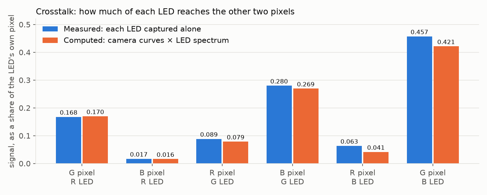
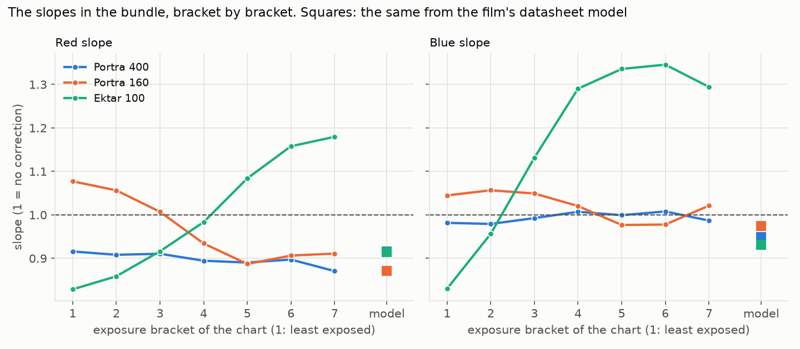
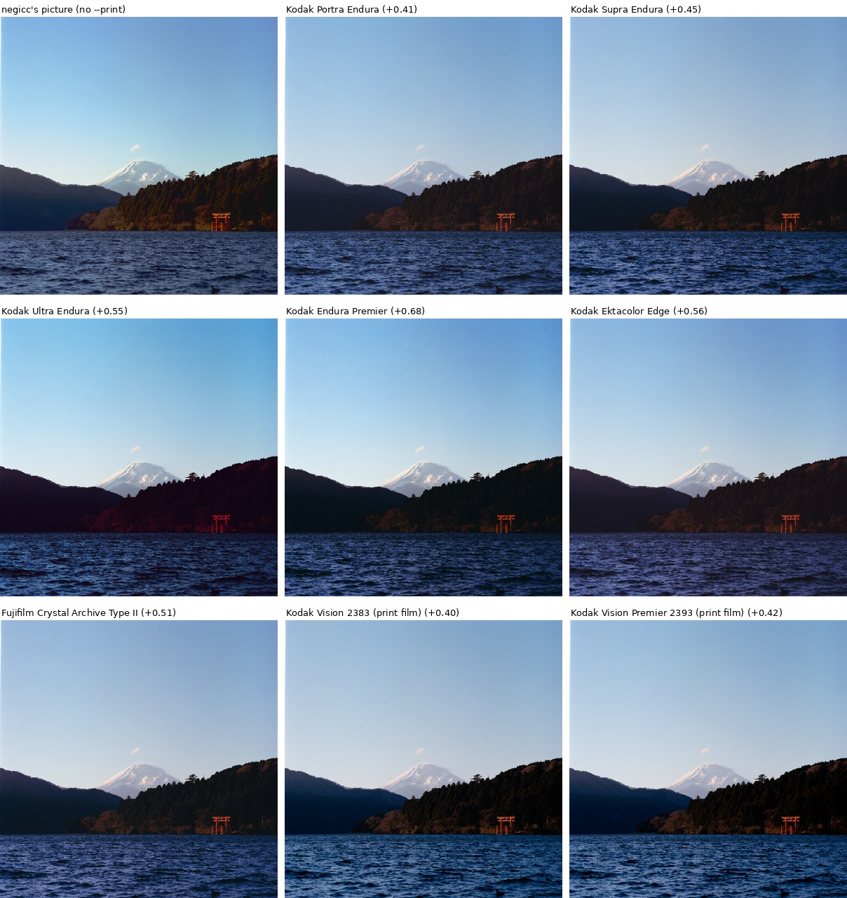

# Design

This document describes how `neg_process` turns a camera scan of a colour negative into a picture or a print, in
the order the data flows. Each section says what goes in, what comes out and how it is computed, and names the code
(`file`: `function`).

# 1. Overview

`neg_process` reads one scan of a negative (a camera RAW, or a TIFF, JPEG or linear DNG) and writes one of three
outputs:

- **a picture of the scene** (`-P srgb`, `srgb-g10` or an ICC profile): the negative inverted through a film profile;
- **a print as a picture** (`--print <material> -P srgb`): the negative as it would look printed on a paper or a
  print film;
- **a density file** (`-P statusm`, `rp180` or `apd`): the negative's density above its film base in a standard
  measure, with, for each `--print <material>`, a CLF beside it that renders the file as that print.

The scan is made under one of two lights. The **RGB LED light** (`--light_source tri`, "TriLED") has three narrow
bands, one red, one green and one blue LED; the camera's raw channels are used directly. The **white light**
(`--light_source d65`) is broad-band; the scan is decoded through the camera's colour matrix to linear Rec.2020.

Each film stock has a **profile set** (a bundle: `profiles/<Stock>-<Camera>-<Light>/`) per light. It holds seven
chart ICC profiles, one per exposure bracket of a chart (section 3), eight print ICC profiles, one per print material
(5.4), the measurements they were built from, and the matrices and curves the print emulation needs.

The stages, and which run for each output:

| Stage | Section | Picture, TriLED | Picture, white light | Print as a picture | Density file |
|---|---|---|---|---|---|
| From the scan to film RGB | 2 | yes | yes | yes | yes |
| Auto search on the chart profiles | 4.2 | yes | yes | no | yes, recorded only |
| White-light curve fit | 4.3 | no | yes | no | white light without `--print`: yes, for the suggested balance only |
| Tone stage | 4.4 | yes (`srgb`) | yes (`srgb`) | no | no |
| The print's search on the print profile | 5.6 | no | no | yes | with `--print`: once per material |
| Conversion | 4.1, 5.4 | chart profile | chart profile | print profile | density, then CLF |

Every pixel is converted once, by one chain of per-pixel stages (`color_pipeline.h`). The searches decide only the
numbers that chain uses; they render small previews and never touch the output's pixels.

## Notation

| Symbol | Meaning |
|---|---|
| `v` | A pixel's camera RGB after black subtraction and flat field, in 16-bit units (white light: linear Rec.2020). |
| `X` | The crosstalk correction, a 3×3 (identity on white light). |
| `f` | The film base: `X v` of unexposed film at the scan's exposure. |
| `n0` | `normalization_target / 65535` = 55000 / 65535 = 0.839, the level the film base lands on. |
| `E`, `g`, `b` | The exposure (a gain on all three channels) and the green and blue gains relative to red. |
| bracket | One capture of the chart at one exposure, and the ICC profile built from it (`Target 1` … `Target 7`). |
| PCS | The ICC profile connection space: CIE XYZ relative to D50. |
| `μ`, `σ` | The intent field: per cell of the network's grid, a predicted CIELAB mean and its spread. |
| `p` | The neutral head's probability that a cell shows a neutral surface. |
| `D_light` | Density above the film base as the light's three channels see it, `−log10` of transmittance. |
| `M`, `F`, `L` | The density matrix of a measure, `M = F L`: `L` from light density to the film's dye amounts, `F` from dye amounts to the measure. |
| APD | Academy Printing Density (SMPTE ST 2065-2), the measure the print emulation works in. |
| `G_c` | The film's grey balance curve: light density in channel `c` → APD of the film's grey with that light density. |
| `A` | The print's mid grey as green APD: the printing exposure. `A_mid` is a bracket's own. |
| `t_c` | A bracket's tilt: the slope of its grey scale relative to `G_c` (`grey_relative.b` in the bundle). |
| `P`, `Q` | The print matrix (a measure's density → the print material's own density) and its part from dye amounts. |

# 2. From the scan to film RGB

These steps run for every output and for the profile building alike. They turn raw sensor values into three
channels that are proportional to the film's transmittance, scaled so that unexposed film reads `n0`.

## 2.1 Reading the scan

A RAW is opened with LibRaw and its black level is subtracted per channel (`np_input.cc`: `load_raw`,
`subtract_cfa_black_in_place`). Two images are made from it:

- **The half-size image** is what the searches and the film base read. Under the RGB LED it is read straight from the
  CFA mosaic, one pixel per 2×2 Bayer quad: `(R, (G1 + G2) / 2, B)`, with no demosaic. It is a view into the mosaic,
  not a copy (`rgb_view.h`: `RgbView::from_cfa_half`, `cpu_preview_debayer`).
- **The full-resolution image** is what the output is converted from. Under the RGB LED a single Sony RGGB RAW is
  demosaiced by a grain-aware debayer (`rgb_view.h`: `cpu_grain_aware_debayer`): green from the two Hamilton-Adams
  estimates blended by `1 / (4096 + gradient²)`, red and blue as ratios `(R + 16) / (G + 16)`, bilinear where a
  channel is within 64 of white. Four pixel-shift captures (Sony A7R IV) are merged instead
  (`cpu_pixel_shift_merge`). Other RAWs go through LibRaw's `dcraw_process` to camera RGB.

Both RGB-LED images above are those of the default `-q -1`. With `-q 0` or more a single RAW is demosaiced by
LibRaw's `dcraw_process` at that quality (4 is DCB), and its half-size image is LibRaw's half-size decode, a copy
(`read_half_size`). A pixel-shift set is always merged. Wherever LibRaw demosaics a single RAW, the frame it cuts (a
`--roi`, or the RAW's inset crop) is demosaiced with two CFA periods of the image around it and cut after, so that its
edge pixels are interpolated from their neighbours (`load_raw`).

Under the RGB LED the bands are narrow and the three layers of the film are seen almost separately; the ratio
debayer exists because film grain is independent in the three layers, so the gradients an edge-directed demosaic
follows are mostly grain.

Under the white light the scan goes through LibRaw (`np_input.cc`: `prepare_white_light_mosaic`,
`decode_white_light`): the camera's daylight white balance and the flat field are applied on the mosaic, the
camera channels are multiplied by gains that put this scan's film base on the profile's (2.3), and LibRaw demosaics
to linear Rec.2020 through its camera matrix, with no rescaling: bilinearly, or at the quality `-q` gives. A linear
DNG takes the white-light path with its own colour data; it needs a white-light profile set.

A TIFF or JPEG under white light is converted to linear Rec.2020 (`to_linear_rec2020`): through its embedded ICC
profile when it has one; without one, 8-bit samples are taken as sRGB, and 16-bit samples are taken as linear
Rec.2020 already and are not converted. A TIFF with `--light_source tri` is taken as the scanning camera's linear RGB
(black subtracted, no white balance or colour matrix) and goes through the crosstalk correction (2.4); a TIFF with an
embedded profile or 8-bit samples is refused there.

Three files are **three captures**, one under each of the red, green and blue lights, and need an RGB-LED profile set or
a single ICC profile (`-p`; `np_input.cc`: `load_rgb_input`). Each gives one channel: red from the first, green from the
second, blue from the third. A RAW or DNG among them is demosaiced by LibRaw to camera RGB (bilinearly, or at the
quality `-q` gives) and the capture's own channel is kept; a TIFF gives its channel as it is read, and must be 16-bit
linear camera RGB with no embedded profile (an 8-bit or colour-managed TIFF among three captures is refused, as a single
TIFF is under an RGB-LED profile set). When all three captures record shutter and ISO, the green and blue channels are
scaled to the first capture's exposure. The half-size image is each RAW's own half-size decode, or the mean of each 2×2
block of a TIFF; when `--roi` cuts a frame (a given one, or `--roi auto`'s when its detection is confident), it is the
mean of each 2×2 block of the assembled image. Each channel comes from the capture under its own light, so `X` is the
identity unless `-r`, `-g` or `-b` give one.

## 2.2 Flat field

The flat field removes the light's and the lens's falloff. It is measured on the empty gate (`--flat`, an `.npz`
from the profile-building tools) as a coarse grid of per-channel gains in half-size sensor coordinates, normalised to
1 at the centre. Every decode is divided by the gain bilinearly interpolated at the pixel's sensor position, before
any crop or rotation (`flat_field.h`: `flat_divide`):

```
v_c(x, y) = round(v_raw_c(x, y) / gain_c(x, y))
```

The half-size view divides as it samples; the full-resolution debayer divides as it writes; the white-light decode
divides the mosaic. A RAW that LibRaw demosaics under the RGB LED (2.1: `-q 0` or more, or another camera's RAW) has
its mosaic divided in place before LibRaw reads it (`FlatField::apply_cfa`). A film base capture is divided by the
same flat.

## 2.3 Film base removal

The film base is the orange mask of unexposed film. Dividing by it makes each channel a transmittance relative to
bare film, so a profile and a scan agree whatever the mask's colour or the scan's exposure. The base `f` is taken,
in this order (`neg_process.cc`, `film_base_detector.cc`: `detect_film_base`):

1. **A capture of unexposed film** (`--film_base <file>[:x,y,w,h]`, TriLED only): decoded as the half-size view,
   flat-fielded, read over the given region or over a region found by tiles (the brightest group of smooth tiles of
   the base's colour), taken through `X` and scaled by the scan's exposure over the capture's (shutter × ISO).
   `--film_base auto` (the default) reuses a capture recorded in the output's sidecar from the same inputs.
2. **The rebate**: the frame detector's patch of unexposed film beside the frame, the median of its inner part (15 %
   inset on each side), refused when the thinnest film in the scan outshines it by more than 0.5 stop, and on TriLED
   when the sensor clipped it (more than 0.1 % of its pixels at 98 % of the white level in a channel, read before the
   flat field, except on the LibRaw path with `--flat`, where the flat has already divided the mosaic): clipped film
   reads the clip, not the base. neg_process then warns that the scan clips its film base
   and suggests a capture (item 1) or a shorter scan. The patch is used on a single RAW or linear DNG, whose
   detection runs on its raw data with `--roi auto` and with a given `--roi` alike; an RGB file and three captures go
   to item 3.
3. **The thinnest film**: the 99.5th percentile per channel of the film pixels of the half-size image reduced to 512
   pixels on the long side, with bare light and the black holder masked out. On TriLED bare light is what the sensor
   clipped in all three channels (98 % of the white level, before the flat field), in parts that reach the image
   border or are the size of a sprocket hole: light is brighter than the base in every channel, film near the clip
   clips first in its brightest channel, and the base is nearly neutral in the camera's channels, so colour does not
   tell thin film from light. On white light bare light is a part clipped in a channel (at the plateau of its maxima)
   whose median blue is above the 99.5th percentile of the film's blue, with the bright unclipped light connected to
   it, or a neutral part bluer than the orange film: film transmits no more blue than its base, so a flat stretch of
   film that forms a plateau is not taken for light. On TriLED, when the same percentile read before the flat field
   is at 98 % of the white level in a channel, the film's thinnest part clipped and the base read from it is the
   clip: neg_process warns, as for a clipped rebate.
4. **The bundle's base**, scaled by the scan's exposure over the base capture's.

The scale (`profile_bundle.cc`: `compute_station_merged_matrix`):

```
s_c = normalization_target / f_c × ρ          ρ = (shutter × ISO of the base capture) / (that of the scan)
```

`ρ` is 1 for a base read on this scan or scaled to it (items 1 to 3); it is used only for the bundle's base (item 4).
After the scale the film base reads 55000 in 16 bits, `n0` in [0, 1].

On white light the base is also used before the camera matrix: gains `K_c = (C⁻¹ f_profile)_c / (C⁻¹ f)_c`, divided by
their largest, on the camera channels, with `C` LibRaw's camera-to-Rec.2020 matrix (`white_light_balance.h`:
`film_base_balance_gains`). A light of another colour than the profile's then gives the base the profile's colour
before the matrix mixes the channels, so dense areas are not pushed below zero.

## 2.4 Crosstalk correction

Each camera pixel sees all three LEDs: the green pixel takes in nearly half as much of the blue LED as the blue pixel
does. `X` undoes that. It is measured with three captures of the bare light, one LED each: `M[:, j]` is the mean
camera RGB over a central disc under LED `j`, each column is divided by its diagonal entry, and `X = M⁻¹`
(`bundle.json`: `crosstalk_profile.crosstalk_correction_matrix`; `-r`, `-g`, `-b` replace it). White light has no
separate LEDs to unmix, and `X` is the identity.

`X` holds for the camera it was measured on. `bundle.json` lists the camera models it holds for (`camera_models`, as
LibRaw reads a RAW's model). A scan that states a model not on the list takes the identity in place of the bundle's
rows (the rows `-r`, `-g` and `-b` give are kept), and the conversion says so. A scan that states no model, or a bundle
without the list, is not compared and takes `X`. A white-light bundle has no `X`, lists no models and is not compared.

The measured matrix is used rather than one computed from the camera's published response curves and the LEDs'
spectra: it is of this camera and this light and needs no spectral data of the camera. The two agree within 8 % on
four of the six terms; the red pixel's two terms differ more.



## 2.5 The input matrix and the soft knee

The steps above, with the exposure and the gains, are one 3×3 per frame (`color_pipeline.h`: `candidate_matrix`,
`knee_compress`):

```
M_frame = diag(s) X                                        the merged matrix
x       = diag(E, E g, E b) M_frame v / 65535              film RGB; the base reads n0 at E = g = b = 1
knee(x) = x                                    x ≤ 0.95
        = min(0.9999, 0.95 + 0.05 tanh((x − 0.95) / 0.05))   x > 0.95;   0 for x ≤ 0
```

`E` multiplies all three channels, which in density is a shift along the film's exposure axis. `g` and `b` shift the
green and blue channels against red: the colour balance. The knee compresses film thinner than the base, which the
profile's input range does not cover, instead of clipping it.

The searches work in a reference unit: the frame as if scanned at 1/8 s, ISO 100 on the bundle's base. With
`e_norm = M_frame[1][1] / M_ref[1][1]`, a TriLED search's exposure is `E × e_norm`, so the same search exposure
means the same rendering whatever the scan's exposure; a white-light search scales the scene's range by `e_norm`
instead (`multi_target_optimizer.cc`: `frame_scale`). The result is reported in
the frame's units (`auto.e`, `-E`).

# 3. The profiles

A profile maps film RGB (2.5, after the knee) to colour in the PCS. It is made from a photograph of a chart on the
film stock, so it holds the film's response to light as measured, through this camera and this light.

## 3.1 The chart and the brackets

An IT8 chart (288 patches: 264 colours and a grey scale of 24 steps, `gs0` to `gs23`) is photographed on the film
at seven exposures, from −3 EV to +3 EV. Each developed frame is captured on the scanner: one **bracket**. A
negative's tones fall into different parts of the film's curves at different exposures, and one bracket's profile is
exact only over the range its chart covers, so the conversion picks, per frame, the bracket whose range holds the
scene (4.2).

## 3.2 Building one profile

The profile-building tools are not in this repository. Each bracket's profile is made in four steps:

1. **Patch reading.** The capture is decoded as in 2.1: under the RGB LED the half-size image straight from the CFA,
   one pixel per 2×2 quad; under white light LibRaw's `dcraw_process` at half size, output linear Rec.2020. The flat
   field is applied at decode, then the crosstalk correction (camera RGB only), and each patch's mean is taken over
   its box of the chart. Each channel is then scaled by `normalization_target / f_c × ρ` (2.3), with the base read as
   the mean over a rectangle of a separate capture of unexposed film, divided by the flat's mean gain there and
   corrected for crosstalk, and `ρ` the base capture's exposure over the chart capture's. The profile's own matrix is
   the identity, the correction being applied before it.
2. **Input curves.** The film's curve per channel (density above base against log exposure, monotone) is fitted
   jointly over all seven brackets. A profile's input curve (4096 entries) maps a corrected value to a linear scene
   value: below the chart's white it is a monotone interpolation through the grey steps; above it the film curve
   extends it and a highlight roll-off compresses it, with the chart's white at 0.75 of the output range, so the table
   has headroom above white (linear sRGB up to about 1.33 on the grey axis).
3. **The 3D table.** ArgyllCMS `colprof` fits a 45 × 45 × 45 table (PCS XYZ) to the patches after the input curves.
   The reference XYZ is the chart maker's data file, adapted to D50 (Bradford) when it is given under another
   illuminant.
4. **The file.** The pieces are merged into one ICC v2 input profile, RGB → PCS XYZ D50, an A2B0 `lut16`: three
   4096-entry input curves, an identity matrix, the 45³ table and identity output curves.

## 3.3 A bracket's calibrated range

A bracket's range is not stored; it is computed at conversion from the bracket's stored patches
(`multi_target_optimizer.cc`: `bracket_enclosure`). With `g_min` and `g_max` the smallest and largest green value of
its patches, `g_lo` and `g_hi` the scene's green 0.5 % and 99.5 % points over the inner 90 % of the frame, and `ρ_b`
the reference exposure (1/8 s, ISO 100) over the bracket's capture exposure:

```
e_min = g_min / g_lo × ρ_b      e_max = g_max / g_hi × ρ_b      e_centre = sqrt(e_min e_max)
usable range: e_min / 2^1.5 … e_max × 2^1.2
```
Every `E` between `e_min` and `e_max` keeps the whole scene inside the calibrated range (the bracket is **feasible**
when `e_min ≤ e_max`). The usable range lets the highlights exceed it by 1.5 stops and the shadows by 1.2. A bracket is
**admissible** for the frame when the scene's span `log2(g_hi / g_lo)` is at most the bracket's span over all its
patches, `log2(g_max / g_min)`, plus 2.7 stops. When the scene exceeds a bracket by more than the two tolerances
together, the usable range is inverted: no `E` keeps both ends within tolerance, and the range is the set of compromises
between them.

## 3.4 The profiles' prediction errors

CIEDE2000 between each profile's prediction and the chart's reference, per bracket, mean / maximum. **In-sample**
is ArgyllCMS `profcheck` on all 288 patches the table was fitted to, as stored in `bundle.json`
(`targets[i].profcheck_output`, the "Fitted" columns of each profile set's README); it shows how well the table fits
its own data. **Held out** is the mean error on colour patches left out of the fit (each profile rebuilt twice, each
time without alternate halves of the 264 colour patches; the grey steps stay in), as each profile set's README gives
it; it is the better guide to a photograph.

| Profile set | Error | −3 EV | −2 EV | −1 EV | 0 EV | +1 EV | +2 EV | +3 EV |
|---|---|---|---|---|---|---|---|---|
| Portra 400, TriLED | in-sample | 0.79 / 5.1 | 0.56 / 5.6 | 0.53 / 3.7 | 0.55 / 3.3 | 0.54 / 4.5 | 0.59 / 4.2 | 0.69 / 3.0 |
| | held out | 2.70 | 2.04 | 2.38 | 2.62 | 2.75 | 2.92 | 3.08 |
| Portra 400, white | in-sample | 1.08 / 7.5 | 0.74 / 4.6 | 0.69 / 3.6 | 0.75 / 10.6 | 0.68 / 6.6 | 0.73 / 12.8 | 0.80 / 4.5 |
| | held out | 2.65 | 1.95 | 2.05 | 2.10 | 1.80 | 2.21 | 2.44 |
| Portra 160, TriLED | in-sample | 1.09 / 10.7 | 0.82 / 14.0 | 0.59 / 4.4 | 0.56 / 3.7 | 0.62 / 3.6 | 0.67 / 3.4 | 0.70 / 3.4 |
| | held out | 2.35 | 2.09 | 1.96 | 2.30 | 2.65 | 2.67 | 2.82 |
| Portra 160, white | in-sample | 1.32 / 18.2 | 1.10 / 19.4 | 0.81 / 4.2 | 0.69 / 5.2 | 0.75 / 5.9 | 0.77 / 5.4 | 0.80 / 3.0 |
| | held out | 2.45 | 2.10 | 1.91 | 1.84 | 1.77 | 1.96 | 2.25 |
| Ektar 100, TriLED | in-sample | 1.11 / 14.2 | 0.61 / 9.8 | 0.51 / 2.3 | 0.62 / 8.2 | 0.63 / 2.0 | 0.72 / 3.8 | 0.83 / 4.1 |
| | held out | 3.05 | 2.68 | 2.79 | 3.25 | 3.52 | 4.01 | 3.72 |
| Ektar 100, white | in-sample | 1.45 / 14.1 | 0.80 / 6.8 | 0.63 / 2.8 | 0.65 / 3.4 | 0.79 / 3.1 | 0.92 / 4.1 | 1.05 / 4.1 |
| | held out | 3.18 | 2.13 | 1.78 | 1.84 | 2.18 | 2.76 | 3.05 |

On the patches it was fitted to, a white-light profile is less exact than a TriLED one. On held-out patches it is
more exact in 18 of the 21 cells, by up to 1.41 (Ektar 100, 0 EV), and less exact by at most 0.13 in the other three
(−3 EV on Portra 160 and Ektar 100, −2 EV on Portra 160). The chart therefore does not show the larger
frame-to-frame cast of a white-light conversion, which the curve fit (4.3) corrects.

## 3.5 The networks

The search judges a render with a vision network: the frozen DINOv3 ViT-S/16 backbone (`models/dinov3-small`), whose
input is the preview scaled so that its longer side is 512 pixels (enlarged when it is smaller), each side rounded to
whole 16-pixel patches; one patch is one cell of the grid (32 × 21 cells for a 3:2 frame). Three heads read its
tokens (`dinov3.h`).

The **intent head**, one per film stock (`models/dinov3-small_<stock>`, a small MLP on the layer 9 and 12 tokens),
predicts per cell the CIELAB `μ` a finished picture would have there and its spread `σ`. Its targets are, per cell,
the mean CIELAB of photographs on that stock in their finished positive scans (2,908 for Portra 400), resampled in
linear light to the network's input and averaged over the cell's 16 × 16 pixels. `σ` has no target: it is learned
with a heteroscedastic Huber loss on the standardised residual `r = |lab − μ| / σ`, `H(r) + log σ` with `H` Gaussian
(`r² / 2`) within one `σ` and linear beyond, so that a few badly predicted cells do not dominate. After training, `σ`
is calibrated per channel on the validation photographers: multiplied by 1.24 to 1.45 (each adapter's
`metadata.json`, `sigma_scale`), the mean unchanged.

The **neutral head** (`models/neutral_head`) predicts per cell `p`, the probability that the cell should render grey,
whatever cast the render has; the white-light curve fit uses it. The **tone heads** (`models/tone_head`) predict, from
the pooled features, the shadow level `L2`, the highlight level `L98` and the tonal range `L90 − L10` a lab scan of
the frame would have; the tone stage uses them. Both were trained on lab scans of eight colour negative stocks, the
neutral head with colour casts added to its inputs and the tone heads with exposure, contrast and level changes added,
so that they read the content and not the render's own cast or levels.

# 4. Scene conversion

## 4.1 The per-pixel conversion

With `-P srgb` or `-P srgb-g10`, every output pixel goes through these stages once (`color_pipeline.h`:
`convert_pixel`):

```
x     = knee(diag(E, E g, E b) M_frame v / 65535)                        2.5
y_c   = in_c(x_c)                                                         the bracket's input curves (4096 entries, linear)
XYZ   = 1.99997 × clut(y)                                                 tetrahedral interpolation of the 45³ table: PCS D50
rgb   = C⁻¹ XYZ (C: the embedded sRGB profile's colorants), clamped at 0  linear sRGB, up to about 1.33
rgb'  = shoulder(rgb), clamped to [0, 1]                                  shoulder: -P srgb, not a print; clamp: both
rgb'' = tone(rgb')                                                        -P srgb, with a tone curve (below)
out   = sRGB curve (or linear for srgb-g10), quantised to 16 bits
```

The tone curve is the tone stage's after a search, or a recorded one (`--tone_stage curve:…`, or a previous run's
on a knob run). With `-P <ICC profile>` a pixel takes the first three stages (`convert_pixel_pcs`) and then goes from
XYZ to the profile through Little-CMS, perceptual intent: no `C⁻¹`, shoulder or tone. Without `-P` the output is the
corrected camera RGB, the first stage alone (the matrix and the knee, `convert_pixel_corrected`), with the bracket's
ICC profile embedded.

**The highlight shoulder** compresses what the profile's headroom holds above the chart's white instead of
clipping it. Per channel, in stops `t = log2(x)`, it is the identity up to a knee `t_k`, then

```
s(t) = C − (C − s_k) (1 − (t − t_k) / (t_hi − t_k))^2         in encoded sRGB, s_k = sRGB(2^t_k)
```

reaching the ceiling `C` = 0.988 (code 252) at `x_hi` and staying there; `t_k` is solved so the join has a continuous
slope. `x_hi` is chosen per frame so that the 99.5 % point of each pixel's largest channel, `max(R, G, B)`, lands on
sRGB 242 (`shoulder_x_hi_anchored`), at most 2.5; for `x_hi` between 1 and 1.1 the ceiling ramps in from 1.

The tone stage (4.4) changes lightness only. A print (5.4) takes neither the shoulder nor the tone stage.

**Where the full-size steps run.** `neg_process` makes the full-resolution image (2.1) and converts it through a
backend (`neg_process.cc`: `Backend`). On a USE_CUDA=1 build with a CUDA device that runs its kernels, the grain-aware
debayer or the pixel-shift merge runs on the device (`gpu_passes.cu`: `gpu_grain_aware_debayer`,
`gpu_pixel_shift_merge`), and so does the conversion to `-P srgb` or `-P srgb-g10`, through the search's GPU render
(4.2). The device's debayer and merge give the CPU's values exactly. Its conversion computes the same `convert_pixel`
but rounds `powf`, `tanhf` and `cbrtf` differently in the last place, so a value of the exported picture can differ
from the CPU's by one 16-bit code. A custom output profile, whose last step is Little CMS, and an image that is not
three samples a pixel are converted on the CPU. `--dino_backend cpu` keeps both steps on the CPU, and so does
`--check_renderer`. The sidecar's `used.full_size` records where each ran.

## 4.2 The Auto search

The search chooses the bracket and `(E, g, b)`. It works on the half-size image of the frame's inner 90 % crop
(`multi_target_optimizer.cc`: `search_conversion_params`). The frame is the one the output writes, on every decode
path: the given `--roi`, or `--roi auto`'s; else, unless `--no_crop`, the RAW's inset crop (the crop the camera
records, e.g. an aspect ratio set in it; for three captures, the first capture's), placed in the image after the
sensor's margins (`np_input.cc`: `inset_crop`); else the whole image.

**The score.** A render's preview goes to the intent head, which predicts `(μ_i, σ_i)` for each cell `i`. The
render's own colour per cell is read as the head's targets were made (`dinov3.cc`:
`trained_cells_lab`): the preview resampled in linear light by area average to the network's input size, CIELAB per
pixel, averaged over the cell. The residual is the mean squared z-score:

```
z2 = 1 / (3N) Σ_i Σ_{k∈L,a,b} ((lab_ik − μ_ik) / σ_ik)^2
```

Under a Gaussian model per cell this is the negative log-likelihood, so cells the network is unsure of count for
little. The network's lightness follows the picture it is shown, so the search fixes one lightness target per frame
(step 2) and lets only `a*` and `b*` be predicted again from each render.

**The (E, g, b) optimiser** (`dinov3.cc`: `optimize_target_for_intent`) is a coordinate descent against a
fixed field. To be fast it scores the grid of patch-averaged camera RGB rendered at each candidate (`intent_loss`;
`intent_cells` gives the same cells for the correction below), not a full preview:

1. `E` over 13 points across its window (plus a start and ±0.03 and ±0.06 around it, those inside the window), then
   ±1 and ±2 steps of `max(0.01, window / 40)` (0.02 for an empty window) around the best, scored on the `L*` loss
   plus the penalties;
2. `g` over a grid, scored on the `a*` loss; then `b` over a grid, scored on the `b*` loss;
3. `g` and `b` refined by ±0.02, on the sum of the `a*` and `b*` losses, starting from that sum at the `g` and `b`
   of step 2.

The penalties are `15 ((clip − 2.5) / 2)^2` once more than 2.5 % of the cells' channels clip white, and
`5 log2(E / e_centre)^2` toward the bracket's centre (none for a bracket whose usable range is inverted: there the
intent field alone places `E` between the two ends). Rendering an average is not the average of the render (a
negative's bright grains render dark and its dark grains bright), so after each preview of a bracket the difference
between the preview's cells and the optimiser's cells at the same parameters is kept, and the bracket's next
optimisation aims at `μ` minus that difference (`SearchFrame::update_correction`). At the fixed point the picture,
not the optimiser's reading of it, matches the field.

**The steps:**

1. **Brackets and their ranges.** In a set of five or more brackets, those whose grey scale (`gs0` to `gs23`) spans
   less than 0.75 of the widest one's are left out (at least three are kept: `filter_admissible_targets`; this is a
   width test of the bracket alone, not the admissibility of 3.3). Each remaining bracket gets its calibrated and
   usable range (3.3), and whether it is admissible. With `--target` the given bracket alone is kept, admissible or
   not.
2. **Metering and the lightness target.** Each admissible bracket (every bracket of step 1 when none is admissible)
   is metered: the `E` at which the scene's log-average renders at `L*` 50 with gains 1.10 and 1.15, by bisection
   (`exposure_for_lightness`; a bracket that cannot render a neutral `L*` 50 within 0.25 ΔE is not metered). Every
   metered bracket is rendered at its metered `E`, clamped to its usable range, and the predicted fields are averaged:
   the **bootstrap field**. Its `L*` is the frame's lightness target for the rest of the search. When no bracket
   meters, the bracket whose range the scene fills best (`|fill − 0.85| + 0.5` per stop of overflow, an admissible one
   when there is one) renders it alone at its `e_centre`. With `-E` one render makes the field, at the given `E`: the
   deepest metered bracket's (its metered `E` furthest inside its usable range), or the best-fit one's when none
   meters.
3. **Screening.** Each metered bracket's `(E, g, b)` is optimised against the bootstrap field over its usable range,
   from gains 1.22 and 1.15 (every bracket of step 2, from its `e_centre`, when none metered), each aimed at the field
   minus its own correction (below): the one of its bootstrap render, or, when one render made the field, the one of
   a render at the `E` it is screened from with the bootstrap's gains. The brackets are ranked by that loss.
4. **Tournament.** The best two run a fixed-point loop (`SearchFrame::fixed_point`), with `E` held within ±0.5 stop of
   its screened value. Each step measures the shoulder's `x_hi`, renders the preview, updates the correction,
   predicts a field, puts the lightness target in its `L*`, measures the residual, and optimises the next `(E, g, b)`.
   A loop stops when `|ΔE| + |Δg| + |Δb| ≤ 0.02`; on TriLED also when the residual changes by 1.5 % or less; on white
   light when the residual has passed its minimum. It is diverged when the residual grows by more than 25 % and more
   than 1.5, and stops after 8 steps (`--dino_iters`). Each loop keeps its lowest-residual step. The lower residual
   wins, whichever way each loop ended.
5. **Clip fallback.** When the winner white-clips more than 0.03 % of the crop (a channel at 16-bit code 65400 or
   above), the next denser bracket, when it was screened and is admissible, runs the loop of step 4 (or keeps its
   tournament run) and is taken if it at least halves the clipping, moves the median `L*` by no more than −4.5 to
   +0.5, and has a residual no more than 10 % higher. A bracket given with `--target` stays.
6. **Highlight pullback.** A bright frame with highlights crowding the top was rendered too bright: median `L*` ≥ 58
   with ≥ 2.2 % of the crop above sRGB 242 in a channel, or median `L*` ≥ 48 with ≥ 7.5 % above 242 (or, on `Target 4`
   and denser brackets, ≥ 11 % above 235). On a feasible bracket with `E` below `e_min`, `E` is raised toward `e_min` by
   at most 0.15 stop. On an infeasible one, steps 2 to 4 run again with the same lightness target: the bootstrap field
   is made again from the metered brackets' renders (when no bracket metered, the first field is kept), the brackets
   step 3 screened are screened again, and the best two run the tournament, with penalties
   `4.5 d_hi² + 1.2 d_sh² + 0.8 slack²` in place of the pull toward the centre (`d_hi`, `d_sh`: stops of `E` below
   `e_min` or above `e_max`; `slack`: stops by which the scene overflows the bracket); the runs are ranked by their
   residual plus the same penalties, whichever way each loop ended. When the winner puts the
   median `L*` more than 7.5 below the first choice's (on a frame with median `L*` ≥ 58; 4.5 otherwise), its `E` is
   lowered, which brightens it, by 0.038 stop per `L*` of the excess, once. The result is taken if the share of the crop
   above 242 grows by no more than 0.5 percentage point, the median `L*` stays at 48 or within 6 of the first choice's,
   and it moves to a denser bracket or raises `E` by more than 2 %. Dark and backlit frames are left alone, and the
   pullback does not run after the clip fallback took the next bracket, with `-E`, or on a one-bracket set.
7. **Final shoulder.** `x_hi` is measured once more at the final parameters.
8. **Shadow alternative.** The picture's preview can crush shadows that no statistic of the cells shows: a colour
   with one saturated channel going below black, or a dark area's chroma noise. The step reads it from the render. One
   clip pass per screened bracket, at its screened parameters, counts the share of the inner crop with a channel
   white-clipped and with a channel black-clipped (the result's own bracket's pass also counts the result). Among the
   brackets whose white share is within the clip allowance of the tone stage (0.5 % of the crop) of the result's, the
   one with the lowest black share is picked, the first in screening order on a tie. When that is not the result's
   bracket and the result's bracket, at its screened parameters, is not as low, the picked bracket runs the loop of
   step 4 (or keeps its tournament run) and has its roll-off measured: the alternative. Whether the conversion takes
   it is decided after the full-size decode, by the tone stage's clip check (4.4). The result's bracket is compared
   whether or not it is within the allowance (the allowance chooses where to move to; the result's bracket is where
   the picture is), and the result's own black share is recorded but takes no part in the choice. The step does not
   run with `--target` or `-E`, with one bracket, or where no alternative could be kept: an output other than sRGB,
   the tone stage off, a density output or a print.

The sidecar records the winning step's field as `intent_field` (`μ` and `σ` per cell): its `a*` and `b*` as that step
predicted them, its `L*` the lightness target of step 2.

The search's parameters, in the order the steps use them:

| Parameter | Value | Purpose |
|---|---|---|
| Inner crop | 90 % | The statistics and previews leave out the frame's border. |
| Scene range | 0.5 % to 99.5 % of green | A few specular highlights or dust specks do not set the scene's range. |
| Wide brackets | in a set of five or more: grey scale span ≥ 0.75 of the widest, at least 3 | A bracket calibrating a much shorter range cannot hold a whole scene. |
| Overflow tolerances | 1.5 stops of highlight, 1.2 of shadow | How far a scene may exceed a bracket's calibrated range: the usable range and admissibility. |
| Metering | `L*` 50 at gains 1.10, 1.15 | The exposure each bracket starts from. |
| Bootstrap field | mean over every metered bracket | No single bracket sets the frame's lightness target. |
| Best-fit fallback | fill 0.85; 0.5 per stop of overflow | The bracket that renders the bootstrap when none meters. |
| Screening start | gains 1.22, 1.15 | Where the screening's optimisation of the gains begins. |
| Clip penalty | above 2.5 % of channels | The search avoids renders that clip white. |
| Exposure penalty | `5 log2(E / e_centre)²`; none on an inverted range | Keeps `E` near the centre of the bracket's calibrated range. |
| Tournament | best 2; trust region ±0.5 stop | The loop refines the screened `E` instead of relocating it. |
| Convergence | 0.02 in `E + g + b`; 1.5 % (TriLED); past minimum (white); 8 steps | When a loop stops. |
| Clip fallback | over 0.03 %; halve; −4.5 to +0.5 `L*`; residual within 10 % | Moves a clipping frame to the next denser bracket. |
| Highlight pullback | `L*` 58 with 2.2 %, `L*` 48 with 7.5 % (11 % above 235); 0.15 stop | Darkens a bright frame whose highlights crowd white. |
| Shadow alternative | white within the tone stage's clip allowance (0.5 %); the lowest black share | A bracket that crushes less shadow, read from its render. |
| Highlight roll-off | 99.5 % point to sRGB 242; `x_hi` ≤ 2.5; exponent 2; ceiling 0.988 | Compresses highlights above the chart's white. |

**Given values.** On a bundle, under either light, `--target`, `-E`, `--gain_g` and `--gain_b` are held and the rest
is searched; with all four given the search runs only for the curve fit (white light) and the tone stage. A single
ICC profile (`-p file.icc`) has no chart readings to meter with: there `-E` or nothing runs the single-bracket solver
(`solve_dinov3_intent`) and a given gain turns the search off. `--brightness`, `--tint` and `--warmth` move the
result afterwards, in stops of the reference grey's luminance and in its `a*` and `b*`.

**Where the passes run.** Every preview and clip pass of the search, the print's search, the curve fit and the tone
plan goes through one renderer (`multi_target_optimizer.h`: `PreviewRenderer`): on a USE_CUDA=1 build with a CUDA
device that runs its kernels the GPU's (`GpuRenderer`, `gpu_passes.cu`), else the CPU's; `--dino_backend cpu` keeps
the passes, the network and the full-size steps (4.1) on the CPU. The GPU runs the same per-pixel pipeline (`color_pipeline.h`) with fused
multiply-add off on both sides, but the two round `powf`, `tanhf` and `cbrtf` differently in the last place, so a
preview can differ by one code and a result in its last digits. The sidecar's `auto` block records `renderer`: `gpu`,
or `cpu, compared with the gpu` under `--check_renderer` with a device (no key: the CPU's). A run reuses a sidecar
only when its search ran where this run's would. `--check_renderer` runs every pass on the CPU and counts it; with a
device it also runs each on the GPU from the same inputs, the search reading the CPU's, and fails before anything is
written when a render's mean change in `L*` per pixel or a zone mean exceeds 0.05, a clip share or a histogram bin
0.01 % of the crop, a median `L*` one bin, or a value is not finite.

**Limits.** The search does not always reach the same answer from different starts. The thresholds of steps 1, 5 and
6 and the tolerances of 3.3 are stated values, not derived.

## 4.3 The white-light curve fit

A white-light conversion leaves a cast that differs from frame to frame more than a TriLED one does: the broad
channels mix the film's layers, which a 3×3 cannot undo. After the search, the fit corrects the green and blue gains
and the slopes of the green and blue input curves so that what the frame shows as neutral comes out grey
(`input_curves.h`; `multi_target_optimizer.cc`: `run_white_light_fit`). It runs on white light with `-P srgb` or
`srgb-g10` (`--fit_curves`), and for a white-light density file without `--print`, where it gives the suggested
balance only. A print takes no fit (5.10).

**The curve.** On the green and blue input of the bracket's profile, below the pivot `ref` (the film base through
the input matrix and the knee):

```
u     = log2(x / ref) ≤ 0
f(u)  = u (1 + a)                              held at slope 1 below the densest cell (slope hold)
x'    = ref 2^f(u)
```

`a` is the channel's bend, the slope term the fit solves. The curve's form in `input_curves.h` also has a bend around
the median cell's `u`, which the fit holds at 0. The fitted curve is composed into the bracket's input tables (stage
"profile tables": `apply_input_curves`), so the one conversion applies it, and `E` is metered again on the combined
profile.

**The anchors.** Every cell that Auto's render puts between `L*` 2 and 92 is an anchor, weighted by `p²`:

```
m = Σ_i p_i²         ω_i = p_i² / m   (plus 10⁻³ spread evenly, so m = 0 is defined)
ā = Σ_i ω_i a*_i     b̄ = Σ_i ω_i b*_i
k_a = 50 cov_ω(L*, a*) / (var_ω(L*) + 25)          (likewise k_b)
```

`m` is the frame's neutral evidence. A neutral surface has `a* = b* = 0` at every lightness, so the gains move `ā` and
`b̄` and the slopes remove the trends `k_a` and `k_b` (the drift of `a*` or `b*` per 50 `L*`). The targets grow with
the evidence:

```
w        = m / (m + 12)
target ā = (1 − w) ā_Auto          target b̄ = (1 − w) b̄_Auto
target k_a = (1 − w s) k_a_Auto,   s = var_ω(L*) / (var_ω(L*) + 36)       (likewise k_b)
```

With no evidence the targets are Auto's own values. `s` shrinks the slope correction when the anchors cover a narrow
range of lightness.

**The intent term.** The search's intent field gives a second estimate of the overall magenta-green balance:

```
ν_i  = (1 / σ_a,i²) / Σ_j (1 / σ_a,j²)          over every fit cell
s_a  = Σ_i ν_i (a*_i − μ_a,i)
dL   = (Σ_i ν_i L*_i − Σ_i ω_i L*_i) / 50 × (var_ω(L*) + 25) / max(var_ω(L*), 25)
intent term = (s_a − (k_a − target k_a) dL − SE) / sqrt(SE² + 1)
anchor term = (ā − target ā) / σ_anc,            σ_anc² = (144 + m) / (m + 12)
```

`SE` is the standard error of `s_a`, from sums over 4 × 4 blocks of cells (neighbouring cells are not independent),
detrended in `L*`. `dL` is the gap between the field's and the anchors' mean lightness per 50 `L*`, so a change of
slope is not read as a shift of `a*`; its factor undoes the damping by `var_ω(L*) + 25` in `k_a`, and stops at 2 when
the anchors span little lightness, so a slope measured over a narrow span is not amplified. Subtracting `SE` leans
the target toward magenta by one standard error. The 1 under the root and the 1 that `σ_anc` approaches are each
estimate's systematic error in `a*`.

**The solve.** One Levenberg-Marquardt solve over four numbers, the green and blue gains and the green and blue slope
terms (`input_curves.h`: `fit_input_curves_joint`). Its residuals are the anchor term, the anchors' `b̄` against its
target, the two trends `k_a` and `k_b` against theirs (weighted by `0.5 sqrt(var_ω(L*) / (var_ω(L*) + 100))`), the
intent term and a ridge on the slope terms; the `a*` and `b*` terms are divided by 1.5. `E` is re-solved at every
step so the median lightness stays where Auto put it.

**The never-greener guard.** The fit may not end greener than Auto's render. It runs freely first; only if its
result is greener does it run again with the excess green penalised (weight 4).

| Parameter | Value | Purpose |
|---|---|---|
| Anchor range | `L*` 2 to 92 | Clipped blacks and whites carry no colour. |
| Evidence half-mass | 12 | The anchors pull at half strength when `m` = 12; a correction resting on little neutral surface is mostly ignored. |
| Slope span | 6 `L*` | A slope measured over a narrow range of lightness is shrunk toward Auto's. |
| Slope hold | on | Beyond the densest cell the curve stops bending. |
| Head systematic error | 1 `a*` | Neither estimate of the overall `a*` is trusted closer than this; with much evidence a disagreement is split. |
| Magenta lean | 1 standard error | Slightly magenta is preferred to slightly green. |
| The guard | on; tolerance 0.5 `a*` | A result up to 0.5 `a*` greener than Auto's counts as not greener. |
| Guard's shadow exemption | full below `L*` 10, fading out by 20 | A magenta cast in deep shadow can still be corrected toward green. |

Bounds: the slope term within 0.35; the curve within 2.2 stops of the profile's own; the green gain within 0.75 stop
and the blue within 1.25 stops of Auto's; the median `L*` 18 to 85; at least 8 cells in range; on a frame that is the
whole image (`--roi auto` fell back, or a given `--roi` covers it), holder-dark cells, and cells at the base's level
when the base is a rebate, are left out.

**Limits.** The half-mass 12, the slope span, the systematic error, the lean and the guard's weight are stated
values, not derived. The fit removes most of a uniform cast but little of a cast that differs between shadows and
highlights; deep shadows have few anchors. The guard is a penalty, not an exact bound, and costs accuracy where
Auto's own render is magenta. The intent term's weights include cells above `L*` 92.

## 4.4 The tone stage

The tone stage sets contrast and the black and white levels: one lightness curve per frame, moving the render toward
the tone heads' prediction while holding the mid-tone (`tone_stage.cc`). It runs after every search with `-P srgb`,
on both lights (`--tone_stage`), on one network inference of the final render's preview.

```
f(L)  = black + (white − black) h(g(L / 100)),   g(x) = x^gamma,   h(x) = x^c / (x^c + (1 − x)^c)
targets: L2' = L2 + 1.0 (L2_pred − L2),   L98' = L98 + 0.5 (L98_pred − L98),
         R'  = R + 0.5 (R_pred − R)  (R = L90 − L10),   L50' = L50
```

The four numbers (black, white, gamma, contrast `c`) are solved so that `f` of the render's percentiles meets the
targets, with a weak prior toward the identity and a term holding the rise above `L98` to the input's (from three
starting white points, the lowest cost kept). The curve is applied per pixel to display linear sRGB: luminance `Y`
goes to `Y'` through `f` on `L*`, and the colour difference is carried along:

```
out = Y' + (v − Y) f'(Y) / f'(Y')          f' the derivative of CIELAB's cube root; ratio at most 8
```

which holds each pixel's `a*` and `b*` to first order (`color_pipeline.h`: `apply_tone`).

| Parameter | Value | Purpose |
|---|---|---|
| Shadow move | 1.0 | All the way to the predicted shadow level. |
| Highlight move | 0.5 | Half way to the predicted highlight level. |
| Range move | 0.5 | Half way to the predicted tonal range. |
| Clip allowance | 0.5 % of the inner crop, at each end | Beyond it at either end, the highlight and range moves are scaled to 0.75, 0.5, 0.25 or 0 until both ends hold; the shadow move with them only where the black end fails with it whole. |
| Clip check | inner crop 90 %; the 2 × 2 at the origin of every 8 × 8 block | The share at white (a channel at the 16-bit maximum) and at black (a channel at 0), each against its own share before the stage. |
| Curve limits | black ±15, white 80 to 110, gamma 0.7 to 1.45, contrast 0.7 to 1.5 | The range of each number; a recorded curve (`--tone_stage curve:`) outside it is refused. |

**The clip check.** Before the export is converted, each candidate curve is tried on a sample of the frame through the
conversion kernel: the 2 × 2 pixels at the origin of every 8 × 8 block that lie in the inner crop, the area the curve is
planned on. The sample is converted once up to the tone curve (`tone_clip_sample`), and each candidate's table is
applied to those values with the rest of the kernel (`tone_clip_shares`). A demosaiced image can clip on some phases of
the 2 × 2 colour mosaic and not on the others, so a sample of one pixel per block could miss it; the 2 × 2 covers every
phase. Each end is compared with its own share before the stage: falling black clipping does not pay for rising white
clipping, nor the reverse. The shares are tried in order (1, 0.75, 0.5, 0.25, 0); at each, the curve keeps the whole
shadow move unless the black end then fails, and only then is the shadow move scaled with the rest, so a curve that
lifts the shadows keeps the lift. When no share holds both ends, `--tone_stage` says which end gives way: `auto` (and
`on`) keep the last share with the shadow lift; `highlights_first` keeps the largest share whose white end holds, else
lowers the shadow lift at the last share through the same shares until white holds, else keeps the least white clipping;
`least_total` keeps the curve whose shares at the two ends together are least, among every curve the other two try (the
larger share on a tie, then the larger lift). The sidecar names the rule as `tone_stage.fallback` (null where a share
held). The sidecar records both shares before (the sample) and after (every pixel of the inner crop) as
`tone_stage.clip`, and the shares kept as `moves.highlight_share` and `moves.shadow_share`.

**Under the knobs.** `--brightness`, `--tint` and `--warmth` act under the tone curve: the curve is the one the run
without them keeps, applied after them. A replay of a record applies its curve as recorded; a fresh run with the knobs
makes the clip check, and the choice of the search's shadow alternative, on each candidate converted without them
(its roll-off measured at the knobs' base, its bracket's profile before the knobs re-anchor the curves), then converts
with the knobs under that curve, so it gives the picture of the knobs on the record of a run without them. The shares
before the stage that the sidecar records are those of the knobbed picture.

**The search's shadow alternative.** When the search found one (4.2, step 8), it goes through the stages after the
search as the result does (the curve fit on white light, the tone plan, the roll-off), and both go through the clip
check: each candidate's sample is converted once, its shares before the stage are counted, and its plan's curve is
chosen on it, which counts the shares after the stage. The alternative replaces the result only if, at white and at
black, before and after the stage, each of its shares is no higher than the result's and at least one is lower. The
clip check of the candidate kept is the export's. The sidecar records the step and the choice as
`auto.shadow_alternative`: each screened bracket's shares in the clip pass, the bracket picked (or why none, and
whether the result's bracket was within the allowance), the alternative's parameters, both candidates' four shares on
the sample (or why they were not compared), and which was kept. Each candidate carries its own knob solve
(`--brightness`, `--tint`, `--warmth`) and the curves re-anchored at it. The Auto's inferences and times, and its log,
include the alternative's work; the log names the alternative's blocks.

**Limits.** The moves were chosen by comparing pictures, not derived.

# 5. Print emulation

## 5.1 What it models

A print is made by shining a printer lamp through the negative onto a print material (a paper, or a print film for
cinema), whose three layers each respond to their part of the light by a characteristic curve and form dyes; the
print is then looked at under a viewing light. The emulation models that chain from the film's measured densities:

1. **The reading of the film.** The scan gives the film's density in the light's three channels, `D_light`. The
   light's spectrum fixes what those channels see: the three measured LED spectra for TriLED, and for white light the
   CIE 1931 observer under D65 as linear Rec.2020.
2. **The film's curves.** The chart's grey steps give the film's grey balance curve `G_c`: for a light density in one
   channel, the density of the film's grey in APD. Each bracket also gives its mid grey and its tilt `t_c`.
3. **APD and the printing density.** A standard measure's response curves (APD, RP 180, Status M) give `F`; the print
   material's spectral sensitivity under a 3200 K lamp gives `Q`. Together they take the film's density to the density
   the print material's layers read.
4. **The print material.** A spektrafilm print profile gives each layer's curve (dye amount against log exposure),
   the dyes' spectra and the base.
5. **The viewing condition.** The print's spectrum under D50 (paper) or D55 (print film), through the CIE 1931 2°
   observer, gives XYZ, shown relative to the paper's white.

The print's exposure is one number, `A`, the APD of the film's grey that prints as the print's mid grey. Steps 1 to
5 are combined into one ICC profile per print material (5.4), and the print's own search (5.6) finds `A` and the
gains for each frame on that profile. The density file and its CLF (5.9) carry the same chain for other tools.

The code is `neg_process.cc`. A profile set holds nothing of a print material, and a print material holds nothing of a
film.

## 5.2 Density

A pixel's density above the film base in the light's channels, and in a measure (`neg_process.cc`:
`density_encode_in_place`):

```
T       = M_frame v / 65535 / n0                    transmittance against bare film (E = g = b = 1, no knee)
D_light = −log10(max(T, 0.0001))
D       = M D_light                                 the measure's density,  M = F L  (Status M: M = F L diag(φ))
```

`L` takes the density the light sees to the film's three dye amounts and depends on the light's spectrum and the
film's dyes. `F` takes the dye amounts to the measure and depends on the film's dyes and the measure's response, not
on the light. Each is a least-squares 3×3 with no offset, fitted on 3000 sample colours of a model of the film (its
dye amounts along its neutral scale between log exposure −1.5 and 1.0, with a log-normal colour variation;
`bundle.json`: `density_matrices.light_to_film` and `density_matrices.<measure>.film_to_measure`). A scanner with
another light replaces `L` alone. Status M alone is calibrated on the chart: `φ` (`light_density_factors`) holds the
chart's grey scale to the film model's Status M with one factor on the green and one on the blue LED density,
applied when within 0.10 of 1.

**The grey balance curve.** `G_c(d)` is the APD of the film's grey that has light density `d` in channel `c`
(`density_matrices.grey_balance_curves`). It comes from the grey steps of all seven brackets (168 points): the red
and the blue light density as a cubic in the green (least squares), carried on by its tangent past the end steps,
then through `M` for APD. 501 points per channel, light density −0.5 to 4.5 in steps of 0.01.

**A bracket's mid grey and tilt.** The chart's 18 % grey step `gs10` of each bracket, through the APD matrix, gives
its mid grey as green APD, `A_mid` (`bracket_mid_apd`). The bracket's grey steps, against the curve, give its tilt
`t_c`: the slope of its grey scale relative to the curve
(`density_matrices.brackets.targets.<bracket>.grey_relative.b`).
The film's channels change their relation with exposure, more on some stocks than others, which a per-bracket tilt
follows:



## 5.3 The print matrix and the print material

A print material is a spektrafilm print profile, read as published: eight are built in
(`3rd_party/spektrafilm/profiles/`), and `--print <file>` takes another (`load_spektrafilm_print`). From it are
computed:

- **the observer**: the CIE 1931 2° observer under D50 for a paper, D55 for a print film, by the profile's `support`
  (its `viewing_illuminant`, K75P on the two print films, is not read);
- **aim**: each layer's log exposure that prints an 18 % grey;
- **`Q`**: the 3×3 from the film's dye amounts to the print's own density (its layers' sensitivity under a 3200 K
  blackbody lamp, no heat filter, in place of the profile's `reference_illuminant`, TH-KG3), least squares with no
  offset on the film model's neutral scale between log exposure −1.5 and 1.0, each point with 27 colour variations
  (each dye amount times `exp(0.184 z)`, `z` = −1, 0, 1);
- **the print matrix** `P = Q L M⁻¹` for each measure, so `P M = Q L` (for a measure without `φ`, `P = Q F⁻¹`).

The print of a printing density `pd`, per layer `c` and wavelength `λ`:

```
logE_c = aim_c − (pd_c − 0.70)                        0.70: the printing density that prints as mid grey
δ_c    = curve_c(logE_c)                              dye amount, held at the curve's ends
τ(λ)   = 10^−(Σ_c δ_c dye_c(λ) + base(λ))             the print's transmittance or reflectance
XYZ    = Σ_λ τ(λ) light(λ) observer(λ) / Σ_λ light(λ) ȳ(λ)
```

## 5.4 The print ICC

The chain is written as an ICC profile shaped as the chart profiles are (ICC v2, RGB → PCS XYZ D50, A2B0 `lut16`:
three 4096-entry input curves, a 45³ table, identity output curves), so the conversion runs it as it runs them
(`neg_process.cc`: `bracket_print_profiles`, `print_table`, `bracket_print_curves`). For the profile's input `x` (2.5,
after the knee) in channel `c`:

```
dL_c    = −log10(unknee(x_c) g_c / n0)                light density; (g_r, g_g, g_b) = (1, g, b), applied after the knee
alpha_c = (G_c(dL_c) − A) (1 + t_c(A))                APD above the print's mid grey; equal in all channels on a grey
pd      = 0.70 + Q L (ψ ∘ alpha),   ψ = M⁻¹ (1, 1, 1)   M for APD; ψ ∘ alpha the light density of that grey
XYZ     = the print of pd (5.3), adapted from D55 to D50 (Bradford) for a print film
```

**What goes in the curves and what in the table.** A 3D table samples a paper's S-curve badly, so the curve goes in
the input curves and the table keeps only colour:

```
in_c(x)          = Paper_c((G_c(dL_c) − A) (1 + t_c(A)))       the profile's input curve (4.1)
table(a)         = the chain above from alpha_c = Paper_c⁻¹(a_c)
Paper_c(alpha_i) = 0.75 curve_c(aim_c − η_c alpha_i) / top_c + 0.25 (1 − i / (N − 1)),   η = P (1, 1, 1),  P for APD
```

`Paper_c` is the dye amount layer `c` takes on a grey `alpha` above the mid grey, scaled to `[0, 1]` per channel on
`alpha_i = −1.5 + 0.005 i` (`N = 661`, −1.5 to 1.8) with a 0.25 linear ramp across the grid (`top_c`: the channel's
largest value), held strictly decreasing on `[0, 1]`, so it spans the full table in every channel, keeps a positive
slope across the toe and shoulder where `Q L` mixes the channels under white light, and inverts the same way for every
`A`. The table therefore has no bracket and no `A` in it: one table serves every print of the material, and two prints
differ only in their curves.

**The table's sampling error.** The print ICC is sampled from the chain above, so the two differ by the sampling alone;
the comparison says nothing of how close the chain is to a real print (6, Limits). On the RGB-LED profile sets every
chart patch of every bracket (288 patches in each of the seven brackets) is printed twice at its bracket's `A_mid` with
gains 1: through the print ICC as the conversion runs it (the knee, the bracket's 16-bit input curves, the table
relative to the paper's white, 5.7), and directly by the chain, from the patch's light density, relative to the print
where every layer holds its least dye. ΔE00 on CIELAB of the two PCS XYZ, with the PCS white as the white, averages 0.06
to 0.14 per print material over the three stocks; the 95th percentile is at most 0.24 and the largest 0.5. On the
white-light sets the table's sampling error on the chart is at most 0.8 ΔE00 (median under 0.1).

The profile-building tools write one print ICC per material into the bundle (`print_*.icc`, curves for the middle
bracket). `neg_process` uses the bundle's table when its curves equal the ones computed here to one 16-bit code, and
otherwise (a material given as a file) computes the table, in about 0.3 s.

## 5.5 The print's exposure and its curves

`A` is the printing exposure, applied after the grey balance curve, so it moves a grey along the grey axis and keeps
it grey. A bracket's own print is the one at `A = A_mid` of that bracket. `t_c(A)` is linear in `A` between the two
brackets whose `A_mid` enclose it, and held beyond the end ones, so at a bracket's own `A_mid` it is that bracket's
tilt (`print_tilt_at`). For a new `A` only the three input curves are computed again and written into the profile
(`PrintContinuum::set_curves_at`, about 5 ms); the table stays. The gains `g` and `b` are applied in the curves too,
after the knee, so film at the base's density never passes the knee whatever the gains; the input matrix carries `E`
alone.

## 5.6 The print's search

A print is searched on its own profile, not on the chart profiles: its lightness once and continuously in `A`, its
colour in `g` and `b` (`multi_target_optimizer.cc`: `search_print_continuous`). It runs on the material's print
profile, made relative to the paper's white (5.7), with its curves written for each `A`, `g` and `b` it tries and
the matrix at `E` alone, as the conversion renders the print (5.5): every preview, every optimiser cell and the shares
at white below score the picture the conversion writes.

1. **E is held** where the frame's film base reads `n0` (search units `E = e_norm`; the result's `E` is 1), so the
   print is the negative's own density above its base, as the brackets were measured, whatever the scan's exposure.
2. **A0 is metered** as the scene's search meters a bracket: the `A` at which the frame's log-average cell (at
   `g = b = 1`) prints at `L*` 50, by bisection over the curve's green APD range.
3. **The lightness target** is the mean of the fields predicted from the print at `A0 − h`, `A0` and `A0 + h`,
   `h = log10(2) / 2` (half a stop of printing exposure). Its `L*` is held for the rest of the search.
4. **g and b are screened** at `A0` against that field, minus the correction of the render at `A0`, on the
   optimiser's grids. `g = b = 1` is the film's own neutral (a grey on the curve prints grey), but the frame's light
   need not be.
5. **The fixed point over (A, g, b).** Each step renders the print at its `A`, updates the optimiser's correction,
   predicts `a*` and `b*` from the render (`L*` is the target) and measures the residual. It then solves `A`: from the
   current `A`, steps of 0.1 APD downhill to bracket the minimum, then golden section to 0.001, with `g` and `b`
   optimised at each `A` (`E` pinned). It stops when the residual changes by 1.5 % or less, or one step after the
   parameters move by 0.02 or less (`A` counted in stops, `ΔA / log10 2`), and keeps the lowest-residual step; at
   most 8 steps.

There is no tournament, clip fallback or highlight pullback: there is no bracket to change, and the print's white is
the paper's, not a chart's. The conversion then renders the print at the search's `A`, `g` and `b`, with no
highlight shoulder and no tone stage: the paper's curve gives the tone and rolls the highlights off to its white.

A print is made by its own search: `--target`, `-E`, `--gain_g` and `--gain_b` are refused with `--print`, and
`--tone_stage` with `--print` is refused. Running the sidecar's `cli_equivalent` again re-runs the search, which is
deterministic on the same build, machine and backend. `--brightness` moves the print's `A`, and `--tint` and
`--warmth` its `g` and `b`, with `E` held (`solve_print_knobs`): solved on the print profile so that the film the
print at the search's values renders as neutral L* 50 renders at the knobs' target, by Newton on (`A`, `ln g`,
`ln b`); an unreachable target is scaled back as for a picture. The sidecar's `knobs.base.a` records the search's
`A`, which a run reusing the sidecar starts from. A density output with `--print` moves each material's print search
the same way before its CLF is built. The bracket a print records is the one nearest its final `A`, the knobs' `A`
when they are given: the log's "nearest", `profile.bundle_target` and `profile.print.bracket_a_mid`, and a density
material's `bracket`. A picture print renders through the search's bracket's print ICC at that `A` either way. A
picture output with `--print` needs a bundle with grey balance curves, under either light (5.10).

The sidecar's `profile.print` records `a`, the nearest bracket's `A_mid` (`bracket_a_mid`), the tilt at `a` (`tilt`)
and the search (`search`): `a0`, the lightness target (`target_L`), `steps`, `converged`, `stopped_by`, the share of
the crop above the knee in percent (`above_knee_pct`), the film base's factor (`base_factor`, `β` in 5.8), per
channel the shares of the crop past the knee and past the cut at `E` (`past_knee_pct`, `past_cut_pct`) and above and
at white (`above_white_pct`, `at_white_pct`), whether `A0` lies at an end of its range (`a0_at_range_end`) and the
last step's move (`last_move`). The shares describe the print at the search's result: the knobs move `a`, `g` and `b`
and leave them as the search measured them. A density output's `search`, one per material, records the same but
`base_factor` and `a0_at_range_end`: the base's factor is the conversion's, in the sidecar's `film_base.print_floor`.

## 5.7 The print's white

The table's lightest node is the paper's base under its viewing light, against a perfect white (`Y` = 1). The print
is shown relative to its paper, as the ICC defines media-relative colorimetry: each of X, Y and Z of every node is
scaled by the PCS white's over the paper base's, so the base becomes the display's white in the preview the search
sees and in the output (`neg_process.cc`: `to_paper_white`). The PCS white is D50 as an ICC profile stores it,
(63190, 65536, 54061) / 65536 (`kPcsWhite`), which the sRGB profile's colorants sum to, so the base is written at 65535
in all three channels. The paper's tint is then not shown, as an eye adapted to the
paper does not see it. A saturated light colour can still have an sRGB channel above 1, which is cut
(`profile.print.search.above_white_pct`).

The bundle's print ICC stays absolute; the scaling is made when it is loaded. With no output space the embedded
profile carries the scaled table and the paper's XYZ in its `wtpt`, a media-relative profile in the ICC's sense.
With an output space (`-P srgb`) the file embeds that space's profile, and the paper's XYZ is recorded in the sidecar
(`profile.print.white`, `paper_white_xyz`).

The papers' whites (the Portra 400 TriLED set's print ICCs):

| Material | Light | `Y` of the base | `L*` | `a*` | `b*` |
|---|---|---|---|---|---|
| Fujifilm Crystal Archive Type II | D50 | 0.823 | 92.7 | +0.07 | +0.45 |
| Kodak Ektacolor Edge | D50 | 0.783 | 90.9 | +0.16 | +0.06 |
| Kodak Professional Endura Premier | D50 | 0.783 | 90.9 | +0.56 | −2.73 |
| Kodak Professional Portra Endura | D50 | 0.809 | 92.1 | +0.15 | +0.80 |
| Kodak Professional Supra Endura | D50 | 0.823 | 92.7 | +0.09 | +0.39 |
| Kodak Professional Ultra Endura | D50 | 0.619 | 82.9 | +0.62 | −4.10 |
| Kodak Vision 2383 (print film) | D55 | 0.862 | 94.4 | +0.23 | +5.97 |
| Kodak Vision Premier 2393 (print film) | D55 | 0.865 | 94.5 | −0.12 | +1.84 |

Ultra Endura's base density is as spektrafilm's profile gives it, two to two and a half times the other papers';
it has not been checked against a data sheet.



## 5.8 The film base of a print

A print's level is relative to the film base (5.6, step 1), so a base darker than the film's thinnest areas would
push thin film past the knee and cut the shadows. On a scan with `--print` under either light, when the base is not
a capture (the rebate, the thinnest film or the bundle's), it is held no darker than the picture's thinnest film
(`multi_target_optimizer.cc`: `print_floor_factor`): its level is multiplied by

```
β = max(1, max_c  P99.5{ (X v)_c / f_c }  over the inner crop)
```

with the colour kept (`X` is the identity on white light). 99.5 % is the base detector's own percentile
(`kBasePercentile`). The crop is the picture's frame: the given `--roi`, or `--roi auto`'s unless it fell back to the
whole image; else, with no `--roi`, the frame detector's crop when the detection succeeded (`ok`) with a confidence
of at least 0.5 and its two scales onto the half-size image agree within 2 %; else the search's frame (4.2): the RAW's
inset crop, or the whole scan. A TIFF, a JPEG and three captures run no frame detection without `--roi auto`, so there
the floor reads the search's frame. The raised base
serves the whole conversion, the density file included, so its CLF still prints the picture's print. The sidecar
records the base as found and `β` (`film_base.print_floor.factor`). A captured base is taken as it is.

## 5.9 The density file and its CLF

The density file is the film as measured: no exposure, gains, curves or tone stage are applied, and the search's
balance is recorded (`suggested_balance`). The code values:

```
code = offset + scale × κ_c D_c        10 bits (.dpx): 95 + 500 κ D        16 bits (.tif): 1520 + 8000 κ D
```

`κ` is 1.00, 0.92, 0.95 for APD (ADX, SMPTE ST 2065-3) and 1 otherwise; RP 180 in a DPX is a Cineon file. A
transmittance below 0.0001 is held there (density 4.0) and counted. The file carries the matrix, the light's
spectrum, the film base and the encoding as JSON, in a TIFF's `ImageDescription` or a DPX's user data.

**The CLF** (`<output>.<material>.clf`) renders the file as the print. Its first node is a matrix for the frame; the
other nodes are the print material's (`print_clf_nodes`): density → log exposure, the curve per layer (4096-point
LUT1D), dye amounts → linear sRGB (45-point LUT3D: XYZ under the viewing light adapted to D65 with CAT02, where the
print ICC adapts a print film's D55 to the PCS's D50 with Bradford), the sRGB curve. On the file's code `q` (code over
the largest code):

```
D             = (q × largest code − offset) / (scale κ)
print density = 0.70 + S P (D + balance − grey)
balance       = M (0, −log10 g, −log10 b)
grey          = M (n + log10 E)                    n: the light density of the curve's grey at green APD A
S_c           = (γ_green / γ_c) (1 + t_c(A)),   γ_c = Σ_j M_cj dn_j/dA      (S_green = 1)
```

`dn_j/dA = 1 / G_j'(n_j)`, a central difference of one table step: the slopes are the curve's tangent at `A` times
`1 + t_c`, the slope of `(G_c − A)(1 + t_c)`, as in the print ICC's curves. Multiplied by `S`, the film's grey scale has
equal contrast in the three channels. With `--print` the density run searches each material's print (5.6) and its
CLF carries that `A`, `g` and `b`, so the CLF prints what the picture output prints; its `balance` is then computed
from that search's gains, and the file's metadata records it (`print.materials.<material>.balance`). The two differ
on film thinner than its base: the picture takes it through the soft knee (2.5), which the print ICC's curves undo
only up to `unknee(x)` = 0.95 + 0.05 atanh(0.998) ≈ 1.12 (0.13 below the base's light density at `E = g = b = 1`),
while the density file keeps it down to its lowest code (density −0.19 in Status M and RP 180; −0.19, −0.21 and −0.20
in APD, through its channel factors). The print CLF is relative to the paper's white like the print ICC.

| Parameter | Value | Purpose |
|---|---|---|
| Measures | Status M, RP 180, APD | `-P statusm`, `rp180`, `apd`. |
| Zero | the film base (2.3, 5.8) | Bare film is density 0. |
| Density floor | 4.0 | A transmittance below 0.0001 is held there. |
| Mid grey lands on | 0.70 | Where the print's 18 % grey prints; the constant cancels inside the CLF. |
| Printer lamp | 3200 K blackbody | With the material's sensitivity it defines the density the material reads. |
| Viewing light | D50 paper, D55 print film | The print's colour is computed under it. |
| Curve table, colour table | 4096 points; 45 points a side | The CLF's LUT1D and LUT3D. |

A CLF fits the one file it is named after: its first matrix holds that file's code scale, measure and channel
factors. To print lighter or darker, add a constant to the three offsets of the first matrix; 0.30 is a stop. The
CLF's tables derive from spektrafilm's print profiles and carry their licence notice (CC BY-SA 4.0).

## 5.10 White-light scans

A white-light scan takes the print as a picture and the density file with its CLFs as a TriLED scan does: the
print's own search (5.6) runs on the white-light decode, and each material's CLF takes that print's `A`, `E` and gains
(5.9). What differs:

- **No crosstalk correction**: `D_white = −log10(max(s ⊙ v / 65535 / n0, 0.0001))` per Rec.2020 channel. The search
  reads `M_frame` itself, so `E = 1` puts the film base at `n0`.
- **`L` for white light.** No spectrum of the light or the camera is measured. Linear Rec.2020 is taken as what it is
  defined to be, the CIE 1931 observer under D65 through the Rec.2020 matrix; `L` is fitted on the same 3000 film
  samples seen that way. `F` is the narrow-band set's. The grey balance curve, the brackets' `A_mid` and tilts and the
  print ICCs are built from the white-light reading of the chart, as for TriLED.
- **No curve fit on a print.** The fit (4.3) composes into the chart profiles, which a print does not use; any
  `--fit_curves` but `auto` with `--print` is refused. A density file without `--print` still runs the fit, which
  changes no pixel and gives the file's suggested balance; with `--print` its suggested balance is the scene search's
  own.

| Parameter | Value | Purpose |
|---|---|---|
| Light assumed | D65, CIE 1931 2°, linear Rec.2020 | Stands in for the light's and the camera's spectra. |
| `F` | the narrow-band set's | It depends on the film and the measure alone. |
| Film base | the rebate, else the thinnest film, held no darker than the picture's thinnest film (5.8) | `--film_base` with a capture is for TriLED scans. |

**Limits.** The assumption is as good as the camera's colour matrix. Over the 2016 chart patches of each stock read
under both lights, the APD of a white-light reading is 0.03 to 0.09 RMS from the narrow-band reading, 1.5 to 2 times
the best a 3×3 fitted to the chart could do. The rows of `F L` are about twice as long as those of the LED's `M`, so
the scan's noise is about twice as large in the file. A broad channel compresses high densities, which a 3×3 cannot
undo.

**The white-light print against the RGB-LED print.** The same chart negatives read under both lights, each reading
printed through its own light's print ICC at the RGB-LED bracket's `A_mid` with gains 1 and relative to the paper's
white, differ by 4.1 to 4.6 ΔE00 on average per print material over the three stocks (3.7 to 5.2 per stock), and by 2.9
to 3.3 on the grey steps alone; the largest, up to 30 on a patch, are in the two densest brackets.

## 5.11 Derivations

**The print matrix.** With `φ` the measure's `light_density_factors` (1 unless Status M was calibrated on the chart):

```
P = Q F⁻¹ + Q L diag(φ⁻¹ − 1) L⁻¹ F⁻¹ = Q L M⁻¹
```

For RP 180, APD, white-light sets and uncalibrated Status M the second term vanishes and `P = Q F⁻¹`. For a
calibrated Status M file it undoes `φ`, so the chart calibration belongs to the Status M readout alone and the APD
slopes apply once. The standard measures' response curves are not shipped, so `P` is not fitted against them.

**The density matrices' accuracy** on the film model (`fit_rms_density`, `fit_max_density`) for the RGB-LED profile
sets, over the three stocks and densities up to about 2.2 above the base; errors against the model, not the film:

| Measure | RMS (density) | Worst (density) |
|---|---|---|
| Status M | up to 0.004 | up to 0.04, in green |
| RP 180 | up to 0.004 red and green, 0.010 blue | up to 0.10, in blue |
| APD | up to 0.010 red, 0.002 green and blue | up to 0.08, in red |

On the white-light profile sets, whose `L` reads the film through the CIE observer and the Rec.2020 matrix (5.10),
the matrices fit the model less closely: RMS up to 0.012 (Status M), 0.018 (RP 180) and 0.016 (APD), and the worst
up to 0.15, 0.22 and 0.20, each largest in green.

The datasheets give no base density below about 400 nm or above about 700 nm, and the nearest measured value is held
there; RP 180 blue and APD red respond partly outside that range (`response_outside_film_data`).

**The spectral data**, all on 380 to 780 nm at 1 nm:

| Data | Used for | Kept in |
|---|---|---|
| The light's three LED spectra | `L` | `bundle.json` `light_source` |
| The film's dye spectra, base and neutral scale | `L`, `F`, `Q` | `bundle.json` `film_model` (spektrafilm's film profile) |
| Status M, RP 180 and APD response curves | `F` | not shipped |
| The print material's sensitivity, curves, dyes and base | `Q`, the print | the spektrafilm print profile |
| The CIE 1931 2° observer, D50, D55 | the print | `neg_process.cc` |

The camera has no spectral data here; the crosstalk correction stands in for its response curves.

# 6. Limits and dependencies

## Limits

- **The profiles hold for one chart.** The brackets, mid greys and tilts hold for the film batch, development and
  scan the profile set was built from; film from another lab may differ.
- **The densities are a model's.** `L` and `F` come from datasheet spectra and have not been checked against a
  densitometer.
- **The print material is a model.** Its curves, dyes and sensitivity are spektrafilm's, the lamp is a blackbody, and
  no print has been compared with a real one.
- **A print on an estimated base** keeps the estimate's colour in its shadows; on TriLED a capture of the roll's
  unexposed film (`--film_base`) is the remedy, and on white light a crop that shows some rebate (`--roi`), as the
  warning says.
- **A print without `--roi`** searches the RAW's inset crop, or the whole scan when there is none, with whatever bare
  light lies in it; it says so.
- **The tilt removes the film's own drift** of its greys from shadows to highlights (`t_c` in the print ICC's curves,
  with it the slopes `S` in the CLF). Whether a print should keep it has not been judged.
- **Mid grey at 0.70, printed as an 18 % grey.** A Cineon scan has an 18 % card at 0.75; both are stated values.
- **Reproducibility.** A re-run reproduces a print to the byte on the same build, machine and backend; another
  compiler, CPU architecture or inference backend can round differently.

## Dependencies

| Quantity | From | Stored in | Changes when |
|---|---|---|---|
| Flat field | a capture of the empty gate | `--flat` file | the scanner is rearranged |
| `X`, crosstalk correction | three captures of the bare light | `bundle.json` | the camera or the light changes |
| `f`, film base | a base capture, the rebate or the thinnest film | the sidecar, the density file | every roll |
| Chart profiles, patches | the chart on the film, seven brackets | `bundle.json`, `Target_*.icc` | the film is profiled again |
| `L` | the light's spectrum (or D65 Rec.2020) and the film's dyes | `bundle.json` `light_to_film` | the light or the stock changes |
| `F` | the film's dyes and the measure's response | `bundle.json` `film_to_measure` | the stock changes |
| `G_c`, `A_mid`, `t_c` | the chart's grey steps | `bundle.json` `density_matrices` | the film is profiled again |
| `Q`, `P` | the print material, the lamp, the film model | computed when loaded | a print material is added |
| Print ICC table | the above and the print material | `print_*.icc`, or computed | either changes |
| Bracket or `A`, `E`, `g`, `b` | the frame | the sidecar, the CLF's first matrix | every frame |
| Intent, neutral and tone heads | trained networks | `models/` | they are retrained |

`L`, `F` and `Q` come from spectra alone; the chart enters the print only through `G_c`, the mid greys and the
tilts. A scanner with another light replaces `L` and `X`. A new print material is one file, and no profile set
changes for it.
