# negicc

`neg_process` converts a camera photo of a colour negative into a positive. You give it the RAW file and the film
stock; it picks exposure, colour balance and contrast and writes a 16-bit TIFF.

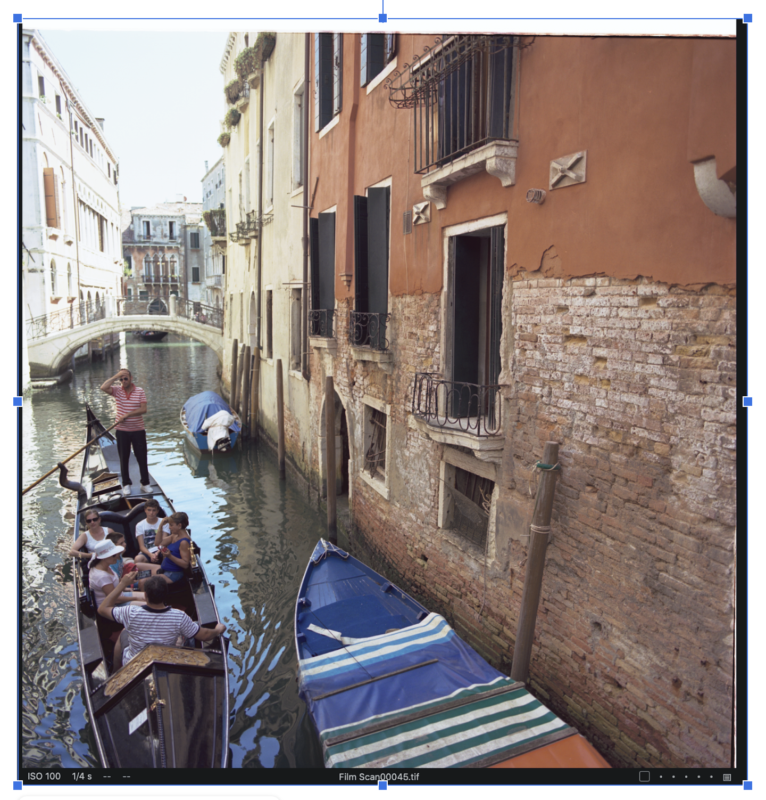

It ships with profiles for Kodak Portra 400, Portra 160 and Ektar 100, each for a white LED and for a narrow-band
RGB LED. The profiles were made with a Sony A7R IV. Scans from other cameras and lamps work with the white-LED
profiles; there are examples further down.

You can try it without building anything at [negicc-web](https://negicc-web-dmin4o4cra-uc.a.run.app): upload a RAW,
DNG, TIFF or JPEG and it runs `neg_process` on it. The longer story of how the method came about is in this
[guide](https://docs.google.com/document/d/1NsfFPx5c7kxNRUhuGQBKRNnaN0c52SjLsZsyhLCj3OE/edit?usp=sharing).

## Build

```bash
sudo apt-get install build-essential git python3 python3-pip   # plus libjpeg-dev for LIBRAW_JPEG=1
pip install torch transformers onnx                             # only needed for `make dinov3_model`
git clone --recursive https://github.com/arufahc/negicc.git && cd negicc
make dinov3_model && make -j$(nproc) neg_process                # add USE_CUDA=1 for an NVIDIA GPU
```

LibRaw, Little-CMS 2, zlib, libtiff and libjpeg-turbo are built from the submodules in `3rd_party/`
([3rd_party/README.md](3rd_party/README.md)). The vision model runs through ONNX Runtime or TensorRT.

## Use

```bash
bin_out/neg_process --list_profiles

# White LED, 35mm. The frame is found automatically.
bin_out/neg_process --film_stock portra400 --light_source d65 --roi auto --film_format 35mm -P srgb -o out.tif scan.ARW

# Narrow-band RGB LED.
bin_out/neg_process --film_stock portra400 --light_source tri -P srgb -o out.tif scan.ARW

# Sony 4-shot pixel shift: give the four RAWs.
bin_out/neg_process --film_stock ektar100 --light_source tri -P srgb -o out.tif ps1.ARW ps2.ARW ps3.ARW ps4.ARW

# Three separate frames under red, green and blue light.
bin_out/neg_process --film_stock portra160 --light_source tri -r "1 0 0" -g "0 1 0" -b "0 0 1" -P srgb -o out.tif r.ARW g.ARW b.ARW

# 6x7 on a white LED, with LibRaw's DCB demosaic.
bin_out/neg_process --film_stock portra400 --light_source d65 -q 4 --roi auto --film_format 6x7 -P srgb -o out.tif scan.ARW

# Set the bracket, exposure and gains yourself. On RGB-LED scans, giving a gain turns the automatic search off.
bin_out/neg_process --film_stock portra400 --light_source tri --target 4 -E 1.15 --gain_g 0.98 --gain_b 1.04 -P srgb -o out.tif scan.ARW

# White LED: fix only the bracket. Everything else is found as usual, on that bracket.
bin_out/neg_process --film_stock portra400 --light_source d65 --target 4 -P srgb -o out.tif scan.ARW
```

On white-LED scans, `--target`, `-E`, `--gain_g` and `--gain_b` each fix one thing and leave the rest automatic: the
search, the curve fit and the contrast step still run, holding what you gave. Add `--fit_curves off` to convert with
the given values and nothing else.

Next to `out.tif` it writes `out.tif.json` with everything it decided. `--brightness`, `--tint` and `--warmth`
adjust the result from that file without running the model again.

## How it works

A colour negative has three dye layers on an orange base, and the layers do not respond to light in step with each
other. Inverting the photo and stretching the histogram gets the colours wrong for that reason, and gets them wrong
differently at every exposure.

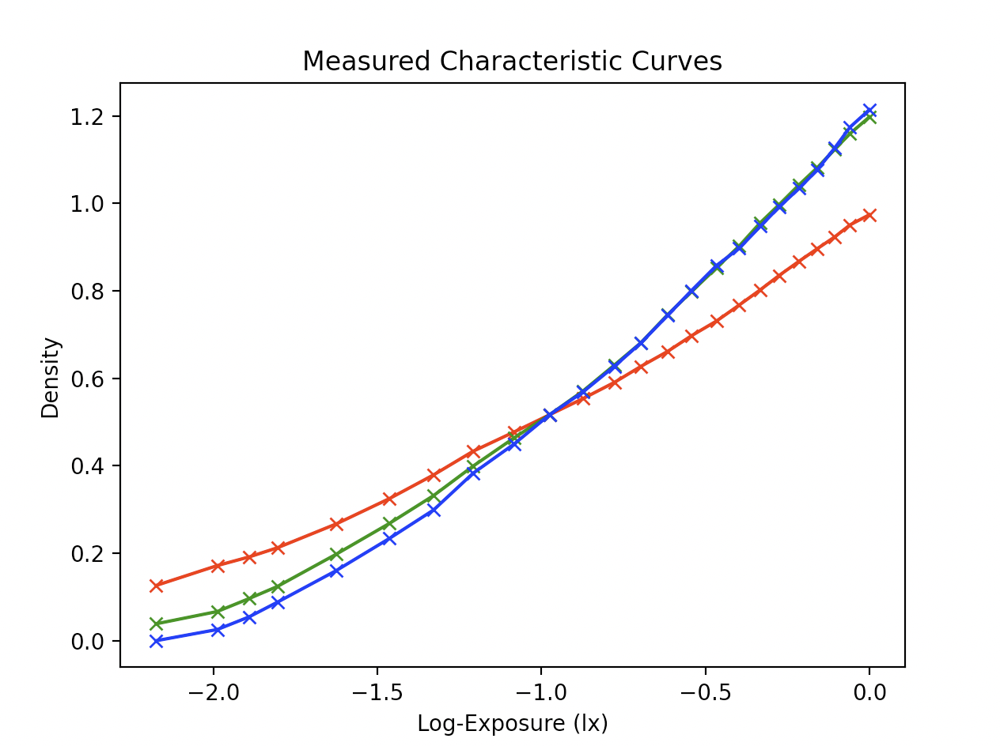

negicc handles this in two parts. The film's behaviour is measured once per stock and stored in profiles. What a
given picture should look like is decided per frame by a vision model.

### The light

`neg_process` reads camera RAWs, DNGs and 16-bit linear TIFFs.

With a white LED (`--light_source d65`) any camera works. The lamp's colour is taken out using the film base found
in the scan itself, so your lamp does not have to match the one the profiles were made with.

With a narrow-band RGB LED (`--light_source tri`) each colour of light falls on one dye, which separates the layers
better. One RAW is enough. Pixel-shift sets and three separate R, G and B frames also work.

Single-shot RGB-LED scans from Sony sensors go through negicc's own demosaic, which was written to stop film grain
turning into maze patterns. Measured against a pixel-shift capture of the same frame it is about 1.2 dB better than
bilinear and 0.5 dB better than LibRaw's DCB. Everything else is demosaiced by LibRaw; `-q` chooses the method.

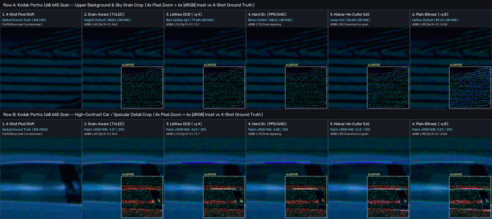

### The profiles

For each stock an IT8 chart was photographed onto the film at seven exposures, from three stops under to three stops
over, and each frame was scanned under both lights.

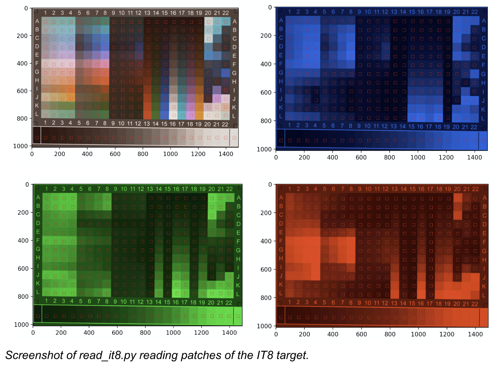

Each exposure became an ICC profile: tone curves that straighten the film's response, then a 3D table for the
colour. Together the seven cover 12 to 13 stops of scene brightness. A frame is converted with the profile nearest
its own exposure.

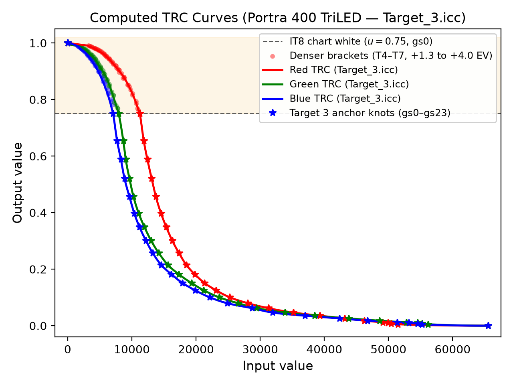
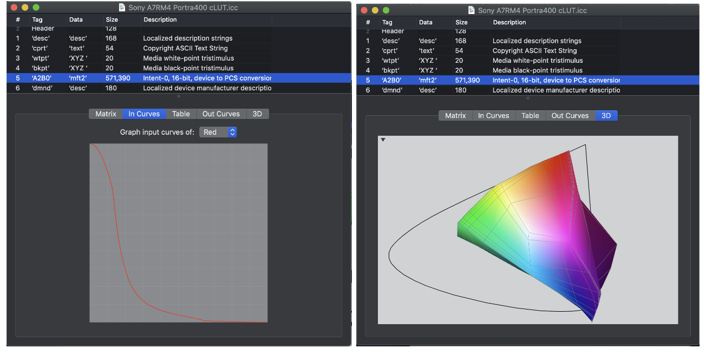
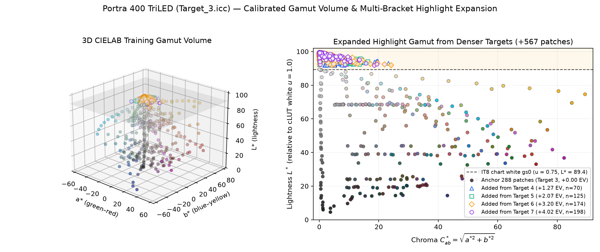

On the chart patches used for the fit the profiles average 0.5 to 0.8 ΔE₀₀. On patches held out of the fit the
typical error is 1.4 to 2.3. The tables are in [MEASUREMENTS.md](MEASUREMENTS.md).

### Choosing exposure and colour

The profiles describe the film. They do not know how bright a particular picture should be or what its colour
balance is. For that, negicc runs Meta's DINOv3 vision model over a preview and reads three small heads trained on
lab scans:

| Head | What it predicts | What it is used for |
|---|---|---|
| Intent | the colour each part of the picture should have | choosing the profile, exposure and colour balance |
| Neutral ([models/neutral_head](models/neutral_head/README.md)) | which parts are neutral surfaces | removing casts that differ between shadows and highlights |
| Tone ([models/tone_head](models/tone_head/README.md)) | how dark the shadows, how bright the highlights and how wide the range should be | contrast |

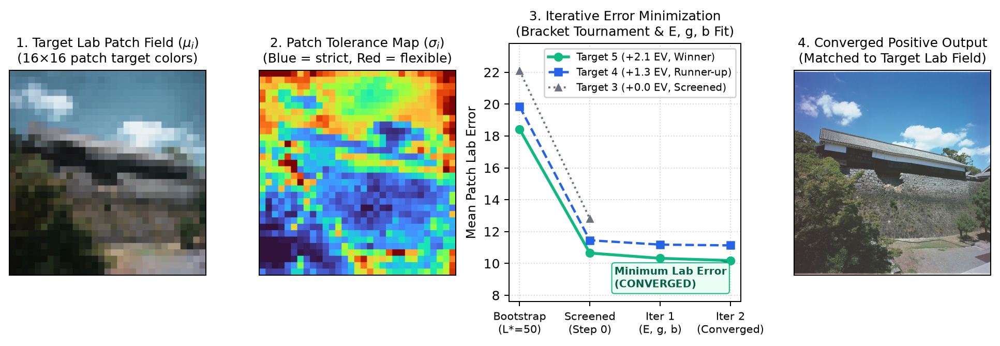

A conversion goes through these steps:

1. Find the frame and the film base, and work out which exposure profiles can hold the scene.
2. Search. Render the candidates, compare each with what the intent head predicts, adjust exposure and the green and
   blue gains, and repeat until it settles. This step runs for both lights.
3. Fit the curves (white light only). Gains cannot remove a cast that is warm in the shadows and cool in the
   highlights. The slopes of the green and blue curves are adjusted until the surfaces the neutral head picked out
   are grey. The same fit sets the overall magenta-green balance from the intent head. A result greener than the
   search's is not accepted, apart from a small tolerance and the deep shadows.
4. Set the contrast (white light only). One lightness curve moves the picture toward the tone head's prediction.

On the frame below the first render is cyan-green and the search brings it to a daylight balance.

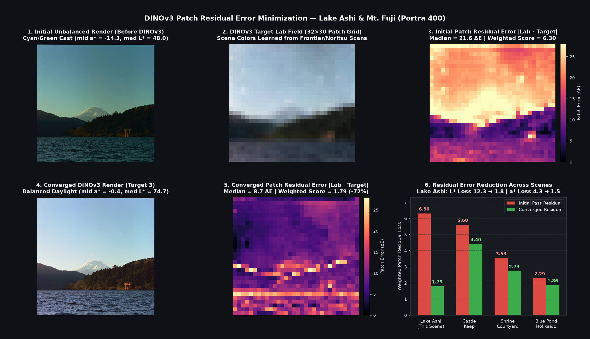

[DESIGN.md](DESIGN.md) has the formulas, every number these steps depend on, and a list of what is known not to
work well yet.

## Scans from other cameras

Three scans people posted on the [pixls.us](https://discuss.pixls.us) forum, taken with cameras and lamps the
profiles were not made with. Left: the scan as the camera saw it. Right: `neg_process` with
`--film_stock portra400 --light_source d65 -P srgb`. The frame crop was given by hand.

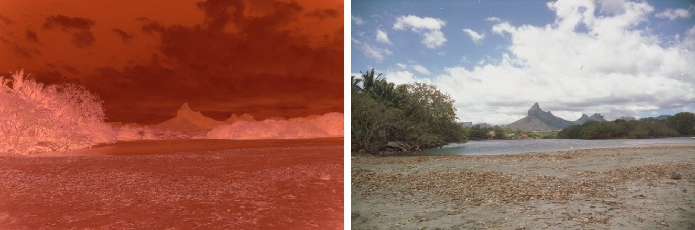

*Canon EOS 5DS R.* [Mauritius Mountain with River Mouth](https://discuss.pixls.us/t/50730/1), posted by gsinha,
2025-06-16.

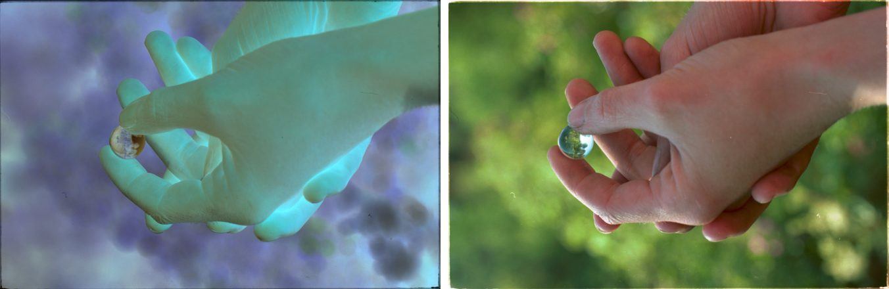

*Nikon D810.* [Negative inversion challenge! Skin tones and greens](https://discuss.pixls.us/t/59155/1), posted by
DanielE, 2026-07-11. Converted with `--fit_curves off`.

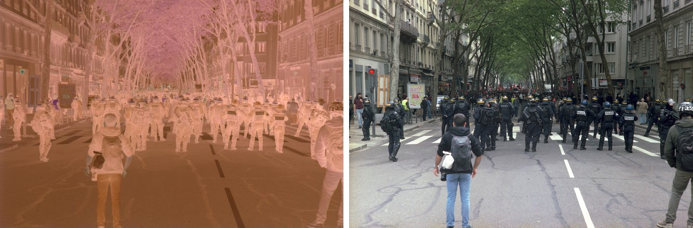

*Canon EOS R.* [Fête du Travail](https://discuss.pixls.us/t/45538/1), posted by jonathanBieler, 2024-09-13.

The RAW files and the pictures belong to the photographers who posted them. No copyright is claimed on them here.
If one of them is yours and you want it removed, open an issue.

## Options

`bin_out/neg_process --help` lists everything. The common ones:

| Option | Meaning |
| :--- | :--- |
| `--film_stock`, `--light_source tri\|d65` | A built-in profile set (`--list_profiles` lists them). |
| `-p`, `--film_profile` | A profile set's JSON or directory, or a single ICC profile. |
| `-P`, `--colorspace srgb\|srgb-g10\|<icc>` | Output encoding. The highlight roll-off and the contrast step need `srgb`; the curve fit needs `srgb` or `srgb-g10`. |
| `-o`, `--output` | The TIFF. `<output>.json` is written next to it unless `--no-metadata` is given. |
| `--target N` | The exposure bracket, by index (from 0) or name. The search runs on that bracket only. |
| `-E`, `--exposure_comp` | Exposure gain. The search keeps it and finds the rest. |
| `--gain_g`, `--gain_b` | Green and blue gains relative to red (default 1). White LED: the search and the curve fit keep them and find the rest. RGB LED: giving either turns the search off. |
| `--brightness`, `--tint`, `--warmth` | Adjustments applied after the search and the curve fit, to found and given values alike. They reuse `<output>.json` from the same inputs. |
| `--fit_curves auto\|off\|on\|<numbers>` | The curve fit. `auto` (default) runs it wherever it applies. `off` skips it and the contrast step; a sidecar's replay command carries it when neither ran. `on` is an error where it does not apply. Eight or ten numbers replay the curves recorded in a sidecar. |
| `--tone_stage curve:<numbers>` | Replays the lightness curve recorded in a sidecar (black, white, gamma, contrast). |
| `--roi auto [h\|v]` or `--roi x y w h [rot [hflip [vflip]]]` | The frame: detected, or given in sensor pixels. |
| `--film_format 35mm\|645\|6x6\|6x7\|6x9\|auto` | The format `--roi auto` looks for (default 35mm). |
| `--rot`, `--hflip`, `--vflip` | Orientation of the output. |
| `-q`, `--quality` | Demosaic: −1 automatic, or a LibRaw quality (4 is DCB). |
| `-r`, `-g`, `-b` | Rows of the crosstalk matrix (default: the profile set's). |
| `-C`, `--no_crop` | Keep the RAW's full area. |
| `--flat` | A flat-field `.npz` measured on the empty gate. |
| `--dino <head>:<file>,...` | Use your own models: `intent` (an `.onnx` file or its directory), `neutral`, `tone`. A path with no head name is the intent model. |
| `--dino_backend auto\|cpu\|gpu`, `--dino_iters` | Where the vision model runs, and how many search iterations. |

`--tint_trim` was removed. If you replay an older sidecar's command line, drop it.

## Hardware the profiles were made with

Sony A7R IV (`ILCE-7RM4`); a [Shoebox Photos BCS](https://www.shoeboxphotosbcs.com) RGB LED light for the RGB-LED
profiles and a white D65 LED panel for the white-LED ones; the coloraid.de `R190808` IT8.7/2 target.

## Licences

negicc is GPL-3.0 (`COPYING`). The DINOv3 backbone in `models/dinov3-small/backbone.onnx` is packed into the
`neg_process` binary. It is Meta's, under the DINOv3 License (`models/dinov3-small/LICENSE.md`): distribute it, or a
binary built with it, only under that licence and with a copy of it. The scans in `samples/web_*.jpg` are other
people's photographs, credited above.
