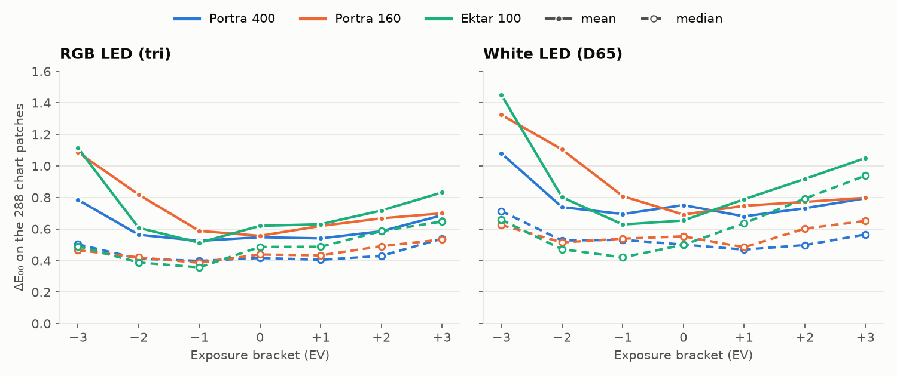

# negicc

`neg_process` converts a camera photo of a colour negative into a positive. You give it the RAW file and the film
stock; it picks exposure, colour balance and contrast and writes a 16-bit TIFF.


It ships with profiles for Kodak Portra 400, Portra 160 and Ektar 100, each for a white LED and for a narrow-band
RGB LED. The profiles were made with a Sony A7R IV. Scans from other cameras and lamps work with the white-LED
profiles; there are examples further down.

You can try it without building anything at [negicc-web](https://negicc-web-dmin4o4cra-uc.a.run.app): upload a RAW,
DNG, TIFF or JPEG and it runs `neg_process` on it. The longer story of how the method came about is in this
[guide](https://docs.google.com/document/d/1NsfFPx5c7kxNRUhuGQBKRNnaN0c52SjLsZsyhLCj3OE/edit?usp=sharing).

## Build

```bash
sudo apt-get install build-essential git python3 python3-pip   # plus libjpeg-dev for LIBRAW_JPEG=1
pip install torch transformers onnx                             # only needed for `make dinov3_model`
git clone --recursive https://github.com/arufahc/negicc.git && cd negicc
make dinov3_model && make -j$(nproc) neg_process                # add USE_CUDA=1 for an NVIDIA GPU
```

LibRaw, Little-CMS 2, zlib, libtiff and libjpeg-turbo are built from the submodules in `3rd_party/`
([3rd_party/README.md](3rd_party/README.md)). The vision model runs through ONNX Runtime or TensorRT.

## Use

```bash
bin_out/neg_process --list_profiles

# White LED, 35mm. The frame is found automatically.
bin_out/neg_process --film_stock portra400 --light_source d65 --roi auto --film_format 35mm -P srgb -o out.tif scan.ARW

# Narrow-band RGB LED.
bin_out/neg_process --film_stock portra400 --light_source tri -P srgb -o out.tif scan.ARW

# Sony 4-shot pixel shift: give the four RAWs.
bin_out/neg_process --film_stock ektar100 --light_source tri -P srgb -o out.tif ps1.ARW ps2.ARW ps3.ARW ps4.ARW

# Three separate frames under red, green and blue light.
bin_out/neg_process --film_stock portra160 --light_source tri -r "1 0 0" -g "0 1 0" -b "0 0 1" -P srgb -o out.tif r.ARW g.ARW b.ARW

# 6x7 on a white LED, with LibRaw's DCB demosaic.
bin_out/neg_process --film_stock portra400 --light_source d65 -q 4 --roi auto --film_format 6x7 -P srgb -o out.tif scan.ARW

# Set the bracket, exposure and gains yourself. On RGB-LED scans, giving a gain turns the automatic search off.
bin_out/neg_process --film_stock portra400 --light_source tri --target 4 -E 1.15 --gain_g 0.98 --gain_b 1.04 -P srgb -o out.tif scan.ARW

# White LED: fix only the bracket. Everything else is found as usual, on that bracket.
bin_out/neg_process --film_stock portra400 --light_source d65 --target 4 -P srgb -o out.tif scan.ARW
```

On white-LED scans, `--target`, `-E`, `--gain_g` and `--gain_b` each fix one thing and leave the rest automatic: the
search, the curve fit and the contrast step still run, holding what you gave. Add `--fit_curves off --tone_stage off`
to convert with the given values and nothing else.

Next to `out.tif` it writes `out.tif.json` with everything it decided. `--brightness`, `--tint` and `--warmth`
adjust the result from that file without running the model again.

### Density instead of a picture

With an RGB-LED scan, `-P statusm`, `-P rp180` or `-P apd` writes the negative as density above the film base, with
no conversion to a picture, for grading tools and film-print LUTs:

```bash
# SMPTE RP 180 printing density in a 10-bit DPX: a Cineon file.
bin_out/neg_process --film_stock portra400 --light_source tri -P rp180 --roi auto -o scan.dpx scan.ARW

# Academy Printing Density in a 16-bit TIFF: ADX16. The film base comes from a capture of unexposed film.
bin_out/neg_process --film_stock portra400 --light_source tri -P apd --film_base base.ARW --roi auto -o scan.tiff scan.ARW
```

| `-P` | Density | In a `.dpx` | In a `.tif` / `.tiff` |
| :--- | :--- | :--- | :--- |
| `statusm` | Status M | Status M at the Cineon scaling | Status M at 8000 codes per unit density |
| `rp180` | SMPTE RP 180 printing density | Cineon | RP 180 at 8000 codes per unit density |
| `apd` | Academy Printing Density (SMPTE ST 2065-2) | ADX10 | ADX16 |

The output's extension picks the file. A `.dpx` holds 10 bits, `code = 95 + 500 × k × D`, and clips at about 1.86
density above the base. A TIFF holds 16 bits, `code = 1520 + 8000 × k × D`. `k` is 1 for `statusm` and `rp180`.
For `apd` it is the channel factor of ADX (SMPTE ST 2065-3): 1.00 for red, 0.92 for green and 0.95 for blue, so a
tool that reads the file as ADX gets Academy Printing Density back. The factors are recorded in the file
(`encoding.channel_factors`). Pixels that run off either end are counted in the sidecar.

A density file's zero is the film base. Without `--film_base` the base is read from the scan: from the rebate when
the frame shows one, else estimated from the thinnest film in the frame, which is too dark wherever the frame has no
unexposed film. `neg_process` warns in that case, and when the base is the profile's own roll's.

Each pixel is divided by the film base, its logarithm is taken, and a 3×3 matrix turns the densities the LED sees
into the measure asked for. The matrices were fitted from the LED's measured spectrum, the film's dye spectra and
the measure's published response curves, and are part of the profile set (`density_matrices` in `bundle.json`,
with the spectrum under `light_source`). They are computed from datasheet spectra and have not been checked against
a densitometer.

How well a 3×3 matrix reproduces each measure on the film model, as each bundle records it (`fit_rms_density`,
`fit_max_density`), across the three stocks. The fit covers the densities a scan reaches (the film's neutral scale
between log exposure −1.5 and 1.0, about 2.2 above the base):

| Measure | RMS error (density) | Worst case (density) |
| :--- | :--- | :--- |
| Status M | up to 0.004 | up to 0.04, in green |
| RP 180 printing density | up to 0.004 in red and green, up to 0.010 in blue | up to 0.10, in blue |
| Academy Printing Density | up to 0.010 in red, 0.002 in green and blue | up to 0.08, in red |

These are errors against the model, not against the film. Two rows rest on film data that does not exist: the
datasheets give no base density below about 400 nm or above about 700 nm, and the fit holds the nearest measured
value there. RP 180 blue has up to 6% of its response below that range. Above it, RP 180 red has 4%, 7% and 26%
of its response and Academy Printing Density red 20%, 30% and 59% (Portra 400, Portra 160, Ektar 100). Take those
rows as approximate (`response_outside_film_data` in the bundle).

The Status M matrix is then calibrated on the profile's own film. The grey scale of the profile's chart, shot at
seven exposures, is held to the Status M density of the film model's neutral scale: one factor on the green and one
on the blue density the LED sees (`density_matrices.neutral_calibration`; the matrix before the factors is
`spectral_fit_matrix`). The factors are 1.02 and 1.06 for Portra 400 and 0.96 and 0.97 for Portra 160. Ektar 100's
(0.83 and 1.08) lie more than 0.10 from 1 and are recorded, not applied: that roll or scan differs from the model by
more than two factors should hide. The two printing densities have no such reference and are the fit from the
spectra alone.

The matrices assume the camera sees each LED band evenly. How the sensor's sensitivity varies inside a band is not
modelled.

Both files carry the matrix that was applied, the LED's spectrum, the film base and the encoding as JSON: a TIFF in
its `ImageDescription` tag, a DPX in its user-defined data. The sidecar has the same record.

`--flat` applies to a density output as it does to a picture: the flat field corrects the scan and the film base
capture before the density is taken, so the light's fall-off towards the corners does not read as density.

Density takes no bracket, exposure, gain, curve fit, contrast step or look option, and no white-LED scan. The
densities are the film as measured. The search that balances a picture still runs, and the colour balance it finds
for the frame is recorded in the file and the sidecar, not applied (`suggested_balance`: one density offset per
channel, summing to zero, that a grading tool can add). The sidecar
counts the pixels that ran off either end of the code range, and those too dense to measure.

A printing density file (`rp180`, `apd`) also records the film's print slopes (`print_slopes`), again not applied.
A film whose three channels differ in contrast prints a grey scale that drifts in colour from shadows to highlights,
which no printer-light setting removes. The slopes are one density scale per channel, about a reference grey, that
does, for a print material: Kodak Portra Endura paper and Kodak Vision 2383 print film. They are measured on the
grey steps of the profile's chart, for each of its seven exposures (a frame takes those of its own bracket), through a model of the print material (spektrafilm's print
profiles); the model has not been compared with a real print.

Beside a printing density file goes one Common LUT Format (CLF) transform per print material, named after the
output: `scan.kodak_portra_endura.clf` and `scan.kodak_2383.clf` for `scan.tif`. Each takes the file's code values
to the print as sRGB. Its first node is a matrix for the frame: the colour balance, the exposure and the slopes,
none of which the density file holds. The exposure places the frame's mid grey, the chart's mid grey on the bracket
and at the exposure the search gave the frame, on the print's mid grey. The nodes after it are the print material
alone (its curves and dyes, `prints/`). Any tool that reads CLF renders the picture, for example with OpenImageIO:

```sh
oiiotool scan.tif --ociofiletransform scan.kodak_portra_endura.clf -o print.jpg
```

To print lighter or darker, add a constant to the three offsets of the first matrix (0.30 is a stop). The balance
and the slopes are applied there and nowhere else: do not also add them by hand from the metadata.

### The film base from a capture

`--film_base base.ARW` reads the film base from a capture that shows unexposed film: a whole frame of it, or a
picture with a strip of rebate beside it. The base is used for a picture or for density. The capture is decoded as
the scan is and scaled to the scan's exposure. The brightest smooth stretch of film anywhere on it is found, leaving
out dust, scratches, clipped areas, and anything that is not the colour of film base, such as bare light beside the
film. `--film_base base.ARW:x,y,w,h` gives the region in sensor pixels. It
needs an RGB-LED profile set and a Sony RAW. Give the same `--flat` as for the scan.

A later run to the same output, with the same inputs and the same `--flat`, takes that base back from
`<output>.json`, so the capture is not needed again. `--film_base scan` reads the base from the scan itself
instead. Without a capture, and with no earlier capture recorded for the output, the base is read from the scan
as before.

## How it works

A colour negative has three dye layers on an orange base, and the layers do not respond to light in step with each
other. Inverting the photo and stretching the histogram gets the colours wrong for that reason, and gets them wrong
differently at every exposure.


negicc handles this in two parts. The film's behaviour is measured once per stock and stored in profiles. What a
given picture should look like is decided per frame by a vision model.

### The light

`neg_process` reads camera RAWs, DNGs and 16-bit linear TIFFs.

With a white LED (`--light_source d65`) any camera works. The lamp's colour is taken out using the film base found
in the scan itself, so your lamp does not have to match the one the profiles were made with.

With a narrow-band RGB LED (`--light_source tri`) each colour of light falls on one dye, which separates the layers
better. One RAW is enough. Pixel-shift sets and three separate R, G and B frames also work.

Single-shot RGB-LED scans from Sony sensors go through negicc's own demosaic, which was written to stop film grain
turning into maze patterns. Measured against a pixel-shift capture of the same frame it is about 1.2 dB better than
bilinear and 0.5 dB better than LibRaw's DCB. Everything else is demosaiced by LibRaw; `-q` chooses the method.


Single-shot TriLED scans on a Sony RGGB sensor, against a 4-shot pixel-shift capture of the same frame.

| Algorithm | Raw MAE ↓ | Positive PSNR (dB) ↑ | Positive ΔE₀₀ mean / p95 ↓ | R−G zipper ↓ |
| :--- | :---: | :---: | :---: | :---: |
| 4-shot pixel shift (ground truth) | 0.00 | ∞ | 0.00 / 0.00 | 142.4 |
| **Grain-aware colour-ratio** (TriLED default) | **80.81** | **40.38** | **1.69 / 6.86** | 56.5 |
| LibRaw DCB (`-q 4`) | 79.60 | 39.85 | 1.76 / 7.21 | 71.7 |
| LibRaw VNG (`-q 1`) | 80.19 | 39.96 | 1.75 / 7.12 | 58.6 |
| PPG / AHD (`-q 2` / `-q 3`) | 80.61 | 40.03 | 1.73 / 6.97 | 55.3 (grain maze) |
| Bilinear (`-q 0`) | 89.15 | 39.16 | 1.90 / 7.87 | 115.0 |

Raw MAE is in 14-bit LSB; PSNR and ΔE₀₀ are measured on the inverted positive.

### The profiles

For each stock an IT8 chart was photographed onto the film at seven exposures, from three stops under to three stops
over, and each frame was scanned under both lights.


Each exposure became an ICC profile: tone curves that straighten the film's response, then a 3D table for the
colour. Together the seven cover 12 to 13 stops of scene brightness. A frame is converted with the profile nearest
its own exposure.


How closely each profile reproduces the chart, measured with ArgyllCMS `profcheck` on all 288 patches (CIEDE2000;
under 2 is barely visible):



Under the RGB LED the error is well below 1 ΔE₀₀: the median is 0.4 to 0.7 in every bracket, and the mean is at most
0.83 from −2 to +3 EV, rising to 1.1 only at −3 EV on Portra 160 and Ektar 100. Under the white LED the mean is 0.6
to 1.5 and the median 0.4 to 0.9. On both lights the error is lowest in the middle brackets and highest at −3 EV.
On patches held out of the fit the median error is 1.3 to 2.3. Each bundle's README has its numbers per bracket,
fitted and held out: [Portra 400 RGB LED](profiles/Portra400-A7R4-TriLED/README.md),
[white LED](profiles/Portra400-A7R4-D65/README.md); [Portra 160 RGB LED](profiles/Portra160-A7R4-TriLED/README.md),
[white LED](profiles/Portra160-A7R4-D65/README.md); [Ektar 100 RGB LED](profiles/Ektar100-A7R4-TriLED/README.md),
[white LED](profiles/Ektar100-A7R4-D65/README.md).

### Choosing exposure and colour

The profiles describe the film. They do not know how bright a particular picture should be or what its colour
balance is. For that, negicc runs Meta's DINOv3 vision model over a preview and reads three small heads trained on
lab scans:

| Head | What it predicts | What it is used for |
|---|---|---|
| Intent | the colour each part of the picture should have | choosing the profile, exposure and colour balance |
| Neutral ([models/neutral_head](models/neutral_head/README.md)) | which parts are neutral surfaces | removing casts that differ between shadows and highlights |
| Tone ([models/tone_head](models/tone_head/README.md)) | how dark the shadows, how bright the highlights and how wide the range should be | contrast |


A conversion goes through these steps:

1. Find the frame and the film base, and work out which exposure profiles can hold the scene.
2. Search. Render the candidates, compare each with what the intent head predicts, adjust exposure and the green and
   blue gains, and repeat until it settles. This step runs for both lights.
3. Fit the curves (white light only). Gains cannot remove a cast that is warm in the shadows and cool in the
   highlights. The slopes of the green and blue curves are adjusted until the surfaces the neutral head picked out
   are grey. The same fit sets the overall magenta-green balance from the intent head. A result greener than the
   search's is not accepted, apart from a small tolerance and the deep shadows.
4. Set the contrast (both lights). One lightness curve moves the picture toward the tone head's prediction.

With the RGB LED the curves are the measured ones, so step 3 does not run there: the profiles were made under that
light, and there is no lamp or camera difference for a fit to correct.

On the frame below the first render is cyan-green and the search brings it to a daylight balance.


[DESIGN.md](DESIGN.md) has the formulas, every number these steps depend on, and a list of what is known not to
work well yet.

## Scans from other cameras

Three scans people posted on the [pixls.us](https://discuss.pixls.us) forum, taken with cameras and lamps the
profiles were not made with. Left: the scan as the camera saw it. Right: `neg_process` with
`--film_stock portra400 --light_source d65 --roi auto -P srgb`, everything else automatic.


*Canon EOS 5DS R.* [Mauritius Mountain with River Mouth](https://discuss.pixls.us/t/50730/1), posted by gsinha,
2025-06-16.


*Nikon D810.* [Negative inversion challenge! Skin tones and greens](https://discuss.pixls.us/t/59155/1), posted by
DanielE, 2026-07-11.


*Canon EOS R.* [Fête du Travail](https://discuss.pixls.us/t/45538/1), posted by jonathanBieler, 2024-09-13.

The RAW files and the pictures belong to the photographers who posted them. No copyright is claimed on them here.
If one of them is yours and you want it removed, open an issue.

## Options

`bin_out/neg_process --help` lists everything. The common ones:

| Option | Meaning |
| :--- | :--- |
| `--film_stock`, `--light_source tri\|d65` | A built-in profile set (`--list_profiles` lists them). |
| `-p`, `--film_profile` | A profile set's JSON or directory, or a single ICC profile. |
| `-P`, `--colorspace srgb\|srgb-g10\|<icc>` | Output encoding. The highlight roll-off and the contrast step need `srgb`; the curve fit needs `srgb` or `srgb-g10`. |
| `-P statusm\|rp180\|apd` | Density above the film base in place of a picture (RGB LED only): Status M, SMPTE RP 180 printing density, or Academy Printing Density. Beside an `rp180` or `apd` file goes one CLF per print material (`<output>.<print>.clf`) that renders it as a print, sRGB. |
| `-o`, `--output` | The TIFF. `<output>.json` is written next to it unless `--no-metadata` is given. A density goes to a `.dpx` (10 bits) or a `.tif` / `.tiff` (16 bits). |
| `--film_base auto\|scan\|<file>[:x,y,w,h]` | The film base. `scan`: read from the scan. A file: read from a capture of unexposed film, over a region in sensor pixels when given. `auto` (default): the base an earlier run to this output read from a capture, when there is one that still applies; otherwise from the scan. |
| `--target N` | The exposure bracket, by index (from 0) or name. The search runs on that bracket only. |
| `-E`, `--exposure_comp` | Exposure gain. The search keeps it and finds the rest. |
| `--gain_g`, `--gain_b` | Green and blue gains relative to red (default 1). White LED: the search and the curve fit keep them and find the rest. RGB LED: giving either turns the search off. |
| `--brightness`, `--tint`, `--warmth` | Adjustments applied after the search and the curve fit, to found and given values alike. They reuse `<output>.json` from the same inputs. |
| `--fit_curves auto\|off\|on\|<numbers>` | The curve fit. `auto` (default) runs it wherever it applies. `off` skips it. `on` is an error where it does not apply (it never applies to the RGB LED). Eight or ten numbers replay the curves recorded in a sidecar. |
| `--tone_stage auto\|off\|on\|curve:<numbers>` | The contrast step. `auto` (default) runs it after every automatic search with `-P srgb`, on both lights. `off` skips it. `on` is an error where it does not apply. `curve:` with four numbers replays the lightness curve recorded in a sidecar (black, white, gamma, contrast). A sidecar's replay command carries `--fit_curves off --tone_stage off` when neither step ran. |
| `--roi auto [h\|v]` or `--roi x y w h [rot [hflip [vflip]]]` | The frame: detected, or given in sensor pixels. |
| `--film_format 35mm\|645\|6x6\|6x7\|6x9\|auto` | The format `--roi auto` looks for (default 35mm). |
| `--rot`, `--hflip`, `--vflip` | Orientation of the output. |
| `-q`, `--quality` | Demosaic: −1 automatic, or a LibRaw quality (4 is DCB). |
| `-r`, `-g`, `-b` | Rows of the crosstalk matrix (default: the profile set's). |
| `-C`, `--no_crop` | Keep the RAW's full area. |
| `--flat` | A flat-field `.npz` measured on the empty gate. |
| `--dino <head>:<file>,...` | Use your own models: `intent` (an `.onnx` file or its directory), `neutral`, `tone`. A path with no head name is the intent model. |
| `--dino_backend auto\|cpu\|gpu`, `--dino_iters` | Where the vision model runs, and how many search iterations. |

`--tint_trim` was removed. If you replay an older sidecar's command line, drop it.

## Hardware the profiles were made with

Sony A7R IV (`ILCE-7RM4`); a [Shoebox Photos BCS](https://www.shoeboxphotosbcs.com) RGB LED light for the RGB-LED
profiles and a white D65 LED panel for the white-LED ones; the coloraid.de `R190808` IT8.7/2 target.

## Licences

negicc is GPL-3.0 (`COPYING`). The DINOv3 backbone in `models/dinov3-small/backbone.onnx` is packed into the
`neg_process` binary. It is Meta's, under the DINOv3 License (`models/dinov3-small/LICENSE.md`): distribute it, or a
binary built with it, only under that licence and with a copy of it. The scans in `samples/web_*.jpg` are other
people's photographs, credited above.
