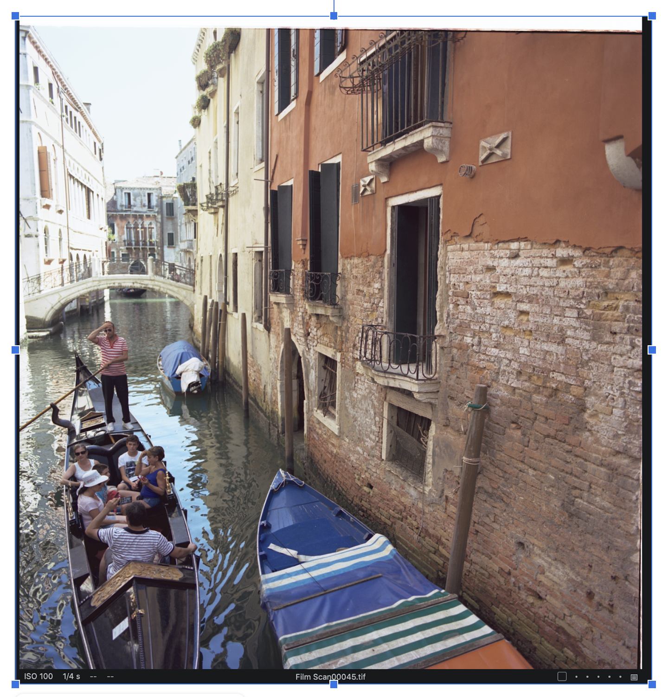
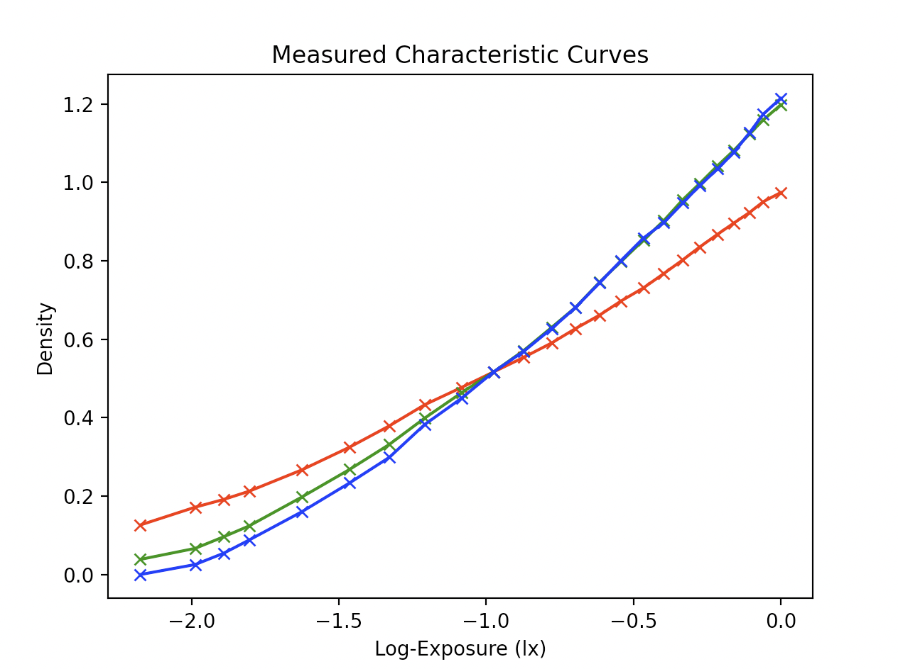
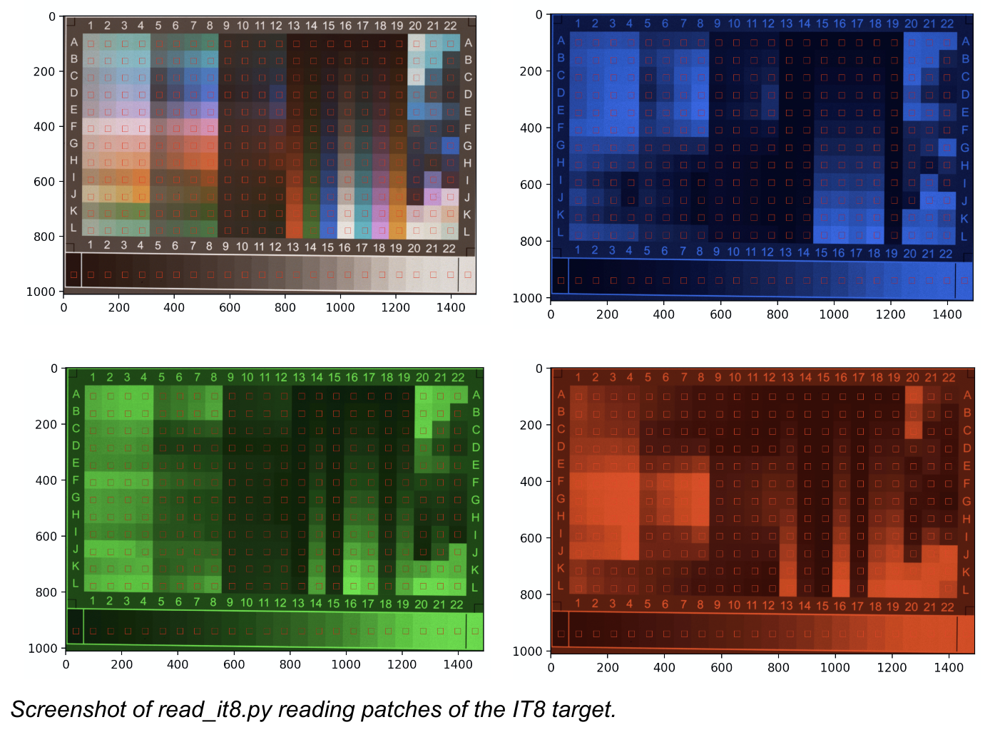
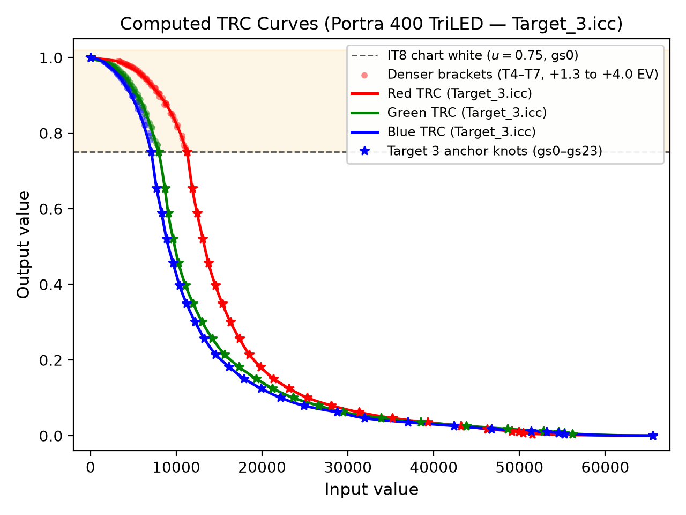
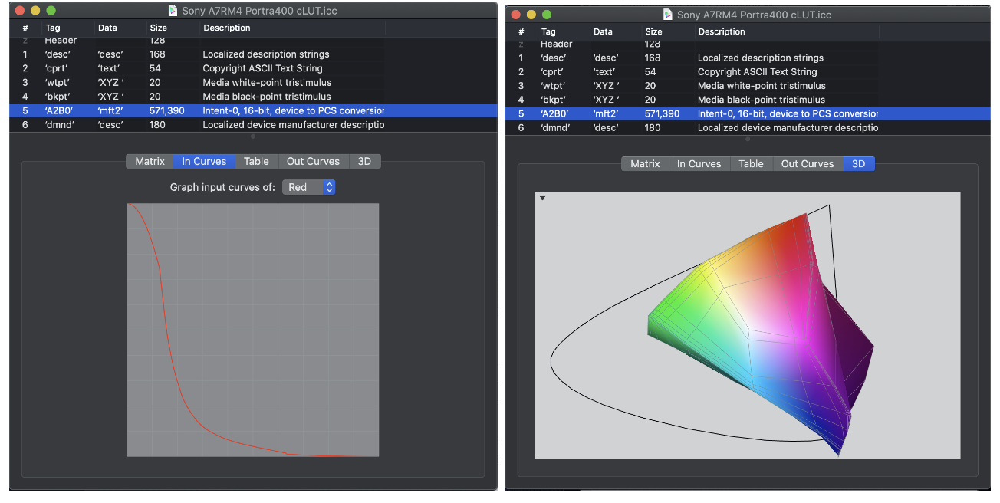
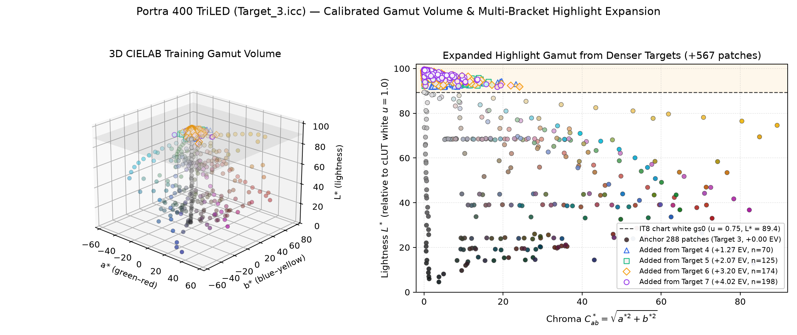
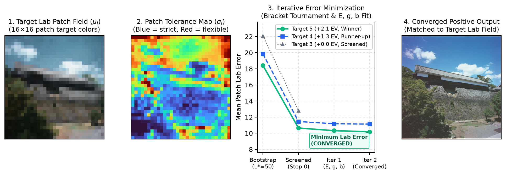
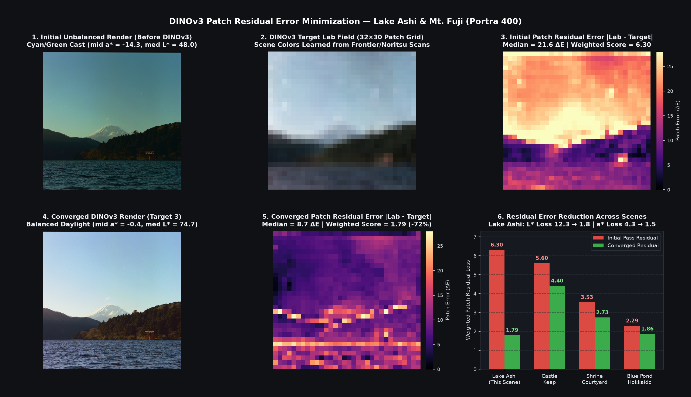

# Objective

NegICC creates ICC profiles and converts color negatives captured with a digital camera into consistent, color-accurate positive images. The ICC profiles and conversion tool (`neg_process`) have the following properties:
* Allow color balance and exposure adjustments while preserving film dye characteristics
* Produce neutral, accurate color ready for display or further editing in standard photo editors
* Include **3 manually profiled film stocks** (**Kodak Portra 400**, **Portra 160**, and **Ektar 100**), each photographed and calibrated across **7 exposure brackets** under **2 light sources** (**42 ICC profiles total** in `profiles/<Key>/`, `Target_1.icc`..`Target_7.icc` under narrowband `TriLED` and white `D65` light)



# Introduction

Typical color negative conversion software operates in sRGB colorspace. However, color negative film records color information as dye density designed to be extracted with [Status M](https://law.resource.org/pub/us/cfr/ibr/001/aimm.it2.18.1996.pdf) densitometry rather than D50 or 5000K light.

The first step of scanning film with a digital camera is to produce a response that resembles Status M densitometry with good separation between the channels (see the original [guide](https://docs.google.com/document/d/1NsfFPx5c7kxNRUhuGQBKRNnaN0c52SjLsZsyhLCj3OE/edit?usp=sharing)).

# How does it work?

With narrowband RGB LED light (or a triband filter) and crosstalk correction, the RGB response is still not linear to density. From this diagram, the B and G responses of the profiled film closely resemble each other, while the R response has a different slope:



An IT8.7/2 reflective target (`R190808` from coloraid.de) photographed onto each film stock across **7 exposure brackets** is used to correct the different channel responses and invert them into linear RGB corresponding to original scene luminance:



### Simple Trichromatic (`TriLED`) & White-Light (`D65`) Capture

Capturing negatives is much simpler now and supports camera RAWs, DNGs, and 16-bit linear TIFFs without optical filter wheels:
* **Trichromatic narrowband RGB LED (`--light_source tri`):**
  * *Single-shot RAW/DNG or 4-shot Sony Pixel Shift:* Uses the bundle's $3\times 3$ sensor crosstalk correction matrix (or custom `-r`, `-g`, `-b` rows) to remove Bayer CFA channel overlap.
  * *3-shot monochromatic RGB (`r.raw g.raw b.raw`) or pre-separated TIFF/DNG:* Capturing 3 separate frames under Red, Green, and Blue LEDs isolates the channels physically with zero sensor crosstalk—use the **identity color correction** (`-r "1 0 0" -g "0 1 0" -b "0 0 1"`).
* **White D65 light (`--light_source d65`):** Single-shot capture under a standard D65 white LED panel. `neg_process` decodes the scan through LibRaw's daylight white balance and camera matrix into linear Rec.2020 with **no crosstalk matrix needed**.

### 7-Bracket Tone Curves (TRC) & Highlight Roll-Off

A single IT8 target only calibrates tones across its own **7.22-stop** range up to the chart's white patch (`gs0` at 0.75). Each film stock is photographed across **7 exposure brackets from `-3 EV` to `+3 EV`** in 1-stop steps (`Target_1`..`Target_7`, centered on `Target_4` at `0 EV`, spanning **4.6 to 5.4 stops** of fitted film density across the 7 brackets). Fitting all 7 brackets together measures each bracket's exact exposure offset and traces the film's true highlight shoulder—giving **~12 to 13 stops of total scene dynamic range** and **up to +3 stops of calibrated highlight headroom** above normal white:



The final step converts linearized RGB values into CIE XYZ / $L^*a^*b^*$ using a 16-bit Curve + **$45^3$ 3D-cLUT** encoded as an ICC profile:



# ICC Profile Description & Expanded Highlight Gamut

What makes NegICC unique is **dedicated multi-bracket physical film profiling** with decoupled tone curves and color tables. Each film stock was photographed on an IT8.7/2 target across **7 exposure brackets (`-3 EV` to `+3 EV`) under 2 light sources** and calibrated into **7 separate 16-bit Curve + $45^3$ 3D-cLUT ICC profiles** (`profiles/<Key>/Target_1.icc`..`Target_7.icc`). Each bracket's 1D tone curves (TRC) first linearize the film's exact density response at that exposure level, and the $45^3$ cLUT then maps linearized RGB to CIE $L^*a^*b^*$. Because a single target has no patches above its white patch ($L^* \approx 89.4$), NegICC injects the brighter patches from the denser, over-exposed brackets (`Target 4`–`Target 7`, `0 EV` to `+3 EV`, adding +567 highlight color samples on `Target_3.icc`) into the cLUT so the calibrated 3D CIELAB gamut volume and highlight chroma extend smoothly all the way to pure white ($L^* = 100$) without amplifying film grain.

This makes NegICC far more adaptable than generic histogram stretching or the **Cineon workflow**, which maps negative scans to density and applies a single fixed 3D cLUT. Because a Cineon LUT bakes the tone curves and color mapping together at one fixed exposure, it is too rigid for real-world exposure variations—for example, when a frame is shot at **+2 stops overexposure**, shifting density into a single LUT pushes midtones and highlights into the wrong part of the film's shoulder and dye-coupling curves. With 7 bracketed profiles, `neg_process` instead matches a `+2 EV` frame to the `+2 EV` profile (`Target_6.icc`) where the film's actual highlight response was measured, and for exposures that do not fall squarely on a bracket, applies **gamut enclosure fitting** and searches for the fine **exposure gain and color balance** using the **DINOv3 vision model** (see [DINOv3 Automatic Color Grader & Iterative Convergence](#dinov3-automatic-color-grader--iterative-convergence) below):



### Why Dedicated Per-Stock Profiles? (Own-Sample vs. Held-Out Color Accuracy)

Generic negative inversion tools apply a single curve or $3\times 3$ matrix to every film stock, which cannot untangle non-linear dye cross-coupling and typically leaves `5–10+ ΔE₀₀` color errors across saturated colors and highlights. By calibrating a dedicated 7-bracket $45^3$ 3D-cLUT per film stock, the profiles achieve **sub-`0.6 ΔE₀₀` mean (`~0.4 ΔE₀₀` median) own-sample accuracy** and **`1.4–2.3 ΔE₀₀` median error on unseen held-out color patches** (2-fold cross-validation holding out half of the 264 color patches at a time, where `< 2.0 ΔE₀₀` is barely perceptible to the human eye):

| Bracket Target (Exposure) | Portra 400 Own `ΔE₀₀` avg (med) | Portra 400 Held-Out avg (med) | Portra 160 Own `ΔE₀₀` avg (med) | Portra 160 Held-Out avg (med) | Ektar 100 Own `ΔE₀₀` avg (med) | Ektar 100 Held-Out avg (med) |
| :--- | :---: | :---: | :---: | :---: | :---: | :---: |
| **`Target 1`** (`-3 EV`) | `0.79` (`0.50`) | `2.70` (`1.91`) | `1.09` (`0.47`) | `2.35` (`1.61`) | `1.11` (`0.49`) | `3.05` (`1.87`) |
| **`Target 2`** (`-2 EV`) | `0.56` (`0.41`) | `2.04` (`1.38`) | `0.82` (`0.42`) | `2.09` (`1.55`) | `0.61` (`0.39`) | `2.68` (`1.52`) |
| **`Target 3`** (`-1 EV`) | `0.53` (`0.40`) | `2.38` (`1.40`) | `0.59` (`0.39`) | `1.96` (`1.40`) | `0.51` (`0.36`) | `2.79` (`1.55`) |
| **`Target 4`** (`0 EV` center) | **`0.55` (`0.42`)** | **`2.62` (`1.48`)** | **`0.56` (`0.44`)** | **`2.30` (`1.37`)** | **`0.62` (`0.49`)** | **`3.25` (`1.84`)** |
| **`Target 5`** (`+1 EV`) | `0.54` (`0.40`) | `2.75` (`1.46`) | `0.62` (`0.43`) | `2.65` (`1.58`) | `0.63` (`0.49`) | `3.52` (`1.75`) |
| **`Target 6`** (`+2 EV`) | `0.59` (`0.43`) | `2.92` (`1.58`) | `0.67` (`0.49`) | `2.67` (`1.62`) | `0.72` (`0.59`) | `4.01` (`2.15`) |
| **`Target 7`** (`+3 EV`) | `0.69` (`0.54`) | `3.08` (`1.77`) | `0.70` (`0.53`) | `2.82` (`1.78`) | `0.83` (`0.65`) | `3.72` (`2.26`) |

### DINOv3 Automatic Color Grader & Iterative Convergence

Instead of relying on simple grey-world heuristics, `neg_process` uses Meta's **DINOv3** vision model as an **automatic color grader** trained on real **Fujifilm Frontier and Noritsu lab scans** collected from Flickr and Photohito (`models/dinov3-small_<stock>/`). Because DINOv3 understands scene semantics, it recognizes objects in context (sky, foliage, skin tones, stone, shadows) and predicts the **target Lab color** ($\mu_i$) and **tolerance** ($\sigma_i$) that each $16\times 16$ patch of the photo should have based on learned lab-scan examples:



To convert a frame automatically:
1. **Auto Film-Base & Frame Detection:** Automatically samples the unexposed orange film base from the scan border (rebate or thinnest film; *TODO: add support for reading the film base from a separate unexposed film capture*) and crops the film frame (`--roi auto --film_format 35mm|645|6x6|6x7|6x9`).
2. **Bracket Screening & Iterative Error Minimization:** Screens the 7 brackets against the predicted target Lab patch field, then iteratively adjusts exposure (`E`) and green/blue color balance (`g`, `b`) on the top brackets—re-evaluating the DINOv3 target Lab field at each step—until the patch Lab residual error converges to a minimum (with automatic highlight pullback and bracket step-up if highlights clip). As shown below on a second scene (Lake Ashi & Mt. Fuji), an unbalanced initial render with a heavy cyan/green cast produces large patch Lab residuals across the sky and water (`21.6 ΔE` median patch error, score `6.30`); DINOv3 drives the residual error down by **72%** (`8.7 ΔE` median, score `1.79`) to recover natural daylight balance:



# Requirements & Hardware

`neg_process` builds LibRaw, Little-CMS 2, zlib, libtiff, and libjpeg-turbo directly from the pinned submodules in `3rd_party/` (see [`3rd_party/README.md`](3rd_party/README.md)), and uses ONNX Runtime (`3rd_party/onnxruntime`) with the DINOv3 model (`make dinov3_model`, which requires Python `torch`, `transformers`, and `onnx`).
* **Hardware & Profile Calibration:** The built-in profiles were created with a Sony A7RM4 (`ILCE-7RM4`), [Shoebox Photos BCS](https://www.shoeboxphotosbcs.com) RGB LED light, and an IT8.7/2 target (`R190808` from coloraid.de, 7 bracketed exposures per film stock). They can also be used with color negatives captured under D65 white light (`--light_source d65`; *TODO: add samples from web images*).

```bash
sudo apt-get install build-essential git python3 python3-pip   # plus libjpeg-dev if building with LIBRAW_JPEG=1
pip install torch transformers onnx
git clone --recursive https://github.com/arufahc/negicc.git && cd negicc
make dinov3_model && make -j$(nproc) neg_process               # add USE_CUDA=1 for NVIDIA GPU acceleration
```

# Usage Example

```bash
bin_out/neg_process --list_profiles   # list built-in 7-bracket bundles (portra400, portra160, ektar100 for tri/d65)

# 1. Single-shot Trichromatic LED scan (auto film-base, auto bracket & DINOv3 color grading -> 16-bit sRGB TIFF)
bin_out/neg_process --film_stock portra400 --light_source tri -P srgb -o out.tif scan.ARW

# 2. Single-shot D65 white-light scan with automatic 6x7 frame crop
bin_out/neg_process --film_stock portra400 --light_source d65 --roi auto --film_format 6x7 -P srgb -o out.tif scan.ARW

# 3. 4-shot Sony Pixel Shift mode (pass 4 RAW files; merges sub-pixel RGB without Bayer demosaicing)
bin_out/neg_process --film_stock ektar100 --light_source tri -P srgb -o out.tif ps1.ARW ps2.ARW ps3.ARW ps4.ARW

# 4. 3-shot sequential R, G, B LED capture (use identity color correction — zero sensor crosstalk)
bin_out/neg_process --film_stock portra160 --light_source tri -r "1 0 0" -g "0 1 0" -b "0 0 1" -P srgb -o out.tif r.ARW g.ARW b.ARW

# 5. Manual override: pick a bracket (0..6), exposure (-E), or green/blue gains (--gain_g, --gain_b)
bin_out/neg_process --film_stock portra400 --light_source tri --target 4 -E 1.15 --gain_g 0.98 --gain_b 1.04 -P srgb -o out.tif scan.ARW
```

# Licences

negicc is GPL-3.0 (`COPYING`). The DINOv3 backbone in `models/dinov3-small/backbone.onnx`, which `neg_process` packs into its binary, is Meta's DINOv3 and is under the DINOv3 License (`models/dinov3-small/LICENSE.md`): distribute it, or a `neg_process` built with it, only under that licence and with a copy of it.
