# negicc

`neg_process` converts a camera photo of a colour negative into a positive. You give it the RAW file and the film
stock; it picks exposure, colour balance and contrast and writes a 16-bit TIFF.


It ships with profiles for Kodak Portra 400, Portra 160 and Ektar 100, each for white light and for a narrow-band
RGB LED. The profiles were made with a Sony A7R IV. Scans from other cameras and lamps work with the white-light
profiles; there are examples further down.

You can try it without building anything at [negicc-web](https://negicc-web-dmin4o4cra-uc.a.run.app): upload a RAW,
DNG, TIFF or JPEG and it runs `neg_process` on it. The longer story of how the method came about is in this
[guide](https://docs.google.com/document/d/1NsfFPx5c7kxNRUhuGQBKRNnaN0c52SjLsZsyhLCj3OE/edit?usp=sharing).

## Build

```bash
sudo apt-get install build-essential curl git python3 python3-pip   # plus libjpeg-dev for LIBRAW_JPEG=1
pip install torch transformers onnx                                 # only needed for `make dinov3_model`
git clone --recursive https://github.com/arufahc/negicc.git && cd negicc
make dinov3_model && make -j$(nproc) neg_process                    # add USE_CUDA=1 for an NVIDIA GPU
```

LibRaw, Little-CMS 2, zlib, libtiff and libjpeg-turbo are built from the submodules in `3rd_party/`
([3rd_party/README.md](3rd_party/README.md)). The vision model runs through ONNX Runtime or TensorRT. ONNX Runtime is
linked as a shared library, which `make` fetches from Microsoft's PyPI wheel the first time (needs `curl` and `python3`;
[3rd_party/onnxruntime_prebuilt/README.md](3rd_party/onnxruntime_prebuilt/README.md)), unless an ONNX Runtime in the
same layout is found in `3rd_party/onnxruntime` or beside the checkout; the build prints which it links.
`make STATIC=1 neg_process` instead builds ONNX Runtime from the `3rd_party/onnxruntime` submodule and links it into the
binary, with the compiler's runtime libraries (libstdc++, libgcc, libgomp): the binary then needs only the C library
(glibc 2.38 or later when built on Ubuntu 24.04).
`neg_process` makes no network connection: it turns ONNX Runtime's telemetry off (`ORT_DISABLE_TELEMETRY=1`, unless
you set that variable) before the library's environment is created, so the library neither writes under `~/.cache`
nor contacts its telemetry server.

A USE_CUDA=1 build also runs the search's passes on the GPU. `CUDA_ARCH` is the GPU's compute capability without the
dot: 87 (the default) for a Jetson Orin, 86 for an RTX 30 card, 89 for an RTX 40, e.g. `make USE_CUDA=1 CUDA_ARCH=86
neg_process`. A newer GPU than `CUDA_ARCH` compiles the passes when the program starts. On an older one they do not
run: `neg_process` warns that the device does not run this build's GPU passes and runs them on the CPU.

## Use

```bash
bin_out/neg_process --list_profiles

# White light, 35mm. The frame is found automatically.
bin_out/neg_process --film_stock portra400 --light_source d65 --roi auto --film_format 35mm -P srgb -o out.tif scan.ARW

# Narrow-band RGB LED.
bin_out/neg_process --film_stock portra400 --light_source tri -P srgb -o out.tif scan.ARW

# Sony 4-shot pixel shift: give the four RAWs.
bin_out/neg_process --film_stock ektar100 --light_source tri -P srgb -o out.tif ps1.ARW ps2.ARW ps3.ARW ps4.ARW

# Three separate frames under red, green and blue light.
bin_out/neg_process --film_stock portra160 --light_source tri -r 1 0 0 -g 0 1 0 -b 0 0 1 -P srgb -o out.tif r.ARW g.ARW b.ARW

# 6x7 under white light, with LibRaw's DCB demosaic.
bin_out/neg_process --film_stock portra400 --light_source d65 -q 4 --roi auto --film_format 6x7 -P srgb -o out.tif scan.ARW

# Set the bracket, exposure and gains yourself; --tone_stage off converts with them and nothing else.
bin_out/neg_process --film_stock portra400 --light_source tri --target 4 -E 1.15 --gain_g 0.98 --gain_b 1.04 --tone_stage off -P srgb -o out.tif scan.ARW

# White light: fix only the bracket. Everything else is found as usual, on that bracket.
bin_out/neg_process --film_stock portra400 --light_source d65 --target 4 -P srgb -o out.tif scan.ARW
```

On either light, `--target`, `-E`, `--gain_g` and `--gain_b` each fix one thing and leave the rest automatic: the
search, the tone stage and (on white light) the curve fit still run, holding what you gave. Add `--tone_stage off`
(and `--fit_curves off` on white light) to convert with the given values and nothing else.

Next to `out.tif` it writes `out.tif.json` with everything it decided. `--brightness`, `--tint` and `--warmth`
adjust the result from that file without running the model again.

Each conversion prints a block headed `Used:`, which `out.tif.json` keeps as `used`. In the pipeline's order it names
the profile set (built in or from a path), the camera the set records and the scan's camera (make and model), and for
a narrow-band set the camera models its crosstalk matrix holds for and whether the scan's model is one; then the decode
(camera RGB, or LibRaw's white-light decode to linear Rec.2020), where the full-size steps ran (`full_size`: the
decode and the conversion, each on the `cpu` or the `gpu`), the flat field, the crop in sensor pixels and where it
came from, the crosstalk correction (its nine numbers and their source, or why there is none), the film base and its
source, and the ICC profile the picture renders through: the bracket's, or the print's.

## Method

A colour negative has three dye layers on an orange base, and the layers do not respond to light in step with each
other. Inverting the photo and stretching the histogram gets the colours wrong for that reason, and gets them wrong
differently at every exposure.

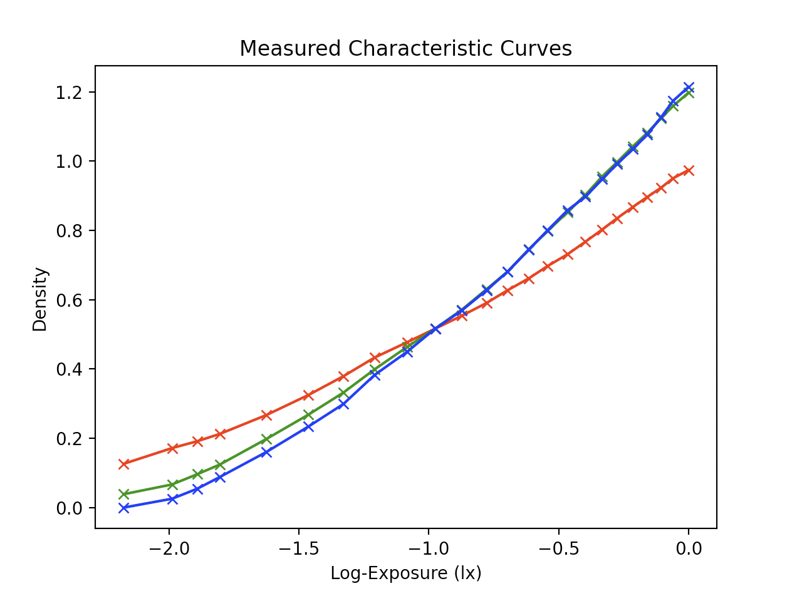

negicc handles this in two parts. The film's behaviour is measured once per stock and stored in profiles. What a
given picture should look like is decided per frame by a vision model.

### The profiles

Each profile set (`profiles/<Stock>-A7R4-<Light>/`) carries two sets of ICC profiles built from the same film
measurements:

- **Scene measured colour** (`Target_1.icc` … `Target_7.icc`): seven exposure brackets that match the negative to the
  measured colours of an IT8 chart in the scene.
- **Print material emulation** (`print_<material>.icc`, used with `--print <material>`): eight print profiles that
  model the negative printed onto darkroom papers and motion-picture print films
  ([spektrafilm](https://github.com/andreavolpato/spektrafilm)).

### Scene colour matching

For the scene profiles, an IT8 chart was photographed onto each stock at seven exposures, from three stops under to
three stops over, and each frame was scanned under both lights.

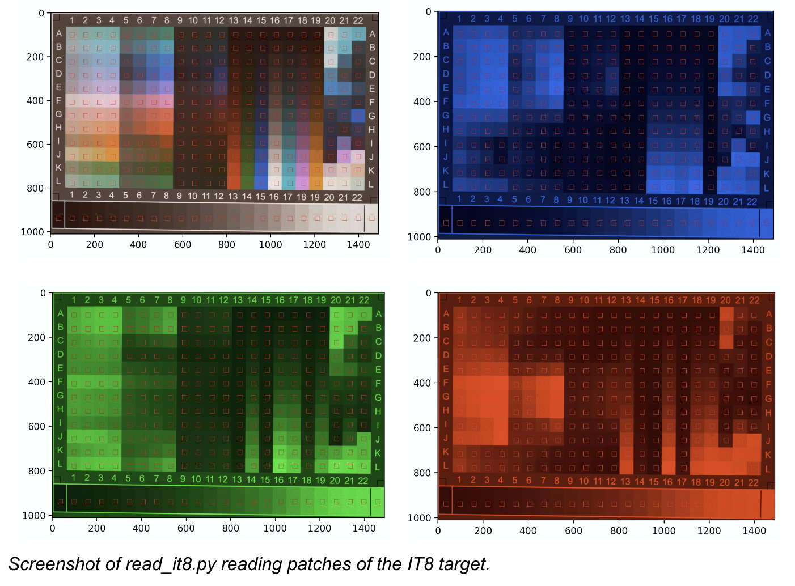

Each exposure became an ICC profile: tone curves that straighten the film's response, then a 3D table for the
colour. Each covers the range of scene brightness its chart frame recorded. For each frame the search (below) picks
the profile that renders it best among those whose range can hold the scene.

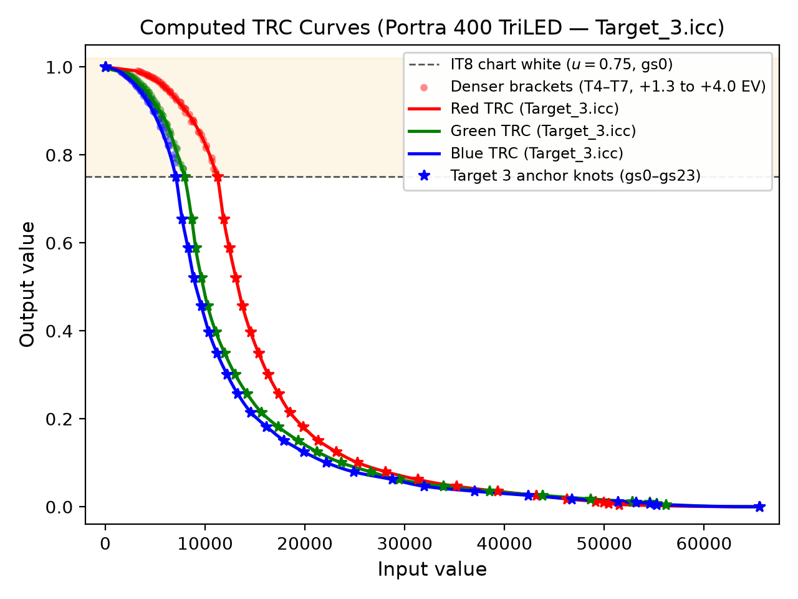

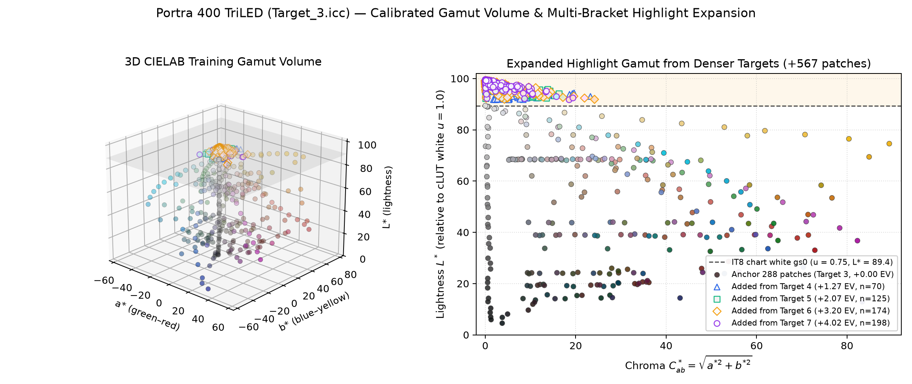


Under the RGB LED the scene profiles reproduce the chart to a mean of 0.5 to 1.1 ΔE₀₀ on the patches they were fitted
to (ArgyllCMS `profcheck`), and 2 to 4 on patches held out of the fit; each profile set's README has its numbers, for
example [Portra 400](profiles/Portra400-A7R4-TriLED/README.md). The print emulation profiles use the same shape (input
TRC curves followed by a 45³ colour table) and are described under [Print emulation](#print-emulation) below.

### Print emulation

Print emulation models shining a printer lamp through the negative onto darkroom paper or motion-picture print film.
Eight materials from [spektrafilm](https://github.com/andreavolpato/spektrafilm) are built in — six papers (such as
Kodak Portra Endura) and two print films (Kodak Vision 2383 and 2393); `--print` alone lists them.


*Left to right: scene colour matching, the print on Portra Endura paper, the print on Vision 2383 print film, each as
its search left it. Rendered with negicc `1d154d7`.*

There are two ways to run it, and both give the same print, apart from the two differences given below:

1. **Print material ICC (`--print <material> -P srgb`)** — writes the print directly as a 16-bit sRGB TIFF through
   the material's print ICC profile (`print_<material>.icc`):

   ```sh
   bin_out/neg_process --film_stock portra400 --light_source tri --print kodak_portra_endura -P srgb \
       --film_base base.ARW --roi auto -o print.tif scan.ARW
   ```

2. **Cineon / ADX16 density file and CLF (`-P rp180|apd|statusm --print <material>`)** — writes the negative's
   density above the film base to a 10-bit Cineon DPX (`-P rp180 -o scan.dpx`) or a 16-bit ADX16 TIFF
   (`-P apd -o scan.tif`), with a CLF transform (`<output>.<material>.clf`) beside it:

   ```sh
   bin_out/neg_process --film_stock portra400 --light_source tri -P apd --print kodak_portra_endura \
       --film_base base.ARW --roi auto -o scan.tif scan.ARW
   oiiotool scan.tif --ociofiletransform scan.tif.kodak_portra_endura.clf -o print.jpg
   ```

Both paths use the same 3D colour table (cLUT) for the print material's dyes. The only difference is how the scan
reaches that table: in the density file and CLF, the pixels are already in log density, so a 3×3 matrix in log space
applies the printing exposure and colour balance before the paper's tone curve; in the print ICC, the input TRC curves
do the same job directly on the linear scan values. The two differ on film thinner than its base and in how they
adapt the viewing light's white ([DESIGN.md](DESIGN.md) 5.9).

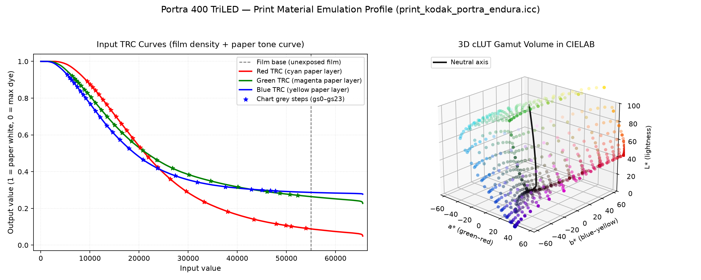

On a print neither the curve fit nor the tone stage (both below) runs, so the picture keeps the print material's own
tone curve.
Under the narrow-band RGB LED (`--light_source tri`), the print ICC reproduces the spectral print model it is sampled
from to 0.06 to 0.14 ΔE₀₀ on average: that is its table's sampling error, and the model itself has not been compared
with a real print. Under white light (`--light_source d65`), where the lamp and camera spectra are not measured, a
printed chart patch differs from the RGB-LED print by 4.1 to 4.6 ΔE₀₀ on average ([DESIGN.md](DESIGN.md) 5.4, 5.10).


*Top left: scene colour matching (without `--print`). Then the six papers and the two print films, each matched to the
scene conversion's mean L\* with `--brightness` (the offset in stops is in each cell's title). Rendered with negicc
`1d154d7`.*

From white-light scans, the print follows the same path: each of the three forum scans shown under
[Scans from other cameras](#scans-from-other-cameras) below, as a print on two materials.

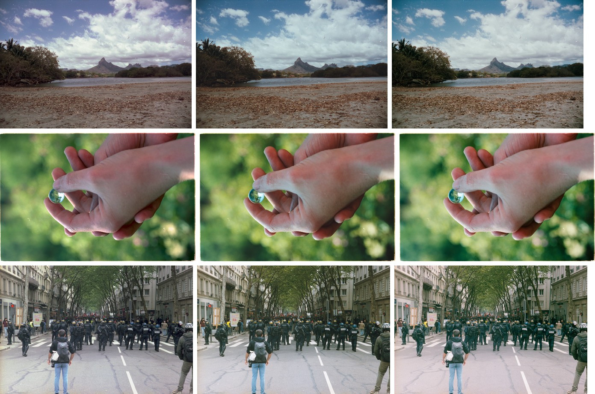

*The three scans of [Scans from other cameras](#scans-from-other-cameras). Left to right: scene colour matching, the
print on Portra Endura paper, the print on Vision 2383 print film, each as its search left it
(`--film_stock portra400 --light_source d65 --roi auto -P srgb`, with `--print kodak_portra_endura` and
`--print kodak_2383`). Rendered with negicc `2130afd`.*

### Choosing exposure and colour

The profiles describe the film. They do not know how bright a particular picture should be or what its colour
balance is. For that, negicc runs Meta's DINOv3 vision model over a preview and reads three small heads trained on
lab scans:

| Head | What it predicts | What it is used for |
|---|---|---|
| Intent | the colour each part of the picture should have | choosing the profile, exposure and colour balance |
| Neutral ([models/neutral_head](models/neutral_head/README.md)) | which parts are neutral surfaces | removing casts that differ between shadows and highlights |
| Tone ([models/tone_head](models/tone_head/README.md)) | how dark the shadows, how bright the highlights and how wide the range should be | contrast |

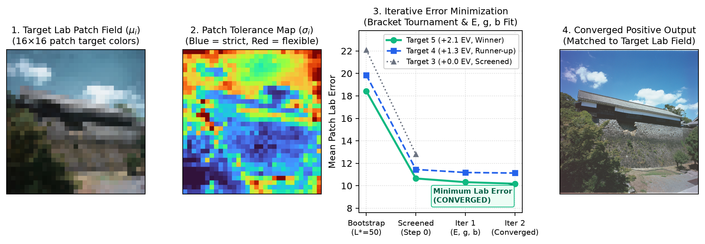

*As committed in `e7fa5a1` (2026-10-31), with an earlier intent adapter than the one shipped now.*

A conversion goes through these steps:

1. Find the frame and the film base, and work out which exposure profiles can hold the scene.
2. Search. Render the candidates, compare each with what the intent head predicts, adjust exposure and the green and
   blue gains, and repeat until it settles. This step runs for both lights.
3. Fit the curves (white light only, never on a print). Gains cannot remove a cast that is warm in the shadows and
   cool in the highlights. The slopes of the green and blue curves are adjusted until the surfaces the neutral head
   picked out are grey. The same fit sets the overall magenta-green balance from the intent head. A result greener
   than the search's is not accepted, apart from a small tolerance and the deep shadows.
4. Set the contrast (both lights, with `-P srgb`, never on a print). One lightness curve moves the picture toward the
   tone head's prediction.

With the RGB LED the curves are the measured ones, so step 3 does not run there: the profiles were made under that
light, and there is no lamp or camera difference for a fit to correct.

#### The search

On the frame below the first render is cyan-green and the search brings it to a daylight balance. This step removes
the uniform colour cast that comes from the LED lights being set to different powers.

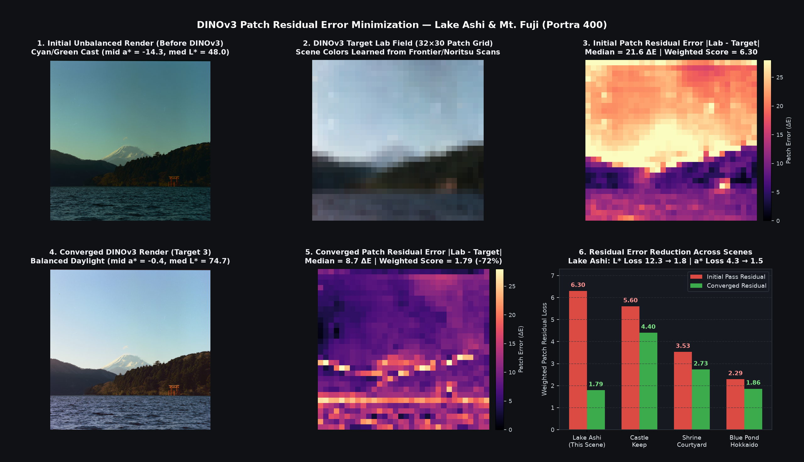

*As committed in `9f9c790` (2026-10-31), with an earlier intent adapter than the one shipped now.*

#### Curve fitting (white light only)

Under a white light the crosstalk matrix and the light's spectrum are unknown, and a broadband light brings in a
lot of noise between the response curves of the film's dye layers. This step is needed to neutralise the colours
and to remove the crossover colour cast, the one that differs between shadows and highlights. A print never runs it.

The neutral head marks the cells that should be grey: here the road, the building fronts and the dark uniforms,
not the trees. Weighted by it, the search's render runs green-yellow in the shadows and magenta-blue in the
highlights; the curve fit takes most of that trend out.

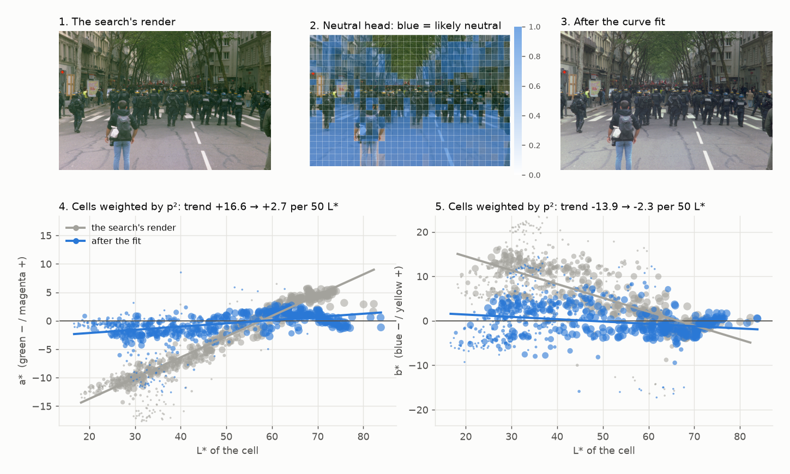

#### The tone stage

The tone head predicts how dark the shadows and how bright the highlights of a lab scan of the frame would be. The
lightness curve moves the shadows all the way and the highlights half way to it, and leaves the mid-tone where it
was. Where that would put more than half a percent more of the picture at black or at white than the render already
has, the highlight and contrast moves are scaled back, and the shadow move with them only if the black end still
clips, until both ends hold; where no scaling holds, `--tone_stage` says which end gives way. When both moves end at
zero, no curve is applied and the picture is the conversion without the stage.

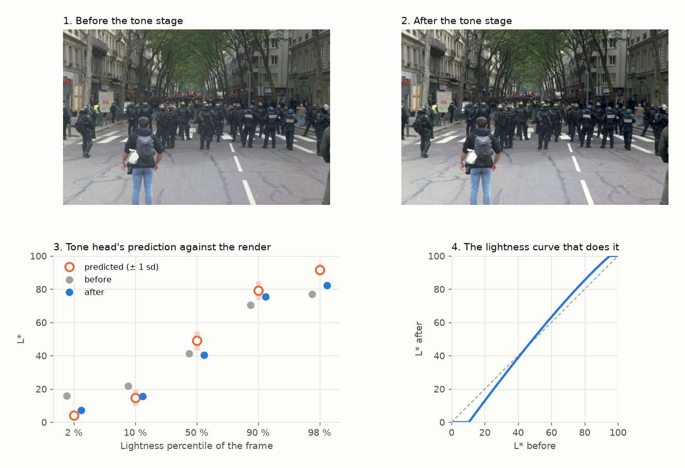

[DESIGN.md](DESIGN.md) has the formulas, every number these steps depend on, and the limits of each step.

### The film base

The film base is the orange mask of unexposed film. The scan is divided by it, so that each channel reads the
film's transmittance relative to bare film and a profile and a scan agree whatever the mask's colour or the scan's
exposure. Without a capture it is read from the scan: from the rebate beside the frame, or else from the thinnest
film in the picture; failing both, the profile set's own base is used.

`--film_base base.ARW` reads the film base from a capture that shows unexposed film: a whole frame of it, or a
picture with a strip of rebate beside it. The base is used for a picture or for density. The capture is decoded as
the scan is and scaled to the scan's exposure. The brightest smooth stretch of film anywhere on it is found, leaving
out dust, scratches, clipped areas, and anything that is not the colour of film base, such as bare light beside the
film. `--film_base base.ARW:x,y,w,h` gives the region in sensor pixels. It needs an RGB-LED profile set and a Sony
RAW. Give the same `--flat` as for the scan.

A later run to the same output, with the same inputs and the same `--flat`, takes that base back from
`<output>.json`, so the capture is not needed again. `--film_base scan` reads the base from the scan itself
instead. Without a capture, and with no earlier capture recorded for the output, the base is read from the scan.

### The flat field

`--flat` takes a flat field measured on the empty gate: an `.npz` holding a coarse grid of gains per channel in
sensor coordinates, 1 at the sensor's centre. Every decode of the scan is divided by the gain at each pixel's sensor
position, before any crop or rotation, which takes out the falloff of the light and the lens. The picture, the
searches and the film base all read the divided scan, and a film base capture is divided by the same flat. It
applies to a camera RAW, a single shot or a pixel-shift set.

### The demosaic

Single-shot RGB-LED scans from Sony sensors with an RGGB colour filter array (CFA) go through negicc's own demosaic,
which was written to stop film grain turning into maze patterns. Measured against a pixel-shift capture of the same
frame it is about 1.2 dB better than bilinear and 0.5 dB better than LibRaw's DCB. Everything else is demosaiced by
LibRaw. `-q` chooses LibRaw's method, and on a Sony single shot `-q 0` or higher replaces negicc's demosaic with it;
pixel-shift sets are always merged. Where negicc's demosaic runs, the searches and the film base read a half-size
image taken straight from the CFA, one pixel per 2×2 block, with no demosaic.

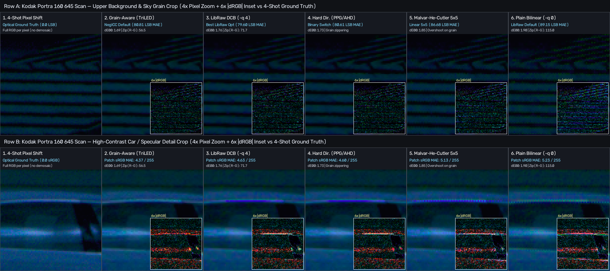

Single-shot RGB-LED scans on a Sony RGGB sensor, against a 4-shot pixel-shift capture of the same frame.

| Algorithm | Raw MAE ↓ | Positive PSNR (dB) ↑ | Positive ΔE₀₀ mean / p95 ↓ | R−G zipper ↓ |
| :--- | :---: | :---: | :---: | :---: |
| 4-shot pixel shift (ground truth) | 0.00 | ∞ | 0.00 / 0.00 | 142.4 |
| **Grain-aware colour-ratio** (RGB-LED default) | **80.81** | **40.38** | **1.69 / 6.86** | 56.5 |
| LibRaw DCB (`-q 4`) | 79.60 | 39.85 | 1.76 / 7.21 | 71.7 |
| LibRaw VNG (`-q 1`) | 80.19 | 39.96 | 1.75 / 7.12 | 58.6 |
| PPG / AHD (`-q 2` / `-q 3`) | 80.61 | 40.03 | 1.73 / 6.97 | 55.3 (grain maze) |
| Bilinear (`-q 0`) | 89.15 | 39.16 | 1.90 / 7.87 | 115.0 |

Raw MAE is in 14-bit LSB; PSNR and ΔE₀₀ are measured on the inverted positive.

### The light

`neg_process` reads camera RAWs, linear DNGs, TIFFs and JPEGs. A TIFF or JPEG with an embedded ICC profile is
converted through it; without one an 8-bit file is taken as sRGB and a 16-bit TIFF as linear Rec.2020. With
`--light_source tri` a 16-bit TIFF without a profile is taken as the scanning camera's linear RGB.

With white light (`--light_source d65`), such as a white LED, any camera works. The lamp's colour is taken out using
the film base found in the scan itself, so your lamp does not have to match the one the profiles were made with.

With a narrow-band RGB LED (`--light_source tri`) each colour of light falls on one dye, which separates the layers
better. One RAW is enough. Pixel-shift sets and three separate R, G and B frames also work.

The camera's channels overlap, so a narrow-band profile set carries a crosstalk matrix measured on the camera the
profiles were made with. Its `bundle.json` lists the camera models the matrix holds for (`camera_models`; the shipped
sets list `ILCE-7RM4` and `ILCE-7RM4A`, the A7R IV and IVA), and `neg_process` compares the RAW's model with that list
exactly. The only case that turns the correction off is a RAW that states a camera model the set's list does not
contain; the log says so and why, and `-r`, `-g` and `-b` give the rows of a matrix measured on that camera. An input
that states no model (a TIFF) and a set without the list are not compared, and take the set's matrix. Three
separate frames need no correction. A white-light set has no matrix and lists no models, and no camera is compared for
it.

Rows given with `-r`, `-g` and `-b` are in the units of the profile set's own correction matrix. The set stores its
film base as read through that matrix, and the automatic exposure compares the scan's film base with the stored one,
so rows of another overall scale move the automatic exposure, by log2 of the scale in stops. Rows that leave the
matrix not invertible are refused.

## Scans from other cameras

Scans from any camera under white light (`--light_source d65`) can be converted for scene colour matching or for print
emulation. Each example below is a scan that someone posted on the [pixls.us](https://discuss.pixls.us) forum, taken
with a camera and lamp the profiles were not made with, and the command that made the picture. Left: the scan as the
camera saw it. Right: the result. Everything the command does not set is automatic.

### Scene colour matching

```sh
bin_out/neg_process --film_stock portra400 --light_source d65 --roi auto -P srgb -o scene.tif scan.RAW
```


*Canon EOS R.* [Fête du Travail](https://discuss.pixls.us/t/45538/1), posted by jonathanBieler, 2024-09-13. Rendered
with negicc `d174ca9`.

### Print emulation directly to a picture

`--print` with `-P srgb` writes the print as a 16-bit sRGB TIFF through the material's print ICC, at the printing
exposure and colour balance its own search finds. `--rot 180` turns this scan upright.

```sh
bin_out/neg_process --film_stock portra400 --light_source d65 --roi auto --print kodak_portra_endura --rot 180 \
    -P srgb -o print.tif scan.RAW
```

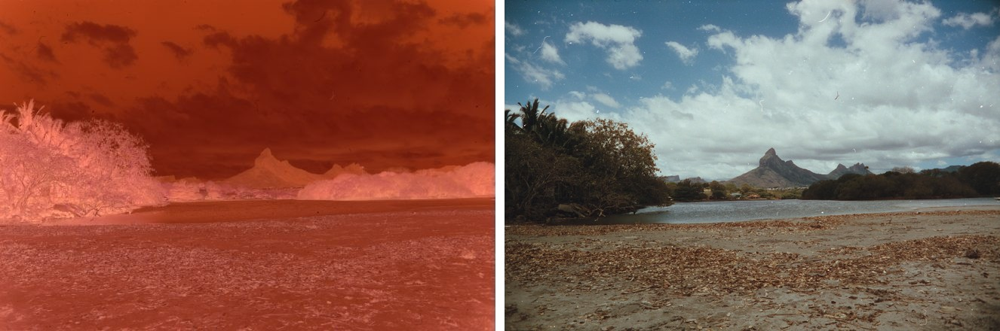

*Canon EOS 5DS R.* [Mauritius Mountain with River Mouth](https://discuss.pixls.us/t/50730/1), posted by gsinha,
2025-06-16. The print on Kodak Portra Endura paper. Rendered with negicc `d174ca9`.

### Print emulation through a density file and a CLF

The first command writes the negative's density above the film base as a 16-bit ADX16 TIFF (`-P apd`; with
`-P rp180 -o scan.dpx` it is a 10-bit Cineon DPX) and, for `--print kodak_2383`, a CLF beside it that renders that file
as the print. The second applies the CLF with OpenImageIO's `oiiotool`; any program that reads CLF through OpenColorIO
can.

```sh
bin_out/neg_process --film_stock portra400 --light_source d65 --roi auto -P apd --print kodak_2383 -o scan.tif scan.RAW
oiiotool scan.tif --ociofiletransform scan.tif.kodak_2383.clf -o print.tif
```

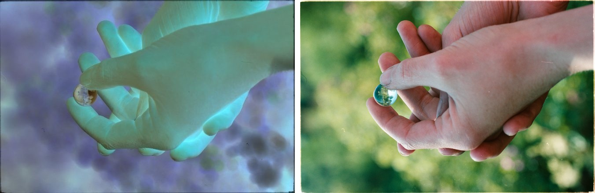

*Nikon D810.* [Negative inversion challenge! Skin tones and greens](https://discuss.pixls.us/t/59155/1), posted by
DanielE, 2026-07-11. The print on Kodak Vision 2383 print film. Rendered with negicc `d174ca9`.

The CLF carries the printing exposure and balance of the print's own search, so this is the print that
`--print kodak_2383 -P srgb` writes from the same scan: the two differ by 0.23 ΔE₀₀ on average (0.54 at the 95th
percentile). They differ most at black: 1.2 % of the picture has a channel at black through the print ICC and 0.8 %
through the CLF, all of the difference in the thinnest film, at or near its base, which the two paths handle
differently ([Print emulation](#print-emulation)).

The RAW files, the pictures above and their prints under [Print emulation](#print-emulation) belong to the
photographers who posted them. No copyright is claimed on them here. If one of them is yours and you want it removed,
open an issue.

## Options

`bin_out/neg_process --help` lists everything. The common ones:

| Option | Meaning |
| :--- | :--- |
| `--film_stock`, `--light_source tri\|d65` | A built-in profile set (`--list_profiles` lists them). |
| `-p`, `--film_profile` | A profile set's JSON or directory, or a single ICC profile. |
| `-P`, `--colorspace srgb\|srgb-g10\|<icc>` | Output encoding; an ICC profile must be an RGB one. The highlight roll-off and the tone stage need `srgb`; the curve fit needs `srgb` or `srgb-g10`. |
| `-P statusm\|rp180\|apd` | Density above the film base in place of a picture: Status M, SMPTE RP 180 printing density, or Academy Printing Density. |
| `--print <material>` | Print on a material: a built-in print material or the path of a spektrafilm print profile. With a picture output (`-P srgb`) the output is the print, made by the print's own search. With a density output: also write a CLF beside the file (`<output>.<material>.clf`, e.g. `scan.tif.kodak_2383.clf`) that renders it as a print on that material, sRGB; repeat it for more prints, or give `all` for the built-in ones. `--print` alone lists them. |
| `-o`, `--output` | The TIFF. `<output>.json` is written next to it unless `--no-metadata` is given. A density goes to a `.dpx` (10 bits) or a `.tif` / `.tiff` (16 bits). |
| `--film_base auto\|scan\|<file>[:x,y,w,h]` | The film base. `scan`: read from the scan. A file: read from a capture of unexposed film, over a region in sensor pixels when given. `auto` (default): the base an earlier run to this output read from a capture, when there is one that still applies; otherwise from the scan. |
| `--target N`, `--bundle_target N` | The exposure bracket, by index (from 0) or name. The search runs on that bracket only. |
| `-E`, `--exposure_comp` | Exposure gain. The search keeps it and finds the rest. |
| `--gain_g`, `--gain_b` | Green and blue gains relative to red (default 1). The search (and the curve fit on white light) keeps them and finds the rest. With an ICC profile (`-p file.icc`), giving either turns the search off. |
| `--brightness`, `--tint`, `--warmth` | Adjustments applied after the search and the curve fit, to found and given values alike. They are applied after Auto and the tone curve are fixed: the curve is the one the conversion without them keeps, so raising brightness can clip highlights the curve lifts (on 198 test frames, `--brightness 0.5` put 16 over half a percent of the frame at white, the worst 14.5 %). A fresh run gives the picture of the same knobs on `<output>.json` from a run without them. They reuse `<output>.json` from the same inputs. On a print they move its printing exposure and colour balance; a density output takes them only with `--print`, for its CLFs, and searches each print again for them. |
| `--fit_curves auto\|off\|on\|<numbers>` | The curve fit. `auto` (default) runs it wherever it applies. `off` skips it. `off` and `on` are errors where it does not apply (it never applies to the RGB LED, an ICC profile or a print). Eight or ten numbers replay the curves recorded in a sidecar. |
| `--tone_stage auto\|off\|on\|highlights_first\|least_total\|curve:<numbers>` | The tone stage. `auto` (default) runs it on every bundle conversion with `-P srgb` that is not a print, on both lights, with given values too. `off` skips it. `on` is an error where it does not apply. Where no scaling of its moves keeps both ends from clipping, `auto` and `on` keep the shadow lift and let the highlights clip; `highlights_first` keeps the highlights and lifts the shadows less; `least_total` keeps the curve that clips least at both ends together; both otherwise run as `auto`. `curve:` with four numbers replays the lightness curve recorded in a sidecar (black, white, gamma, contrast); numbers outside the stage's limits are refused. A sidecar's replay command carries `--tone_stage off` (with `--fit_curves off` on white light) when neither step ran. A TriLED replay command from an older build that gives the values without any `--tone_stage` now runs the tone stage; add `--tone_stage off` to reproduce its file. |
| `--roi auto [h\|v]` or `--roi x y w h [rot [hflip [vflip]]]` | The frame: detected, or given in sensor pixels. |
| `--film_format 35mm\|645\|6x6\|6x7\|6x9\|auto` | The format `--roi auto` looks for (default 35mm). With a given `--roi`, the format the film base is read around (default: every format). A sidecar's replay command carries the format the film base was read around when its detection used one (given, or `--roi auto`'s 35mm), as it carries the frame. |
| `--rot` (`--rot_cw`), `--hflip`, `--vflip` | Orientation of the output. |
| `-q`, `--quality` | Demosaic: −1 automatic, or a LibRaw quality (4 is DCB). |
| `-r`, `-g`, `-b` | Rows of the crosstalk matrix (default: the profile set's), in the units of the set's own matrix. |
| `-C`, `--no_crop` | Keep the RAW's full area. |
| `--flat` | A flat-field `.npz` measured on the empty gate. |
| `--dino <head>:<file>,...` | Use your own models: `intent` (an `.onnx` file or its directory), `neutral`, `tone`. A path with no head name is the intent model. |
| `--dino_backend auto\|cpu\|gpu`, `--dino_iters` | Where the vision model runs, and how many search iterations. `cpu` keeps everything on the CPU: the model, the search's passes (DESIGN.md 4.2) and the full-size debayer, merge and conversion, which a USE_CUDA=1 build otherwise runs on a CUDA device (DESIGN.md 4.1). On the device a value of the exported picture can differ from the CPU's by one 16-bit code. |
| `--check_renderer`, `--probe_intent`, `--probe_params`, `--probe_stops` | Development aids: a check of the search's renderer interface (the search, the print's search, the curve fit and the tone plan through a renderer that runs and counts each pass on the CPU, and on a USE_CUDA=1 build with a device also on the GPU, comparing the two, DESIGN.md 4.2; the picture must equal a conversion whose passes run on the CPU, compared by hand), and a record of what the intent head predicts from chosen renders. `--help` describes them. |

## Hardware the profiles were made with

Sony A7R IV (`ILCE-7RM4`); a [Shoebox Photos BCS](https://www.shoeboxphotosbcs.com) RGB LED light for the RGB-LED
profiles and a white D65 LED panel for the white-light ones; the coloraid.de `R190808` IT8.7/2 target.

## Licences

negicc is GPL-3.0 (`COPYING`). The DINOv3 backbone in `models/dinov3-small/backbone.onnx` is packed into the
`neg_process` binary. It is Meta's, under the DINOv3 License (`models/dinov3-small/LICENSE.md`): distribute it, or a
binary built with it, only under that licence and with a copy of it. The scans in `samples/web_*.jpg` are other people's
photographs, credited above. The print profiles in `3rd_party/spektrafilm/` are
[spektrafilm](https://github.com/andreavolpato/spektrafilm)'s, unmodified, under CC BY-SA 4.0
(`3rd_party/spektrafilm/README.md`); a CLF that `neg_process` writes with one carries that notice for its two tables,
and the pictures made through one are free. The `film_model` block of every profile set's `bundle.json` holds
spektrafilm's film spectra, under the same licence, and so do the eight print ICCs of each profile set
(`print_<material>.icc`), whose tables derive from spektrafilm's print profiles; each says so in its own copyright tag.
The licence covers those blocks and files only, not the rest of a bundle or its chart profiles (`Target_<n>.icc`), nor
the pictures made with a print ICC. The SHA-256 in `3rd_party/picosha2/` is PicoSHA2's, unmodified, under the MIT
licence (Copyright (c) 2017 okdshin, `3rd_party/picosha2/LICENSE`).
