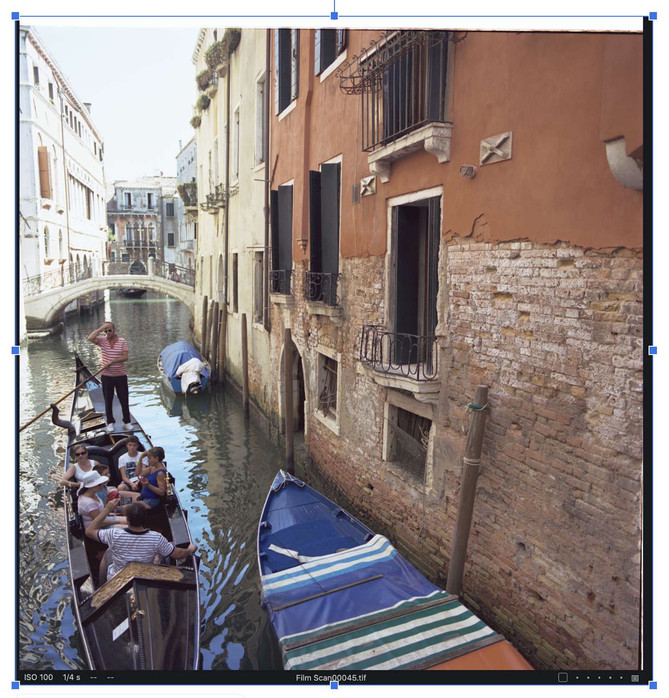
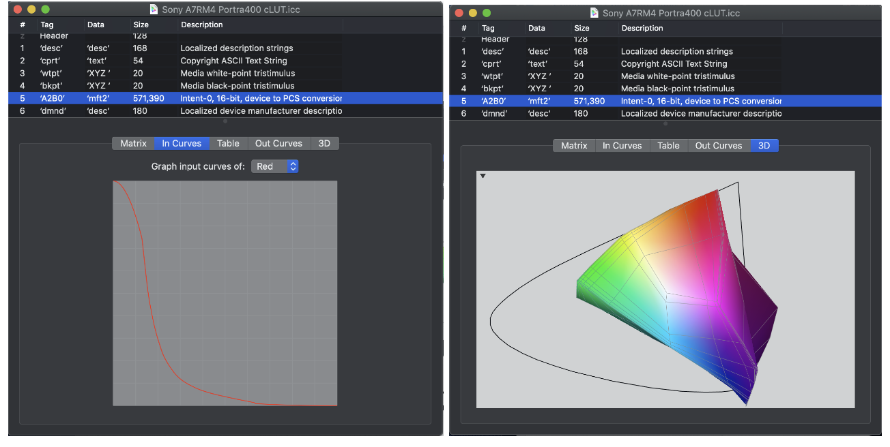
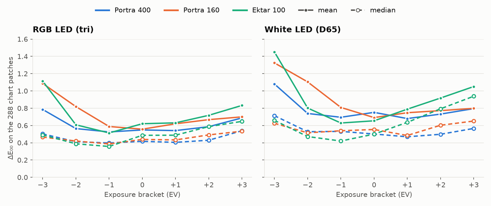
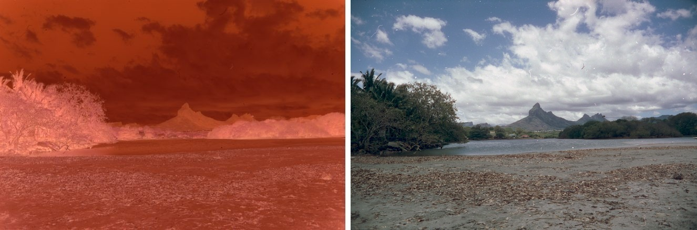
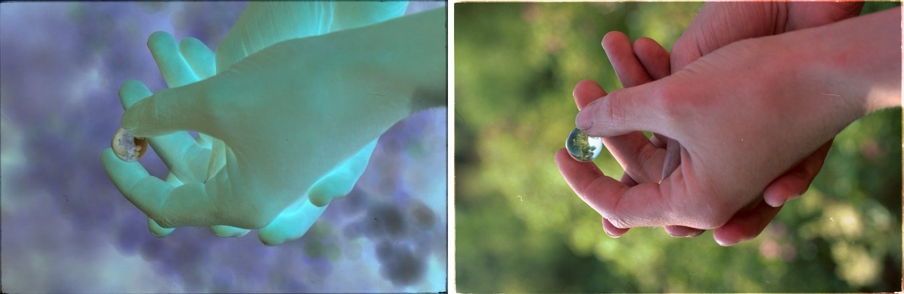
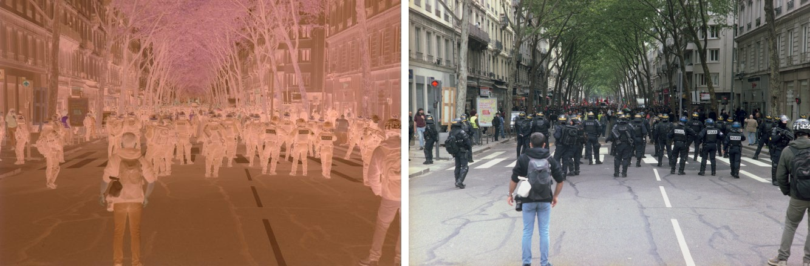
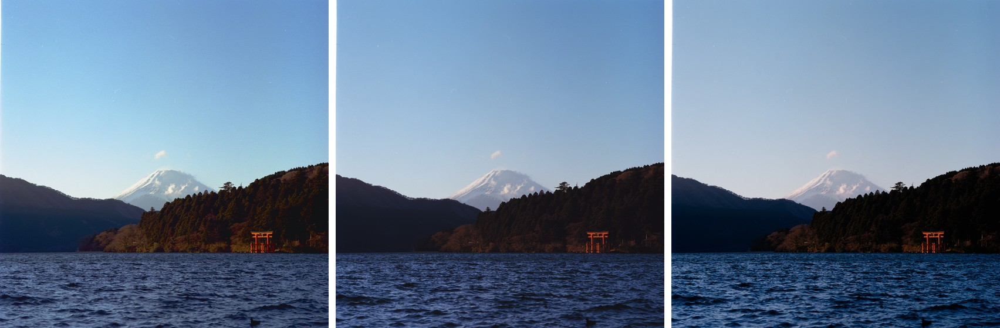
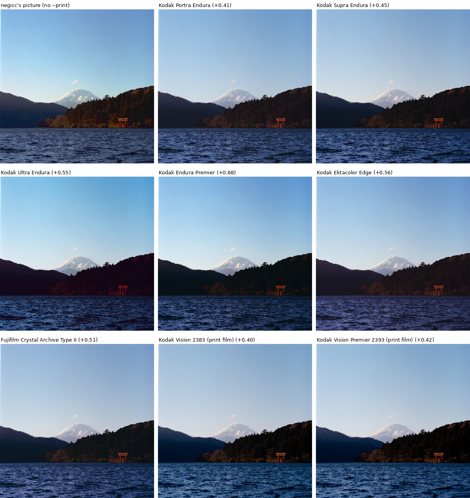

# negicc

`neg_process` converts a camera photo of a colour negative into a positive. You give it the RAW file and the film
stock; it picks exposure, colour balance and contrast and writes a 16-bit TIFF.



It ships with profiles for Kodak Portra 400, Portra 160 and Ektar 100, each for a white LED and for a narrow-band
RGB LED. The profiles were made with a Sony A7R IV. Scans from other cameras and lamps work with the white-LED
profiles; there are examples further down.

You can try it without building anything at [negicc-web](https://negicc-web-dmin4o4cra-uc.a.run.app): upload a RAW,
DNG, TIFF or JPEG and it runs `neg_process` on it. The longer story of how the method came about is in this
[guide](https://docs.google.com/document/d/1NsfFPx5c7kxNRUhuGQBKRNnaN0c52SjLsZsyhLCj3OE/edit?usp=sharing).

## Build

```bash
sudo apt-get install build-essential git python3 python3-pip   # plus libjpeg-dev for LIBRAW_JPEG=1
pip install torch transformers onnx                             # only needed for `make dinov3_model`
git clone --recursive https://github.com/arufahc/negicc.git && cd negicc
make dinov3_model && make -j$(nproc) neg_process                # add USE_CUDA=1 for an NVIDIA GPU
```

LibRaw, Little-CMS 2, zlib, libtiff and libjpeg-turbo are built from the submodules in `3rd_party/`
([3rd_party/README.md](3rd_party/README.md)). The vision model runs through ONNX Runtime or TensorRT.

## Use

```bash
bin_out/neg_process --list_profiles

# White LED, 35mm. The frame is found automatically.
bin_out/neg_process --film_stock portra400 --light_source d65 --roi auto --film_format 35mm -P srgb -o out.tif scan.ARW

# Narrow-band RGB LED.
bin_out/neg_process --film_stock portra400 --light_source tri -P srgb -o out.tif scan.ARW

# Sony 4-shot pixel shift: give the four RAWs.
bin_out/neg_process --film_stock ektar100 --light_source tri -P srgb -o out.tif ps1.ARW ps2.ARW ps3.ARW ps4.ARW

# Three separate frames under red, green and blue light.
bin_out/neg_process --film_stock portra160 --light_source tri -r "1 0 0" -g "0 1 0" -b "0 0 1" -P srgb -o out.tif r.ARW g.ARW b.ARW

# 6x7 on a white LED, with LibRaw's DCB demosaic.
bin_out/neg_process --film_stock portra400 --light_source d65 -q 4 --roi auto --film_format 6x7 -P srgb -o out.tif scan.ARW

# Set the bracket, exposure and gains yourself. On RGB-LED scans, giving a gain turns the automatic search off.
bin_out/neg_process --film_stock portra400 --light_source tri --target 4 -E 1.15 --gain_g 0.98 --gain_b 1.04 -P srgb -o out.tif scan.ARW

# White LED: fix only the bracket. Everything else is found as usual, on that bracket.
bin_out/neg_process --film_stock portra400 --light_source d65 --target 4 -P srgb -o out.tif scan.ARW
```

On white-LED scans, `--target`, `-E`, `--gain_g` and `--gain_b` each fix one thing and leave the rest automatic: the
search, the curve fit and the contrast step still run, holding what you gave. Add `--fit_curves off --tone_stage off`
to convert with the given values and nothing else.

Next to `out.tif` it writes `out.tif.json` with everything it decided. `--brightness`, `--tint` and `--warmth`
adjust the result from that file without running the model again.

### The film base from a capture

`--film_base base.ARW` reads the film base from a capture that shows unexposed film: a whole frame of it, or a
picture with a strip of rebate beside it. The base is used for a picture or for density. The capture is decoded as
the scan is and scaled to the scan's exposure. The brightest smooth stretch of film anywhere on it is found, leaving
out dust, scratches, clipped areas, and anything that is not the colour of film base, such as bare light beside the
film. `--film_base base.ARW:x,y,w,h` gives the region in sensor pixels. It
needs an RGB-LED profile set and a Sony RAW. Give the same `--flat` as for the scan.

A later run to the same output, with the same inputs and the same `--flat`, takes that base back from
`<output>.json`, so the capture is not needed again. `--film_base scan` reads the base from the scan itself
instead. Without a capture, and with no earlier capture recorded for the output, the base is read from the scan
as before.

## Method

A colour negative has three dye layers on an orange base, and the layers do not respond to light in step with each
other. Inverting the photo and stretching the histogram gets the colours wrong for that reason, and gets them wrong
differently at every exposure.


negicc handles this in two parts. The film's behaviour is measured once per stock and stored in profiles. What a
given picture should look like is decided per frame by a vision model.

### The light

`neg_process` reads camera RAWs, linear DNGs, TIFFs and JPEGs. A TIFF or JPEG with an embedded ICC profile is
converted through it; without one an 8-bit file is taken as sRGB and a 16-bit TIFF as linear Rec.2020. With
`--light_source tri` a 16-bit TIFF without a profile is taken as the scanning camera's linear RGB.

With a white LED (`--light_source d65`) any camera works. The lamp's colour is taken out using the film base found
in the scan itself, so your lamp does not have to match the one the profiles were made with.

With a narrow-band RGB LED (`--light_source tri`) each colour of light falls on one dye, which separates the layers
better. One RAW is enough. Pixel-shift sets and three separate R, G and B frames also work.

Single-shot RGB-LED scans from Sony sensors go through negicc's own demosaic, which was written to stop film grain
turning into maze patterns. Measured against a pixel-shift capture of the same frame it is about 1.2 dB better than
bilinear and 0.5 dB better than LibRaw's DCB. Everything else is demosaiced by LibRaw. `-q` chooses LibRaw's method,
and on a Sony single shot `-q 0` or higher replaces negicc's demosaic with it; pixel-shift sets are always merged.


Single-shot TriLED scans on a Sony RGGB sensor, against a 4-shot pixel-shift capture of the same frame.

| Algorithm | Raw MAE ↓ | Positive PSNR (dB) ↑ | Positive ΔE₀₀ mean / p95 ↓ | R−G zipper ↓ |
| :--- | :---: | :---: | :---: | :---: |
| 4-shot pixel shift (ground truth) | 0.00 | ∞ | 0.00 / 0.00 | 142.4 |
| **Grain-aware colour-ratio** (TriLED default) | **80.81** | **40.38** | **1.69 / 6.86** | 56.5 |
| LibRaw DCB (`-q 4`) | 79.60 | 39.85 | 1.76 / 7.21 | 71.7 |
| LibRaw VNG (`-q 1`) | 80.19 | 39.96 | 1.75 / 7.12 | 58.6 |
| PPG / AHD (`-q 2` / `-q 3`) | 80.61 | 40.03 | 1.73 / 6.97 | 55.3 (grain maze) |
| Bilinear (`-q 0`) | 89.15 | 39.16 | 1.90 / 7.87 | 115.0 |

Raw MAE is in 14-bit LSB; PSNR and ΔE₀₀ are measured on the inverted positive.

### The profiles

For each stock an IT8 chart was photographed onto the film at seven exposures, from three stops under to three stops
over, and each frame was scanned under both lights.


Each exposure became an ICC profile: tone curves that straighten the film's response, then a 3D table for the
colour. Each covers the range of scene brightness its chart frame recorded. For each frame the search (below) picks
the profile that renders it best among those whose range can hold the scene.







Under the RGB LED the profiles reproduce the chart to a mean of 0.5 to 1.1 ΔE₀₀ on the patches they were fitted to
(ArgyllCMS `profcheck`), and 2 to 4 on patches held out of the fit; each profile set's README has its numbers, for
example [Portra 400](profiles/Portra400-A7R4-TriLED/README.md).

### Choosing exposure and colour

The profiles describe the film. They do not know how bright a particular picture should be or what its colour
balance is. For that, negicc runs Meta's DINOv3 vision model over a preview and reads three small heads trained on
lab scans:

| Head | What it predicts | What it is used for |
|---|---|---|
| Intent | the colour each part of the picture should have | choosing the profile, exposure and colour balance |
| Neutral ([models/neutral_head](models/neutral_head/README.md)) | which parts are neutral surfaces | removing casts that differ between shadows and highlights |
| Tone ([models/tone_head](models/tone_head/README.md)) | how dark the shadows, how bright the highlights and how wide the range should be | contrast |


A conversion goes through these steps:

1. Find the frame and the film base, and work out which exposure profiles can hold the scene.
2. Search. Render the candidates, compare each with what the intent head predicts, adjust exposure and the green and
   blue gains, and repeat until it settles. This step runs for both lights.
3. Fit the curves (white light only). Gains cannot remove a cast that is warm in the shadows and cool in the
   highlights. The slopes of the green and blue curves are adjusted until the surfaces the neutral head picked out
   are grey. The same fit sets the overall magenta-green balance from the intent head. A result greener than the
   search's is not accepted, apart from a small tolerance and the deep shadows.
4. Set the contrast (both lights). One lightness curve moves the picture toward the tone head's prediction.

With the RGB LED the curves are the measured ones, so step 3 does not run there: the profiles were made under that
light, and there is no lamp or camera difference for a fit to correct.

#### The search

On the frame below the first render is cyan-green and the search brings it to a daylight balance. This step removes
the uniform colour cast that comes from the LED lights being set to different powers.


#### Curve fitting (D65 light only)

Under a white light the crosstalk matrix and the light's spectrum are unknown, and a broadband light brings in a
lot of noise between the response curves of the film's dye layers. This step is needed to neutralise the colours
and to remove the crossover colour cast, the one that differs between shadows and highlights.

The neutral head marks the cells that should be grey: here the road, the building fronts and the dark uniforms,
not the trees. Weighted by it, the
search's render runs green-yellow in the shadows and magenta-blue in the highlights; the curve fit takes most of that
trend out.


#### Toning

The tone head predicts how dark the shadows and how bright the highlights of a lab scan of the frame would be. The
lightness curve moves the shadows all the way and the highlights half way to it, and leaves the mid-tone where it
was.


[DESIGN.md](DESIGN.md) has the formulas, every number these steps depend on, and the limits of each step.

## Scans from other cameras

Three scans people posted on the [pixls.us](https://discuss.pixls.us) forum, taken with cameras and lamps the
profiles were not made with. Left: the scan as the camera saw it. Right: `neg_process` with
`--film_stock portra400 --light_source d65 --roi auto -P srgb`, everything else automatic.



*Canon EOS 5DS R.* [Mauritius Mountain with River Mouth](https://discuss.pixls.us/t/50730/1), posted by gsinha,
2025-06-16.



*Nikon D810.* [Negative inversion challenge! Skin tones and greens](https://discuss.pixls.us/t/59155/1), posted by
DanielE, 2026-07-11.



*Canon EOS R.* [Fête du Travail](https://discuss.pixls.us/t/45538/1), posted by jonathanBieler, 2024-09-13.

The RAW files and the pictures belong to the photographers who posted them. No copyright is claimed on them here.
If one of them is yours and you want it removed, open an issue.

## Density files and print emulation

`-P statusm`, `-P rp180` or `-P apd` writes the negative's density above the film base in
place of a picture: a 10-bit DPX or a 16-bit TIFF, by the output's extension. `rp180` in a DPX is a Cineon file and
`apd` in a TIFF is ADX16.

```sh
bin_out/neg_process --film_stock portra400 --light_source tri -P apd --print kodak_portra_endura \
    --film_base base.ARW --roi auto -o scan.tif scan.ARW
oiiotool scan.tif --ociofiletransform scan.tif.kodak_portra_endura.clf -o print.jpg
```

With `--print <print>`, `neg_process` also writes a CLF transform beside the density file, and any tool that reads
CLF renders the file through it as a print on that material. The print materials are the print profiles of
[spektrafilm](https://github.com/andreavolpato/spektrafilm): eight are built in (six papers, among them Kodak
Portra Endura, and the print films Kodak Vision 2383 and 2393; `--print` alone lists them), and `<print>` may also
be the path of another spektrafilm print profile. Without `--print` only the density file is written.
The print is a model and has not been compared with a real print. `DESIGN.md` has the encodings, the matrices and
how the print is computed.

A white-LED scan takes the same options (`--light_source d65`). Its density is less exact than an RGB-LED scan's:
no spectrum of the light is measured, so the scan's channels are taken to be linear Rec.2020. The film base comes
from the scan itself, since `--film_base` with a capture is for RGB-LED scans. The curve fit runs as it does for a
picture and changes no pixel of the density file; the CLF takes the frame's mid grey and slopes from it. With
`--fit_curves off` the CLF takes the mid grey and slopes of the frame's bracket in the profile set. On an RGB-LED scan
the density run searches each material's print as it does for the print as a picture (below), and the CLF carries
that print's exposure and balance, so it prints what the picture output prints.



*Left to right: negicc's picture, the print on Portra Endura paper, the print on Vision 2383 film.*

### The print as a picture

On an RGB-LED scan, `--print <print>` with `-P srgb` writes the print itself, with no density file or CLF in
between:

```sh
bin_out/neg_process --film_stock portra400 --light_source tri --print kodak_portra_endura -P srgb \
    --film_base base.ARW --roi auto -o print.tif scan.ARW
```

This writes the print on the chosen material as an sRGB picture. The automatic search runs on the print itself: its
printing exposure, then its colour balance. The paper's curve gives the tone, so the toning step does not run. The
print is shown relative to its paper's white. A white-LED scan takes `--print` with a density output only. DESIGN.md
has the rest.

The paper whites below are those of the Portra 400 RGB-LED set's print ICCs (`DESIGN.md`, "The print's white").

| Material | Type | Viewing light | Its paper white, L\* a\* b\* under that light (shown at the display's white) |
|---|---|---|---|
| Kodak Professional Portra Endura (`kodak_portra_endura`) | paper | D50 | 92.1, +0.15, +0.80 |
| Kodak Professional Supra Endura (`kodak_supra_endura`) | paper | D50 | 92.7, +0.09, +0.39 |
| Kodak Professional Ultra Endura (`kodak_ultra_endura`) | paper | D50 | 82.9, +0.62, −4.10 |
| Kodak Professional Endura Premier (`kodak_endura_premier`) | paper | D50 | 90.9, +0.56, −2.73 |
| Kodak Ektacolor Edge (`kodak_ektacolor_edge`) | paper | D50 | 90.9, +0.16, +0.06 |
| Fujifilm Crystal Archive Type II (`fujifilm_crystal_archive_typeii`) | paper | D50 | 92.7, +0.07, +0.45 |
| Kodak Vision 2383 (`kodak_2383`) | print film | D55 | 94.4, +0.23, +5.97 |
| Kodak Vision Premier 2393 (`kodak_2393`) | print film | D55 | 94.5, −0.12, +1.84 |



*Top left: negicc's picture, without `--print`. Then the six papers and the two print films, each made by its own
print search (`--print <material> -P srgb`) and shown relative to its paper's white.*

## Options

`bin_out/neg_process --help` lists everything. The common ones:

| Option | Meaning |
| :--- | :--- |
| `--film_stock`, `--light_source tri\|d65` | A built-in profile set (`--list_profiles` lists them). |
| `-p`, `--film_profile` | A profile set's JSON or directory, or a single ICC profile. |
| `-P`, `--colorspace srgb\|srgb-g10\|<icc>` | Output encoding. The highlight roll-off and the contrast step need `srgb`; the curve fit needs `srgb` or `srgb-g10`. |
| `-P statusm\|rp180\|apd` | Density above the film base in place of a picture: Status M, SMPTE RP 180 printing density, or Academy Printing Density. |
| `--print <print>` | Print on a material: a built-in print material or the path of a spektrafilm print profile. On an RGB-LED scan with a picture output (`-P srgb`) the output is the print, made by the print's own search. With a density output: also write a CLF beside the file (`<output>.<print>.clf`, e.g. `scan.tif.kodak_2383.clf`) that renders it as a print on that material, sRGB; repeat it for more prints, or give `all` for the built-in ones. `--print` alone lists them. |
| `-o`, `--output` | The TIFF. `<output>.json` is written next to it unless `--no-metadata` is given. A density goes to a `.dpx` (10 bits) or a `.tif` / `.tiff` (16 bits). |
| `--film_base auto\|scan\|<file>[:x,y,w,h]` | The film base. `scan`: read from the scan. A file: read from a capture of unexposed film, over a region in sensor pixels when given. `auto` (default): the base an earlier run to this output read from a capture, when there is one that still applies; otherwise from the scan. |
| `--target N`, `--bundle_target N` | The exposure bracket, by index (from 0) or name. The search runs on that bracket only. |
| `-E`, `--exposure_comp` | Exposure gain. The search keeps it and finds the rest. |
| `--gain_g`, `--gain_b` | Green and blue gains relative to red (default 1). White LED: the search and the curve fit keep them and find the rest. RGB LED: giving either turns the search off. |
| `--brightness`, `--tint`, `--warmth` | Adjustments applied after the search and the curve fit, to found and given values alike. They reuse `<output>.json` from the same inputs. |
| `--fit_curves auto\|off\|on\|<numbers>` | The curve fit. `auto` (default) runs it wherever it applies. `off` skips it. `on` is an error where it does not apply (it never applies to the RGB LED). Eight or ten numbers replay the curves recorded in a sidecar. |
| `--tone_stage auto\|off\|on\|curve:<numbers>` | The contrast step. `auto` (default) runs it after every automatic search with `-P srgb`, on both lights. `off` skips it. `on` is an error where it does not apply. `curve:` with four numbers replays the lightness curve recorded in a sidecar (black, white, gamma, contrast). A sidecar's replay command carries `--fit_curves off --tone_stage off` when neither step ran. |
| `--roi auto [h\|v]` or `--roi x y w h [rot [hflip [vflip]]]` | The frame: detected, or given in sensor pixels. |
| `--film_format 35mm\|645\|6x6\|6x7\|6x9\|auto` | The format `--roi auto` looks for (default 35mm). With a given `--roi`, the format the film base is read around (default: every format). A sidecar's replay command carries the format the base was read with. |
| `--rot` (`--rot_cw`), `--hflip`, `--vflip` | Orientation of the output. |
| `-q`, `--quality` | Demosaic: −1 automatic, or a LibRaw quality (4 is DCB). |
| `-r`, `-g`, `-b` | Rows of the crosstalk matrix (default: the profile set's). |
| `-C`, `--no_crop` | Keep the RAW's full area. |
| `--flat` | A flat-field `.npz` measured on the empty gate. |
| `--dino <head>:<file>,...` | Use your own models: `intent` (an `.onnx` file or its directory), `neutral`, `tone`. A path with no head name is the intent model. |
| `--dino_backend auto\|cpu\|gpu`, `--dino_iters` | Where the vision model runs, and how many search iterations. |
| `--check_renderer`, `--probe_intent`, `--probe_params`, `--probe_stops` | Development aids: a check of the search's renderer interface (`tools/check_renderer.sh`), and a record of what the intent head predicts from chosen renders. `--help` describes them. |

## Hardware the profiles were made with

Sony A7R IV (`ILCE-7RM4`); a [Shoebox Photos BCS](https://www.shoeboxphotosbcs.com) RGB LED light for the RGB-LED
profiles and a white D65 LED panel for the white-LED ones; the coloraid.de `R190808` IT8.7/2 target.

## Licences

negicc is GPL-3.0 (`COPYING`). The DINOv3 backbone in `models/dinov3-small/backbone.onnx` is packed into the
`neg_process` binary. It is Meta's, under the DINOv3 License (`models/dinov3-small/LICENSE.md`): distribute it, or a
binary built with it, only under that licence and with a copy of it. The scans in `samples/web_*.jpg` are other people's
photographs, credited above. The print profiles in `3rd_party/spektrafilm/` are
[spektrafilm](https://github.com/andreavolpato/spektrafilm)'s, unmodified, under CC BY-SA 4.0
(`3rd_party/spektrafilm/README.md`); a CLF that `neg_process` writes with one carries that notice for its two tables,
and the pictures made through one are free. The `film_model` block of every profile set's `bundle.json` holds
spektrafilm's film spectra, under the same licence, and so do the eight print ICCs of each RGB-LED profile set
(`print_<material>.icc`), whose tables derive from spektrafilm's print profiles; each says so in its own copyright tag.
The licence covers those blocks and files only, not the rest of a bundle or its chart profiles (`Target_<n>.icc`), nor
the pictures made with a print ICC.
