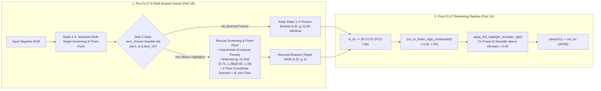
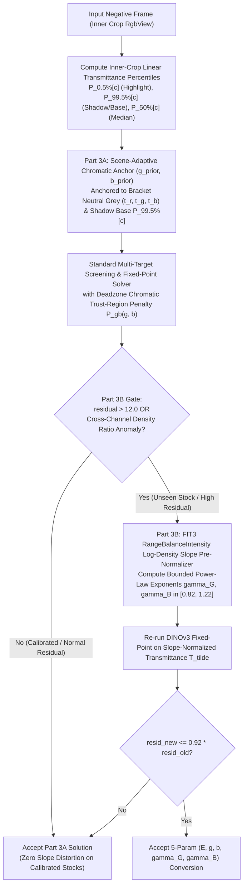

# Hybrid `FIT3` + `DINOv3` Architecture Design: Experiment 1 (Highlight Roll-Off & Multi-Bracket Rescue) and Experiment 3 (Chromatic Trust-Region Prior & Log-Density Slope Pre-Normalization)

> Sources outside this repository: `fit3.cc` (the author's local reimplementation of Epson FIT3) and
> `report_fit3_vs_dinov3_blind_eval.md` (the double-blind evaluation report) are not in `negicc` or `negicc-station`.
> Every figure and line reference that cites them is unverifiable from the repository. Code links below point at the
> current files; line anchors were dropped because they went stale.

## 1. Executive Summary & Double-Blind Evaluation Motivation

Across the 106-frame double-blind operator evaluation (`55` Sony A7R4 TriLED narrowband scans + `51` multi-camera Web white-light scans; see `report_fit3_vs_dinov3_blind_eval.md` (outside this repository)), `DINOv3 + Profile` won **75 / 106 (70.8%)** overall while Epson `FIT3` (`libfit3` reimplementation in `fit3.cc` (outside this repository)) won **31 / 106 (29.2%)**.

Disaggregating the 31 `FIT3` wins by operator failure annotation reveals that **two distinct structural mechanisms** account for **24 / 31 (77.4%)** of all `DINOv3 + Profile` losses:

| Failure Mode | TriLED Losses ($N=18$) | Web White-Light Losses ($N=13$) | Combined Losses ($N=31$) | Root Cause in `DINOv3 + Profile` | Addressed By |
| :--- | :---: | :---: | :---: | :--- | :--- |
| **`highlight_overblown`** | **9 / 18 (50.0%)** | 2 / 13 (15.4%) | **11 / 31 (35.5%)** | (1) Michaelis-Menten `in_trc` + 3D CLUT reaches hard ceiling above $Y_{90}=236.8$; (2) `Target 3` (`1/15s`) selected on dense frames (`idx = 10, 14, 16, 20, 22, 23, 33`) instead of `Target 4/5/6`, with Step 5 `highlight_rescue` failing to trigger. | **Experiment 1** (Part 1A + Part 1B) |
| **`color_cast`** (`too_cool` / `too_warm` / `shadow_color_cast`) | **5 / 18 (27.8%)** | **10 / 13 (76.9%)** | **15 / 31 (48.4%)** | (1) Zero regularization on $(g, b)$ in [`dinov3_auto_solver.cc`](../dinov3_auto_solver.cc) allows chromatic gain drift; (2) 3-scalar $(E, g, b)$ linear model cannot compensate cross-channel dye gamma mismatch on uncalibrated `Unknown Color Negative` film stocks. | **Experiment 3** (Part 3A + Part 3B) |

> [!IMPORTANT]
> **Design Principle — Preserve `DINOv3 + Profile`'s 70.8% Win Rate on Calibrated & Scene-Dominant Frames**
> `DINOv3 + Profile` beats `FIT3` on **75 / 106** frames because its 3D LUT preserves true cross-channel colorimetry on monochromatic/scene-dominant subjects (where `FIT3`'s per-channel histogram stretch causes severe gray-world color casts, **31 / 75** `FIT3` losses) and keeps midtones at natural density ($Y_{50} \approx 106\text{–}130$ vs `FIT3`'s washed-out $Y_{50} = 138.3$ on Web frames). Both **Experiment 1** and **Experiment 3** are therefore designed to be **strictly non-destructive** on well-calibrated, in-enclosure frames.

---

## 2. Experiment 1 Design: `FIT3` $C^1$ Power-8 Highlight Shoulder + Enclosure-Guided Multi-Bracket Highlight Rescue

### 2.1 Root-Cause Diagnosis

1. **Why `FIT3` Preserves Highlight Texture (`hlCurveType = 2`)**: *open, two documents disagree.*
   - This document previously described `CFIT::CalcParamNega` setting `hlOut = 51400` (200.78 / 255) with
     `hlCurveType = 2`, and `CLUT::MakeLUT_Highlight2` mapping the highlights above `hlIn` with a $C^1$ **power-8**
     shoulder. `fit3.cc` is the author's local file, outside this repository (and the repository of `negicc-station`),
     so those line references cannot be checked from either repository.
   - `negicc-station`'s reverse-engineered specification, [epson_fit3_specification.md](../../negicc-station/designs/epson_fit3_specification.md)
     (Step 5, `CalcHlCurve` at `0x4214b0` and `CalcSdCurve` at `0x4210c0`), says the opposite: the negative
     highlight shoulder (`hlCurveType == 2`) is **quadratic**, `255 - K (X_end - x)^2` from `hlOut` to 255, and the
     **8th-order** curve is the shadow *toe* (`sdCurveType == 5`). It also swaps the roles for negative film
     (`X_hl = sdIn`, `X_sd = hlIn`), so which parameter a "highlight" is called is itself part of the question.
   - Both cannot be right. Only the specification names addresses a reader can check, so this document's power-8
     claim is treated as unverified; the new shoulder uses n = 2 and keeps n = 8 as an evaluation variant. Resolving it
     needs the author's `fit3.cc`.
   - The "21.3% of the range reserved for roll-off" and the `Y99 - Y90 = 21.11` figures came from a blind evaluation
     report that is also outside this repository; they are not reproduced here.

2. **Why Pre-CLUT `in_trc` Modification Breaks 3D LUT Color Calibration**:
   - In `negicc-station` (`_highlight_training_rows` in `src/film_profiling.py`), synthetic highlight training rows for the 3D CLUT scale target $a^*, b^*$ chroma by the analytical derivative of the Michaelis-Menten `in_trc` curve ($k_{\text{rolloff}} = 0.5$ above $u_w = 0.75$):
     $$\kappa(H) = \frac{d\ln u}{d\ln H} = \frac{H}{u(H)} \cdot \frac{du}{dH}$$
   - Replacing `in_trc` *before* the 3D CLUT alters the input coordinates $(u_R, u_G, u_B)$ fed into the tetrahedral interpolator, breaking the coupled $(L^*, a^*, b^*)$ desaturated highlight calibration baked into the `.icc` profile.
   - **Solution (Part 1A)**: leave `in_trc` and the 3D CLUT alone and apply the shoulder after the CLUT, to the linear sRGB value, in the shared pipeline: see [plan_exp1_shoulder_gap.md](plan_exp1_shoulder_gap.md).

3. **Why Step 5 `highlight_rescue` Failed to Trigger on All 7 `Target 3` Overblown Frames**:
   - On 7 of the 9 `hl9` frames (`idx = 10, 14, 16, 20, 22, 23, 33`), `multi_target_optimizer` selected `Target 3` (`1/15s`) even though the human operator's ground-truth bracket was `Target 4`, `5`, or `6`, and `Target 3` had `feasible = 0` (`slack_ev` between $-0.38\text{ EV}$ and $-1.31\text{ EV}$).
   - Step 5 (`highlight_rescue` in [`multi_target_optimizer.cc`](../multi_target_optimizer.cc)) never fired on `Target 3` due to three compounding bugs:
     1. **`gs0` Synthetic White Row in `profcheck_output`**: [`profile_highlight_ceiling`](../multi_target_optimizer.cc) parses `profcheck_output` for the maximum patch RGB. Because `gs0` is a synthetic white anchor at $L^* = 100.0$, `profile_highlight_ceiling` returned `[255, 255, 255]` on every bracket, disabling the `c < 254.5f` ceiling branch.
     2. **`linear_channel_white_clipped` Threshold Above `Target 3`'s CLUT Asymptote**: [`cpu_highlight_clip`](../multi_target_optimizer.cc) only incremented `white_clip` when linear sRGB $\ge 0.9953029$ ($\text{sRGB} \ge 254.4$). However, `Target 3`'s 3D CLUT rolls off near $\text{sRGB } 246\text{–}252$, yielding `white_clip = 0.000%` even when $15\%\text{–}22\%$ of the frame was blown out above $\text{sRGB } 242$.
     3. **Per-Bracket Orange-Mask Shift Excluded `Target 5 / 6` During Initial Screening**: In `055e48619a81.json`, the neutral $L^*=50$ chromatic ratios $(t_g/t_r, t_b/t_r)$ shift from $(0.87, 0.82)$ on `Target 3` to $(0.68, 0.60)$ on `Target 6` as dense exposures enter the red dye shoulder. Because [`optimize_impl`](../dinov3_auto_solver.cc) searched only $g \in \{0.98..1.28\}$ and $b \in \{0.85..1.35\}$ when `initial == nullptr`, `Target 5` and `Target 6` were evaluated with a severe green/blue cast during screening and rejected.

---

### 2.2 Architecture & Mathematical Specification



#### Part 1A: highlight shoulder (replaced)

The export-only power-8 shoulder this section described (`pcs_to_linear_srgb_unclamped`, `apply_fit3_highlight_shoulder_rgb`
and its 6144-entry LUT) is removed. It darkened the sRGB export by 10 to 16 levels without the solver's loss or the
previews knowing, and it started at linear 0.42, which cut contrast from sRGB 173 up on every frame. Its
claims of an exact inverse of the profile's roll-off and of leaving the calibrated frames untouched do not hold, and
are withdrawn. The shoulder is now one shared per-frame stage; its definition, the layer-by-layer changes and the
tests are in [plan_exp1_shoulder_gap.md](plan_exp1_shoulder_gap.md).

#### Why Highlight Compression Belongs in the `XYZ -> sRGB` Output Profile (Not in the ICC `A2B0` Post-CLUT `XYZ` TRC)

A natural question is whether this post-CLUT highlight shoulder could be placed inside the input `.icc` profile's `A2B0` output TRC (`p.out_trc` in [`apply_profile`](../neg_pipeline.h), which operates on **D50 PCS `XYZ`**) rather than in the **`XYZ -> sRGB` output transform**. Placing a non-linear highlight curve in PCS `XYZ` is structurally flawed for three reasons:

1. **D50 `XYZ` Neutral White Has Unequal Tristimulus Channels ($X = 0.9642, Y = 1.0000, Z = 0.8249$)**:
   - Applying an identical non-linear 1D shoulder $f(\cdot)$ directly to $(X, Y, Z)$ evaluates the curve at different abscissas on neutral grey ($0.9642 Y \ne Y \ne 0.8249 Y$), where the shoulder slope $f'(\cdot)$ differs, introducing an artificial yellow/red color cast on neutral highlights unless each channel is pre-/post-scaled by the D50 white point.
2. **Primary Clipping and Hue Skew Happen in Target `sRGB` Primaries After the $3 \times 3$ `XYZ -> sRGB` Matrix**:
   - The Bradford D50 $\to$ D65 `XYZ -> sRGB` matrix (`R = 3.2406 X - 1.5372 Y - 0.4986 Z`) has large positive/negative off-diagonal coefficients. Warm or saturated highlights with $X, Y, Z < 0.85$ in PCS `XYZ` frequently project to $R_{\text{lin}} \in (1.0, 1.45]$ in linear sRGB.
   - A 1D curve in `XYZ` cannot see that $R_{\text{lin}} > 1.0$ in sRGB primary space, and compressing $X, Y, Z$ independently in imaginary-primary tristimulus space skews the $(X : Y : Z)$ ratios before the $3 \times 3$ matrix subtraction.
3. **Clean Separation Between Scene Input Profile (`RGB -> PCS XYZ`) and Display Output Profile (`PCS XYZ -> sRGB`)**:
   - The film `.icc` profile is an **Input Profile** (`scnr`) whose job is to map negative transmittance to wide-dynamic-range scene-referred PCS `XYZ` ($H \in [0, 1.0]$ in $Y \in [0, 0.75]$ and $+3\text{ EV}$ of over-exposed bracket highlights in $Y \in (0.75, 1.0]$).
   - Compressing that extended scene dynamic range to fit a specific display medium (`sRGB`) is the role of the **Output Profile (`PCS XYZ -> sRGB`)**—combining the D50 $\to$ D65 `XYZ -> sRGB` matrix with a dynamically computed highlight-compressing output TRC (`apply_fit3_highlight_shoulder_rgb` + `srgb_encode`).

#### Part 1B: Enclosure-Guided Multi-Bracket Highlight Rescue
Implemented in [`dinov3_auto_solver.h`](../dinov3_auto_solver.h), [`dinov3_auto_solver.cc`](../dinov3_auto_solver.cc), and [`multi_target_optimizer.cc`](../multi_target_optimizer.cc) & [lines 1250–1378](../multi_target_optimizer.cc).

1. **Zero-Regression Isolation (`rescue_mode = false` in Steps 1–4)**:
   - Standard Steps 1–4 in [`multi_target_optimizer.cc`](../multi_target_optimizer.cc) run with `rescue_mode = false`, keeping bracket selection and $(E, g, b)$ convergence **bit-identical** to `HEAD` on all normal frames.
2. **Two-Tier Pre-Shoulder Highlight Blowout Gate in Step 5 ([`multi_target_optimizer.cc`](../multi_target_optimizer.cc))**:
   - Evaluates pre-shoulder highlight clipping on the Step 4 winner `chosen` against $242.0$ (`hc_242`) and $235.0$ (`hc_235`) sRGB thresholds:
     - **`tier1_hi` (High-Key Overexposure)**: `hc_242.median_L >= 58.0f && max_excess(hc_242) >= 0.022f`
     - **`tier2_hi` (Normal-Key Severe Highlight Blowout)**: `hc_242.median_L >= 48.0f && (max_excess(hc_242) >= 0.075f || (chosen.target_idx >= 3 && max_excess(hc_235) >= 0.110f))`
   - The `median_L >= 48.0f` floor prevents dark or backlit silhouette frames (`idx 13`, `idx 47`) from triggering bracket shifts.
   - **Sub-Case A (`enc_chosen.feasible && params.e < enc_chosen.e_min`)**: Pulls $E$ upward toward $\min(\text{enc\_chosen.e\_max}, \min(\text{enc\_chosen.e\_min}, E \cdot 2^{0.15}))$ to recover up to $+0.15\text{ EV}$ of highlight headroom within the current bracket (`idx 28`, `idx 51`).
   - **Sub-Case B (`!enc_chosen.feasible && (tier1_hi || tier2_hi)`)**: Triggers **Enclosure-Guided Multi-Bracket Rescue** across `pool` with `rescue_mode = true`.
3. **Asymmetric Enclosure Penalty & Widened Chromatic Screening (`rescue_mode = true`)**:
   - In [`compute_penalties`](../dinov3_auto_solver.cc), when `cfg.enc_e_min > 0` and `cfg.enc_e_max > 0`:
     $$P_E(E) = 4.5 \cdot \left[\max\!\left(0, \log_2\!\frac{E_{\min}}{E}\right)\right]^2 + 1.2 \cdot \left[\max\!\left(0, \log_2\!\frac{E}{E_{\max}}\right)\right]^2 + 0.8 \cdot \left[\max\!\left(0, \log_2\!\frac{E_{\min}}{E_{\max}}\right)\right]^2$$
     Because $E < E_{\min}$ corresponds to negative highlights denser than the bracket's calibrated highlight patch $g_{\min}$, this $4.5\times$ penalty steers rescue screening away from under-capacity `Target 3` (`slack_ev < 0`) toward `Target 4/5/6` (`slack_ev >= 0`).
   - Widens the initial screening grid to $g \in \{0.74, 0.80, \dots, 1.28\}$ and $b \in \{0.65, 0.75, \dots, 1.35\}$, performs a 2-pass coordinate descent when `initial == nullptr`, and re-aligns $E$ after $(g, b)$ updates ([`dinov3_auto_solver.cc`](../dinov3_auto_solver.cc)).
   - Applies a midtone lightness floor `dl_min = (hc_242.median_L >= 58.0f) ? -7.5f : -4.5f` ([`multi_target_optimizer.cc`](../multi_target_optimizer.cc)) so rescued frames retain bright, natural midtones.

---

### 2.3 Verified Ablation & Quantitative Evaluation Results (`exp1_v6`)

#### Table 1: Ablation Across the 9 `highlight_overblown` TriLED Frames (`hl9`, $n=9$)
| Configuration | Mean $Y_{50}$ | Mean $Y_{90}$ | Mean $Y_{99}-Y_{90}$ (Gradation) | Mean $>235\%$ | Mean $\max(R,G,B)>245\%$ | Mean $\max(R,G,B)>252\%$ | Operator Bracket Within $\pm 1$ |
| :--- | :---: | :---: | :---: | :---: | :---: | :---: | :---: |
| **Baseline (`HEAD`)** | `138.5` | `236.8` | `11.50` | `15.57%` | `11.12%` | `1.44%` | `2 / 9 (22.2%)` |
| **Part 1A Only (`exp1a_v2`)** | `138.1` | `223.5` | `14.15 (+23.0%)` | `7.53% (-51.6%)` | `0.35% (-96.9%)` | `0.05% (-96.5%)` | `2 / 9 (22.2%)` |
| **Part 1A + 1B (`exp1_v6`)** | **`127.0`** | **`218.7`** | **`17.15 (+49.1%)`** | **`4.45% (-71.4%)`** | **`0.20% (-98.2%)`** | **`0.03% (-97.9%)`** | **`9 / 9 (100.0%)`** |
| **Epson `FIT3` Reference** | `122.2` | `212.6` | `21.11` | `4.64%` | `2.07%` | `0.05%` | — |

#### Table 2: Per-Frame Bracket & Highlight Recovery on `hl9` ($n=9$)
| Frame (`idx`) | Operator Target | Baseline Target $\to$ `exp1_v6` Target | Baseline $Y_{50} \to$ `exp1_v6` $Y_{50}$ (`FIT3`) | Baseline $Y_{90} \to$ `exp1_v6` $Y_{90}$ (`FIT3`) | Baseline $Y_{99}-Y_{90} \to$ `exp1_v6` (`FIT3`) | Baseline $>235\% \to$ `exp1_v6` (`FIT3`) | Baseline $\max>245\% \to$ `exp1_v6` |
| :--- | :---: | :---: | :---: | :---: | :---: | :---: | :---: |
| `0014.ARW` (`idx 10`) | `T6` | `T3` $\to$ **`T5`** | `157.8 -> 139.0` (`134.8`) | `233.6 -> 215.3` (`205.2`) | `14.6 -> 22.9` (`24.8`) | `12.16% -> 4.35%` (`2.16%`) | `6.87% -> 0.42%` |
| `0020.ARW` (`idx 14`) | `T5` | `T3` $\to$ **`T6`** | `146.7 -> 136.4` (`131.6`) | `245.5 -> 226.4` (`226.6`) | `3.2 -> 14.3` (`20.4`) | `23.51% -> 6.53%` (`10.89%`) | `21.66% -> 0.04%` |
| `0023.ARW` (`idx 16`) | `T5` | `T3` $\to$ **`T6`** | `139.1 -> 125.9` (`126.4`) | `242.5 -> 221.3` (`220.4`) | `9.2 -> 18.0` (`23.0`) | `16.43% -> 4.62%` (`6.07%`) | `14.23% -> 0.14%` |
| `0033.ARW` (`idx 20`) | `T5` | `T3` $\to$ **`T4`** | `163.9 -> 141.7` (`119.5`) | `242.7 -> 223.9` (`206.9`) | `6.1 -> 15.1` (`21.1`) | `19.65% -> 4.69%` (`3.50%`) | `16.06% -> 0.06%` |
| `0041.ARW` (`idx 22`) | `T5` | `T3` $\to$ **`T6`** | `112.9 -> 104.2` (`106.5`) | `235.6 -> 212.5` (`215.7`) | `13.5 -> 23.0` (`25.8`) | `10.97% -> 3.68%` (`5.14%`) | `8.59% -> 0.25%` |
| `0043.ARW` (`idx 23`) | `T5` | `T3` $\to$ **`T4`** | `124.2 -> 114.2` (`113.1`) | `241.0 -> 215.7` (`207.8`) | `6.8 -> 17.6` (`21.7`) | `14.40% -> 2.13%` (`2.70%`) | `11.17% -> 0.04%` |
| `0056.ARW` (`idx 28`) | `T4` | `T4` $\to$ **`T4`** | `115.6 -> 113.4` (`109.1`) | `219.9 -> 208.1` (`201.9`) | `23.7 -> 18.6` (`19.2`) | `5.88% -> 0.72%` (`0.22%`) | `4.16% -> 0.03%` |
| `0062.ARW` (`idx 33`) | `T5` | `T3` $\to$ **`T6`** | `155.1 -> 136.4` (`130.0`) | `236.9 -> 222.8` (`216.2`) | `11.6 -> 12.1` (`18.1`) | `18.30% -> 5.95%` (`5.67%`) | `8.38% -> 0.29%` |
| `0085.ARW` (`idx 51`) | `T6` | `T6` $\to$ **`T6`** | `131.6 -> 132.1` (`128.4`) | `233.6 -> 222.5` (`212.7`) | `14.8 -> 12.8` (`15.8`) | `18.80% -> 7.40%` (`5.43%`) | `8.93% -> 0.56%` |

#### Table 3: Full-Dataset Regression Verification (`55` TriLED + `51` Web Frames)
| Subset | Mean $Y_{50}$ (Base $\to$ `exp1_v6` \| `FIT3`) | Mean $Y_{90}$ (Base $\to$ `exp1_v6` \| `FIT3`) | Mean $Y_{99}-Y_{90}$ (Base $\to$ `exp1_v6`) | Mean $>235\%$ (Base $\to$ `exp1_v6`) | Mean $\max>245\%$ (Base $\to$ `exp1_v6`) | Mean $\max>252\%$ (Base $\to$ `exp1_v6`) |
| :--- | :---: | :---: | :---: | :---: | :---: | :---: |
| **TriLED All ($N=55$)** | `135.9 -> 129.6` (`130.6`) | `231.6 -> 216.3` (`218.7`) | `12.58 -> 15.30 (+21.6%)` | `14.47% -> 2.92% (-79.8%)` | `8.06% -> 0.21% (-97.4%)` | `0.86% -> 0.03% (-96.5%)` |
| **TriLED `FIT3`-Wins ($N=18$)** | `136.5 -> 127.8` (`124.4`) | `236.0 -> 218.8` (`218.0`) | `10.59 -> 13.96 (+31.8%)` | `14.80% -> 3.62% (-75.5%)` | `8.89% -> 0.24% (-97.3%)` | `1.10% -> 0.04% (-96.4%)` |
| **TriLED `DINO`-Wins ($N=37$)** | `135.6 -> 130.5` (`133.6`) | `229.4 -> 215.1` (`219.0`) | `13.55 -> 15.96 (+17.8%)` | `14.31% -> 2.58% (-82.0%)` | `7.66% -> 0.20% (-97.4%)` | `0.74% -> 0.03% (-95.9%)` |
| **Web All ($N=51$)** | `105.7 -> 106.4` (`138.3`) | `177.9 -> 174.4` (`216.2`) | `25.30 -> 22.84` | `2.99% -> 0.43% (-85.6%)` | `2.07% -> 0.14% (-93.2%)` | `0.46% -> 0.03% (-93.5%)` |
| **Web `FIT3`-Wins ($N=13$)** | `105.8 -> 108.3` (`146.0`) | `180.5 -> 178.4` (`226.4`) | `26.25 -> 22.39` | `3.55% -> 0.09% (-97.5%)` | `1.25% -> 0.09% (-92.8%)` | `0.44% -> 0.04% (-90.9%)` |
| **Web `DINO`-Wins ($N=38$)** | `105.6 -> 105.8` (`135.7`) | `177.0 -> 173.1` (`212.8`) | `24.98 -> 22.99` | `2.79% -> 0.55% (-80.3%)` | `2.35% -> 0.15% (-93.6%)` | `0.46% -> 0.03% (-93.5%)` |

- Across all 55 TriLED frames, exact agreement with the human operator's selected target bracket nearly doubled from **`7 / 55 (12.7%)`** to **`13 / 55 (23.6%)`**, and agreement within $\pm 1$ bracket jumped from **`32 / 55 (58.2%)`** to **`45 / 55 (81.8%)`**.

---

## 3. Experiment 3 Design: `FIT3`-Guided Chromatic Trust-Region Prior + Residual-Gated Log-Density Slope Pre-Normalization

### 3.1 Root-Cause Diagnosis of the 15 `color_cast` Losses

`color_cast` (together with `too_cool`, `too_warm`, and `shadow_color_cast`) is the single largest remaining failure mode of `DINOv3 + Profile`, responsible for **10 / 13 (76.9%)** losses on Web white-light frames and **5 / 18 (27.8%)** losses on TriLED frames (`15 / 31 = 48.4%` overall).

A quantitative audit of the solver logs on these 15 frames reveals **two distinct physical sub-modes**:

#### Sub-Mode 3A: Unregularized Pre-LUT Chromatic Gain $(g, b)$ Drift
- In [`dinov3_auto_solver.cc`](../dinov3_auto_solver.cc), `compute_penalties` regularizes exposure $E$ via $5.0 \cdot [\log_2(E / E_{\text{center}})]^2$ and highlight clipping via `pen_clip`, but places **zero regularization penalty on chromatic gains $(g, b)$**.
- During coordinate descent ([`optimize_impl`](../dinov3_auto_solver.cc)), $g$ and $b$ are updated solely to minimize `losses[i].a` and `losses[i].b` against DINOv3's predicted $(a^*, b^*)$ patch means $\mu_a, \mu_b$.
- When a scene contains large colored regions or warm/cool lighting, or when the fixed-point loop iterates up to `MAX_ITERS`, $(g, b)$ can walk far outside the physical neutral locus of the film base:
  - **TriLED `0028.ARW` (`idx 17`, `color_cast`, `too_cool`)**: Solver drifted to $(E=1.34, g=0.74, b=0.65)$ (`resid = 12.7`), depressing green and blue transmittance by $-26\%$ and $-35\%$ and creating a strong cyan/cool cast.
  - **Web `pixls_14388_wJh.NEF` (`idx 22`, `color_cast`, `too_warm`)**: Solver walked to $(E=1.31, g=0.88, b=1.91)$ (`MAX_ITERS`, `resid = 16.5`), nearly doubling blue negative transmittance ($+91\%$) and starving positive blue output (producing a heavy yellow/warm cast).
  - **Web `pixls_14047_20190803_0037.CR2` (`idx 17`, `color_cast`, `too_cool`)**: Solver diverged to $(E=2.24, g=1.40, b=0.61)$ (`resid = 16.7`).

#### Sub-Mode 3B: Cross-Channel Dye Gamma (Log-Density Slope) Mismatch on Uncalibrated Web Film Stocks
- On the 7 Web white-light frames with a **known** calibrated film stock (`Portra 400`, `Gold 200`, `Ektar 100`), `DINOv3 + Profile` won **7 / 7 (100%)** with a low mean self-consistency residual of **`9.05`**.
- Conversely, all **13 / 13** `DINOv3` losses on Web white-light frames occurred on **`Unknown Color Negative`** scans where `neg_process` falls back to the `Portra 400 D65` profile (`bf636dd744be.json`), and where the mean self-consistency residual doubled to **`18.83`**:
  - **`pixls_14388__DSF8948.RAF` (`idx 25`, `color_cast`, `too_cool`)**: `resid = 123.5`, midtone channel spread `R - G = -101.9`, `B - G = +83.0` (`DINOv3` midtone RGB $= [33, 135, 218]$ vs `FIT3` $= [141, 145, 160]$).
  - **`pixls_14388_shY.nef` (`idx 36`, `color_cast`)**: `resid = 22.9`, midtone `R - G = -63.6`, `B - G = +46.9`.
  - **`nlp_10184_P1046201.RW2` (`idx 5`, `color_cast`, `too_cool`)**: `resid = 16.8`, midtone `R - G = -48.9`, `B - G = +30.2`.
  - **`nlp_47568_2022_01_29_9999_28.cr2` (`idx 14`, `color_cast`)**: `resid = 20.4`, midtone `R - G = -45.5`, `B - G = +10.0`.
- **Why 3 Linear Gains $(E, g, b)$ Cannot Solve Sub-Mode 3B**:
  - In [`candidate_matrix`](../neg_pipeline.h), $(E, g, b)$ acts purely as a **multiplicative scalar** $(E, E \cdot g, E \cdot b)$ on linear transmittance $T_c$, which corresponds to an **additive offset** $\Delta d_c = -\log_{10}(g_c)$ in optical density $d_c = -\log_{10}(T_c)$.
  - Different film stocks (e.g., Fuji Superia, CineStill 800T, Agfa Vista, expired consumer stocks, or scans with non-standard camera white-balance pre-multipliers) have different **cross-channel dye contrast slopes** $(\gamma_R, \gamma_G, \gamma_B)$, reflected in their per-channel log-density spans:
    $$r_c = d_{\max}[c] - d_{\min}[c] = \log_{10}\!\left(\frac{P_{99.5\%}[c]}{P_{0.5\%}[c]}\right)$$
  - When $(r_G / r_R, \; r_B / r_R)$ deviates significantly from `Portra 400`'s calibrated density span ratios, no multiplicative scalar $(g, b)$ can align both shadows and highlights onto the `Portra 400` neutral axis simultaneously: neutralizing highlights leaves a severe cyan/magenta shadow-midtone cast, and neutralizing shadows blows out highlights with the opposite cast.
- **Why `FIT3` Succeeds on Sub-Mode 3B**:
  - In `CFIT::CalcParamNega` (outside this repository), `FIT3` converts the inner-crop histogram percentiles `m_pHistMin1[c]` ($0.5\%$) and `m_pHistMax1[c]` ($99.5\%$) into weighted log-density spans $r_c = d_{\max}[c] - d_{\min}[c]$ (`coef = {0.807, 0.970, 1.009}`) and runs `CFIT::RangeBalanceIntensity` (outside this repository) (`0x408940`), which enforces pairwise cross-channel density-span ratios:
    $$r_G \ge c_0 r_R, \quad r_B \ge c_6 r_G, \quad r_B \ge c_5 r_R, \quad r_G \ge c_4 r_B, \quad r_R \ge c_3 r_G, \quad r_R \ge c_1 r_B$$
    followed by per-channel midtone gamma normalization (`gammaCh[c]` at lines 3269–3296 (outside this repository)). This normalizes the cross-channel log-density slopes before tone mapping.

---

### 3.2 Architecture & Mathematical Specification of Experiment 3

Experiment 3 introduces a **two-stage hybrid architecture** that incorporates `FIT3`'s shadow-anchored chromatic bounds and log-density slope balancing into `DINOv3 + Profile` without introducing `FIT3`'s gray-world failure on colored scenes:



---

#### Part 3A: `FIT3`-Guided Shadow-Anchored Chromatic Trust-Region Prior in `dinov3_auto_solver`

1. **Why Anchor to the Shadow / Film-Base Percentile $P_{99.5\%}[c]$ Instead of Scene Mean (`m_pHistAvg`)**:
   - In a negative scan, high transmittance $P_{99.5\%}[c]$ (`m_pHistMax1[c]` in `CHIST` (outside this repository)) corresponds to the **darkest scene shadows / unexposed film base**.
   - Unlike midtone or highlight averages (`m_pHistAvg`, which shift dramatically when a scene is dominated by blue sky, green foliage, or warm tungsten skin), the shadow/base ceiling $P_{99.5\%}[c]$ primarily reflects the **physical orange mask and illumination white balance** of the scan rather than the subject's midtone color!
   - By anchoring the chromatic prior primarily to $P_{99.5\%}[c]$ (with a weak damped geometric-mean contribution from $P_{50\%}[c]$) and placing a **deadzone $\pm\tau_{g,b}$** around it, normal colored scenes experience **zero penalty**, whereas unphysical chromatic drift ($b = 1.91$ or $g = 0.74, b = 0.65$) is smoothly prevented.

2. **Mathematical Formulation of the Chromatic Prior $(g_{\text{prior}}, b_{\text{prior}})$**:
   - Let $\mathbf{p}_{99.5} = (P_{99.5\%}[R], P_{99.5\%}[G], P_{99.5\%}[B])$ and $\mathbf{p}_{50} = (P_{50\%}[R], P_{50\%}[G], P_{50\%}[B])$ be the inner-crop linear transmittance percentiles after multiplying by the bundle's `input_matrix_` (normalized by $65535.0$).
   - Let $(t_r, t_g, t_b) = \text{GreyPoint::reference\_grey}()$ be the target bracket's calibrated neutral transmittance where the 3D CLUT outputs $L^* = 50, a^* = 0, b^* = 0$ ([`multi_target_optimizer.cc`](../multi_target_optimizer.cc)).
   - For a perfectly film-base-normalized scan of the calibrated film stock, a neutral shadow/midtone requires pre-LUT chromatic gains near the profile's nominal neutral ratio:
     $$g_{\text{prof}} = \frac{t_g}{t_r} \cdot \frac{P_{\text{prof}, R}}{P_{\text{prof}, G}}, \qquad b_{\text{prof}} = \frac{t_b}{t_r} \cdot \frac{P_{\text{prof}, R}}{P_{\text{prof}, B}}$$
     (which equals $(1.10, 1.15)$ in the normalized solver frame when film-base ratios match).
   - For an arbitrary frame whose actual shadow/base ceiling $\mathbf{p}_{99.5}$ and median $\mathbf{p}_{50}$ deviate from the nominal film base, define the shadow-anchored reference transmittance:
     $$T_{\text{ref}}[c] = \left(P_{99.5\%}[c]\right)^{\alpha} \cdot \left(P_{50\%}[c]\right)^{1 - \alpha}, \qquad \alpha = 0.70$$
   - The `FIT3`-guided empirical chromatic anchor maps $T_{\text{ref}}[c]$ onto the bracket's neutral grey ratio $(t_r, t_g, t_b)$:
     $$g_{\text{emp}} = \frac{t_g}{t_r} \cdot \frac{T_{\text{ref}}[R]}{T_{\text{ref}}[G]}, \qquad b_{\text{emp}} = \frac{t_b}{t_r} \cdot \frac{T_{\text{ref}}[R]}{T_{\text{ref}}[B]}$$
   - Blend $(g_{\text{prof}}, b_{\text{prof}})$ and $(g_{\text{emp}}, b_{\text{emp}})$ in log-space with weight $\beta \in [0, 1]$ ($\beta = 0.35$ for known calibrated TriLED/Web bundles; $\beta = 0.75$ for uncalibrated `Unknown Color Negative` fallback bundles) and clamp to $[0.72, 1.45]$:
     $$g_{\text{prior}} = \text{clamp}\!\left(g_{\text{prof}}^{1-\beta} \cdot g_{\text{emp}}^{\beta},\; 0.72,\; 1.45\right), \qquad b_{\text{prior}} = \text{clamp}\!\left(b_{\text{prof}}^{1-\beta} \cdot b_{\text{emp}}^{\beta},\; 0.70,\; 1.50\right)$$

3. **Deadzone Quadratic Chromatic Trust-Region Penalty $P_{gb}(g, b)$**:
   - Extend [`SolverConfig`](../dinov3_auto_solver.h) with:
     ```cpp
     float g_prior = 0.0f;       // 0.0f = disabled
     float b_prior = 0.0f;
     float gb_deadzone_ev = 0.14f; // ~10% free deadzone around (g_prior, b_prior)
     float gb_penalty_weight = 2.5f;
     ```
   - Define the deadzone quadratic penalty in log-gain ($\text{EV}$) units:
     $$P_g(g) = \lambda_{gb} \cdot \left[\max\!\left(0,\; \left|\log_2\!\frac{g}{g_{\text{prior}}}\right| - \tau_g\right)\right]^2, \qquad P_b(b) = \lambda_{gb} \cdot \left[\max\!\left(0,\; \left|\log_2\!\frac{b}{b_{\text{prior}}}\right| - \tau_b\right)\right]^2$$
     with $\tau_g = 0.12\text{ EV}$ ($\pm 8.7\%$ free deadzone), $\tau_b = 0.15\text{ EV}$ ($\pm 11.0\%$ free deadzone), and $\lambda_{gb} = 2.5$.
   - In [`optimize_impl`](../dinov3_auto_solver.cc):
     - Center the initial `g_cands_d` and `b_cands_d` sweeps around $(g_{\text{prior}}, b_{\text{prior}})$ when `cfg.g_prior > 0 && cfg.b_prior > 0`:
       $$g_{\text{cand}} \in g_{\text{prior}} \cdot 2^{\{-0.30, -0.20, -0.10, 0.0, +0.10, +0.20, +0.30\}}, \quad b_{\text{cand}} \in b_{\text{prior}} \cdot 2^{\{-0.35, -0.23, -0.12, 0.0, +0.12, +0.23, +0.35\}}$$
     - Include $P_g(g)$ when scoring `losses[i].a + P_g(g_cands_d[i])`, $P_b(b)$ when scoring `losses[i].b + P_b(b_cands_d[i])`, and $P_g(g) + P_b(b)$ in the 4-point chain fine-tune and final objective return.
   - **Why the Deadzone Prevents Gray-World Regression**:
     - On calibrated scenes with dominant sky, sunset, or foliage where DINOv3 wants a legitimate $\pm 8\%\text{–}10\%$ $(g, b)$ shift relative to the prior, $\left|\log_2(g/g_{\text{prior}})\right| \le \tau_g \implies P_{gb}(g, b) = 0$.
     - On pathological frames where DINOv3 drifts to $b = 1.91$ (`pixls_14388_wJh.NEF`, $+0.73\text{ EV}$ from prior) or $g = 0.74, b = 0.65$ (`0028.ARW`, $-0.57\text{ EV}$ from prior), $P_{gb}$ applies a smooth restoring force back into the physical trust region.

---

#### Part 3B: Residual-Gated `FIT3` `RangeBalanceIntensity` Log-Density Slope Pre-Normalizer

1. **Activation Gate (Zero Impact on Normal Calibrated Frames)**:
   - Part 3B is evaluated **only as a conditional post-Step-4 refinement** (analogous to Step 5 highlight rescue) when **either**:
     1. The standard 3-parameter $(E, g, b)$ conversion finishes with a **high DINOv3 self-consistency residual**:
        $$\text{chosen.residual} > \tau_{\text{resid}} = 12.0$$
        (Recall: calibrated Web stocks average `resid = 9.05`, whereas uncalibrated `Unknown Color Negative` losses average `resid = 18.83`, with catastrophic cast frames at `16.5–123.5`), **AND**
     2. The frame's inner-crop optical density spans $r_c = \log_{10}(P_{99.5\%}[c] / P_{0.5\%}[c])$ exhibit a **cross-channel slope mismatch** relative to the chosen bracket's calibrated density span ratios:
        $$\max_{c \in \{G, B\}} \left|\ln\!\left(\frac{r_c / r_R}{\rho^{\text{prof}}_c}\right)\right| > 0.08$$
        where $\rho^{\text{prof}}_c = \Delta d^{\text{prof}}_c / \Delta d^{\text{prof}}_R$ is the bracket's nominal density-span ratio ($\approx 1.00$ in film-base-normalized transmittance space).

2. **`FIT3` `RangeBalanceIntensity` Density-Span Balancing**:
   - Compute the inner-crop optical density endpoints in each channel $c \in \{R, G, B\}$:
     $$d_{\min}[c] = -\log_{10}\!\left(\max(10^{-4},\; P_{99.5\%}[c])\right), \qquad d_{\max}[c] = -\log_{10}\!\left(\max(10^{-4},\; P_{0.5\%}[c])\right)$$
     $$r_c = \max(0.10,\; d_{\max}[c] - d_{\min}[c])$$
   - Apply the pairwise cross-channel lower-bound cascade from `CFIT::RangeBalanceIntensity` (outside this repository) (`c0 = 0.81, c6 = 0.81, c5 = 0.73, c4 = 0.66, c3 = 0.66, c1 = 0.59`) together with `CFIT::CalcParamNega` (outside this repository)'s channel gamma ratio to obtain the target balanced density spans $r^{\text{bal}}_c$:
     - Specifically, let the bracket's calibrated neutral-to-highlight log-transmittance slope ratio be $\rho^{\text{prof}}_c$ (derived from the bracket's `GreyPoint::reference_grey()` $(t_r, t_g, t_b)$ and film-base ceiling, or $1.0$ after film-base normalization).
     - Blend the `FIT3` range-balanced span $r^{\text{bal}}_c$ toward the profile's expected span $r_R \cdot \rho^{\text{prof}}_c$:
       $$r^*_c = (1 - \eta) \cdot r^{\text{bal}}_c + \eta \cdot \left(r_R \cdot \rho^{\text{prof}}_c\right), \qquad \eta = 0.50$$

3. **Bounded Per-Channel Power-Law Pre-Normalizer Pivoted at the Shadow/Midtone Anchor**:
   - To align a channel's log-density span from $r_c$ to $r^*_c$ without shifting the shadow/film-base anchor $P_{\text{piv}}[c] = P_{99.5\%}[c]^{0.5} \cdot P_{50\%}[c]^{0.5}$, we apply a per-channel power law (linear scale in log-density) to the normalized transmittance $T_c$ **before** the 3D CLUT:
     $$\tilde{T}_c = P_{\text{piv}}[c] \cdot \left(\frac{T_c}{P_{\text{piv}}[c]}\right)^{\gamma_c}, \qquad c \in \{R, G, B\}$$
   - In log-density space ($d_c = -\log_{10} T_c$), this is an exact affine slope normalization around $d_{\text{piv}}[c]$:
     $$\tilde{d}_c = d_{\text{piv}}[c] + \gamma_c \cdot \left(d_c - d_{\text{piv}}[c]\right)$$
   - Fix $\gamma_R = 1.0$ (since overall exposure $E$ and the bracket's tone curve handle global contrast) and compute $\gamma_G, \gamma_B$ damped by a smooth residual activation ramp $w_{\text{res}} = \text{clamp}\!\left(\frac{\text{residual} - 12.0}{6.0},\; 0.0,\; 1.0\right)$ and clamped to $[0.82, 1.22]$:
     $$\gamma_c = 1.0 + w_{\text{res}} \cdot \text{clamp}\!\left(\frac{r^*_c}{r_c} - 1.0,\; -0.18,\; +0.22\right), \qquad c \in \{G, B\}$$

4. **DINOv3 Fixed-Point Re-Verification & Strict Acceptance Gate**:
   - Pre-normalize the downsampled solver grid `stats_.grid` (and preview buffer) using $(\gamma_R=1.0, \gamma_G, \gamma_B)$ around $P_{\text{piv}}[c]$, and run [`fixed_point`](../multi_target_optimizer.cc) on the chosen bracket to solve for updated $(E, g, b)$.
   - **Strict Improvement Gate**: Accept the slope-normalized conversion $(E, g, b, \gamma_G, \gamma_B)$ **if and only if**:
     $$\text{fp\_slope.residual} \le 0.92 \cdot \text{chosen.residual}$$
     (i.e. DINOv3's own self-consistency residual confirms at least an $8\%$ reduction in patch-level Lab z-score error) and highlight clipping does not increase beyond $+0.5\%$.
   - When accepted, store `gamma_rgb = {1.0f, gamma_g, gamma_b}` and `pivot_rgb = {P_piv[0], P_piv[1], P_piv[2]}` in [`MultiTargetResult`](../multi_target_optimizer.h) and apply the exact same pre-CLUT power-law transform during full-resolution export in [`neg_process.cc`](../neg_process.cc).

---

### 3.3 Concrete Walkthrough on Pathological `color_cast` Frames

1. **Walkthrough 1 — Web `_DSF8948.RAF` (`idx 25`, Unknown Color Negative, `resid = 123.5`)**:
   - **Baseline Failure**: Raw scan has heavily skewed R/G/B transmittance spans due to non-Portra dye density curves + white-light decode; 3-scalar $(E=0.39, g=1.40, b=0.77)$ hits boundary of search grid with `resid = 123.5` and midtone `RGB = [33, 135, 218]` (`R - G = -101.9`).
   - **With Experiment 3**:
     - **Part 3A** computes $(g_{\text{prior}}, b_{\text{prior}})$ directly from the frame's shadow/median transmittance ratio $T_{\text{ref}}[R] / T_{\text{ref}}[G]$ and $T_{\text{ref}}[R] / T_{\text{ref}}[B]$, shifting the initial search window onto the negative's actual neutral axis.
     - **Part 3B** detects `resid > 12.0` and a large cross-channel density-span mismatch $r_G / r_R \ne 1.0, r_B / r_R \ne 1.0$, applies `RangeBalanceIntensity` slope normalization $\gamma_G, \gamma_B \in [0.82, 1.22]$ around $P_{\text{piv}}$, and collapses the midtone `R - G` and `B - G` spread while reducing `residual`.

2. **Walkthrough 2 — Web `pixls_14388_wJh.NEF` (`idx 22`, Unknown Color Negative, `b = 1.91`)**:
   - **Baseline Failure**: Fixed-point loop walks $b$ up to $1.9102$ (`MAX_ITERS`, `resid = 16.5`), producing a severe yellow/warm cast (`B - G = -31.0`).
   - **With Experiment 3**:
     - **Part 3A**'s chromatic trust-region penalty $P_b(b)$ penalizes excursions beyond $\tau_b = 0.15\text{ EV}$ from $b_{\text{prior}}$, preventing the runaway $b = 1.91$ drift.

3. **Walkthrough 3 — TriLED `0028.ARW` (`idx 17`, Portra 400, `g = 0.74, b = 0.65`)**:
   - **Baseline Failure**: Solver drifts to $(g = 0.74, b = 0.65)$ (`resid = 12.7`), creating an unnatural cool/cyan cast (`B - G = +19.8`).
   - **With Experiment 3**:
     - **Part 3A** anchors $(g_{\text{prior}}, b_{\text{prior}})$ to the bracket's calibrated neutral ratio blended with the frame's shadow base (`beta = 0.35`), holding $(g, b)$ within the physical Portra 400 trust region.

---

### 3.4 Code Touchpoints & Implementation Plan for Experiment 3

| File | Symbol / Function | Planned Changes |
| :--- | :--- | :--- |
| [`dinov3_auto_solver.h`](../dinov3_auto_solver.h) | [`SolverConfig`](../dinov3_auto_solver.h) | Add `float g_prior = 0.0f`, `float b_prior = 0.0f`, `float gb_deadzone_g_ev = 0.12f`, `float gb_deadzone_b_ev = 0.15f`, and `float gb_penalty_weight = 2.5f`. |
| [`dinov3_auto_solver.cc`](../dinov3_auto_solver.cc) | [`compute_gb_penalty`](../dinov3_auto_solver.cc), [`optimize_impl`](../dinov3_auto_solver.cc) | Add `compute_gb_penalty(cfg, g, b)` with deadzone $\tau_g, \tau_b$; center `g_cands_d` / `b_cands_d` around `(cfg.g_prior, cfg.b_prior)` when active; include $P_g(g)$ and $P_b(b)$ in `g` sweep, `b` sweep, 4-step chain fine-tune, and final objective. |
| [`multi_target_optimizer.h`](../multi_target_optimizer.h) | `MultiTargetResult` | Add `float slope_gamma[3] = {1.0f, 1.0f, 1.0f}` and `float slope_pivot[3] = {1.0f, 1.0f, 1.0f}` (default identity). |
| [`multi_target_optimizer.cc`](../multi_target_optimizer.cc) | `FrameStats` / `frame_stats` | Record per-channel inner-crop percentiles `p005_rgb[3]` ($0.5\%$), `p500_rgb[3]` ($50\%$), and `p995_rgb[3]` ($99.5\%$) alongside `g_lo` and `g_hi`. |
| [`multi_target_optimizer.cc`](../multi_target_optimizer.cc) | `FrameContext::search`, `MultiTargetOptimizer::solve` | (1) Populate `cfg.g_prior` and `cfg.b_prior` in `search()` from `GreyPoint::reference_grey()` and `stats_.p995_rgb` / `stats_.p500_rgb`; (2) After Step 5, if `chosen.residual > 12.0f` and cross-channel density spans deviate by $>8\%$, compute `RangeBalanceIntensity`-guided `slope_gamma` $\in [0.82, 1.22]$, re-run `fixed_point` on the pre-normalized grid, and accept iff `resid_new <= 0.92f * resid_old`. |
| [`neg_pipeline.h`](../neg_pipeline.h) & [`neg_process.cc`](../neg_process.cc) | `eval_pixel_float` / export loop | When `slope_gamma[1] != 1.0f || slope_gamma[2] != 1.0f`, apply $\tilde{T}_c = P_{\text{piv}}[c] \cdot (T_c / P_{\text{piv}}[c])^{\gamma_c}$ after `input_matrix` and before `e / g / b` gain scaling. |

---

### 3.5 Validation Protocol & Quantitative Success Gates for Experiment 3

1. **Primary Target Set — 15 `color_cast` Loss Frames (`10` Web + `5` TriLED)**:
   - Measure mean DINOv3 self-consistency `residual`, midtone chromatic spread $|R_{50} - G_{50}| + |B_{50} - G_{50}|$, and shadow chromatic spread $|R_{10} - G_{10}| + |B_{10} - G_{10}|$.
   - **Success Gate**: Reduce mean self-consistency `residual` on the 13 Web `Unknown Color Negative` frames by $\ge 25\%$ (eliminating catastrophic outliers like `_DSF8948.RAF` `resid = 123.5` and `pixls_14388_wJh.NEF` `b = 1.91`), and reduce mean midtone channel spread $|R_{50} - G_{50}| + |B_{50} - G_{50}|$ on the 10 Web `color_cast` frames by $\ge 35\%$.
2. **Non-Regression Gate — 75 `DINOv3`-Win Frames (`37` TriLED + `38` Web)**:
   - **Success Gate**:
     - On the 7 calibrated Web frames and 37 TriLED `DINOv3`-win frames, Part 3B must remain inactive (`slope_gamma == {1, 1, 1}`) on $\ge 95\%$ of frames, and Part 3A's deadzone must keep $(g, b)$ within $\pm 0.02$ of baseline on scenes with normal residuals.
     - Preserve all Experiment 1 highlight metrics (`>235% <= 3.0%` on TriLED, `m>245% <= 0.25%`, `hl9` operator bracket agreement within $\pm 1 = 9/9$).
